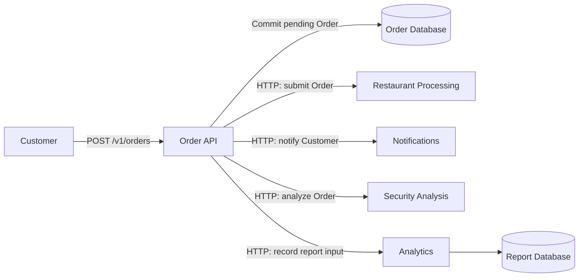
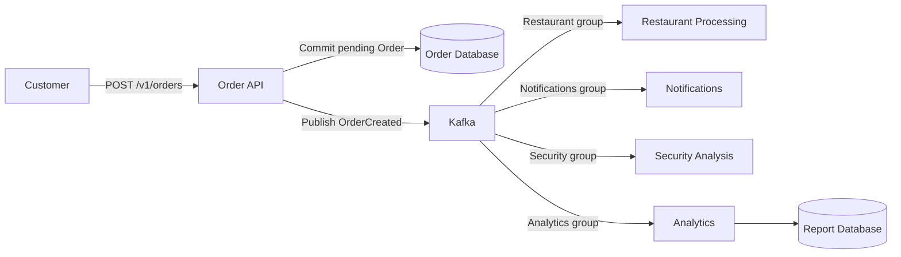
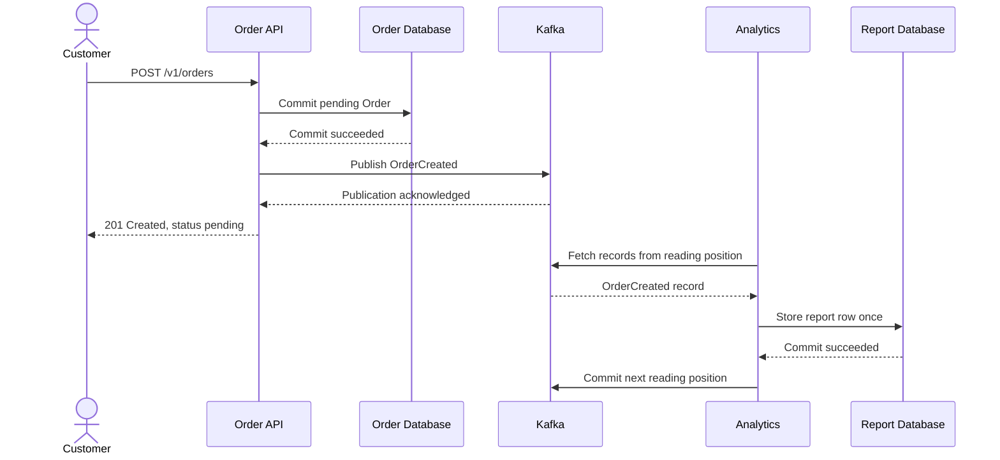
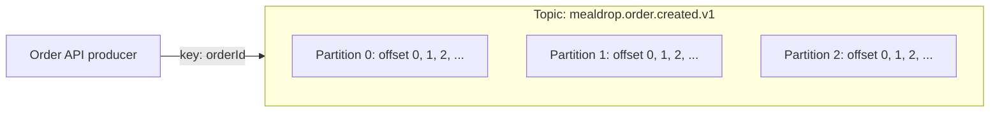
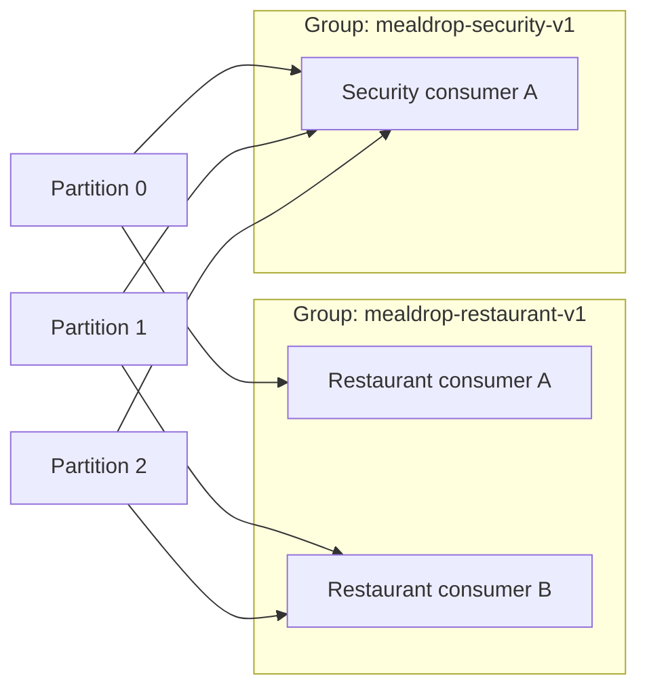
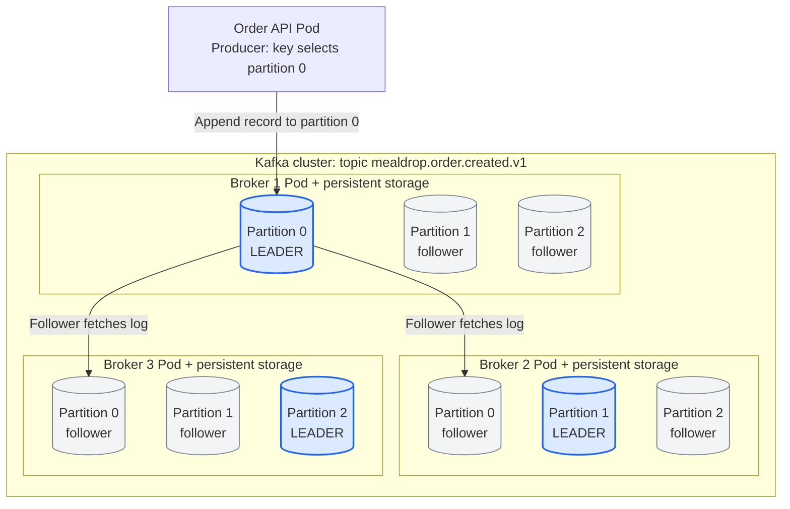
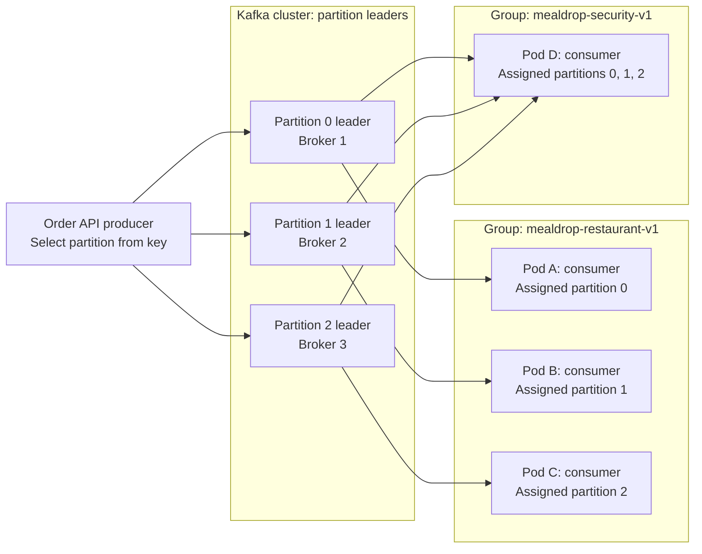

# Lecția 7: Brokeri de mesaje și Kafka

Un sistem poate primi lucru mai repede decât îl poate procesa. Mai multe părți
ale sistemului pot avea nevoie de aceleași date la momente diferite. Un broker
de mesaje transmite mesaje între aceste părți, astfel încât ele să poată lucra independent.

Acest ghid folosește procesarea Comenzilor din MealDrop. La final, ar trebui
să poți explica de ce mesageria se potrivește unui sistem, să urmărești o
înregistrare Kafka, să alegi un consumer group, să analizezi reîncercările și
replay-ul și să publici și să consumi mesaje cu TypeScript.

## 1. Construiește pipeline-ul Comenzilor cu HTTP

[Lecția 6](lecture-06-api-design-and-data-modeling.md) a definit Comenzile
MealDrop și API-ul lor. Păstrează același sens pentru `pending`: Comanda este
înregistrată, dar Restaurantul nu a acceptat-o încă.

Adaugă aceste responsabilități pe rând:

| Parte | Responsabilitate |
| --- | --- |
| Order API | Validează cererea, calculează sumele convenite și înregistrează Comanda |
| Restaurant Processing | Trimite Comanda la Restaurant și urmărește decizia acestuia |
| Notifications | Informează Clientul despre Comanda înregistrată |
| Security Analysis | Analizează Comenzile trimise pentru a identifica tipare suspecte |
| Analytics | Construiește rapoarte zilnice cu numărul și valoarea Comenzilor trimise |

Security Analysis este monitorizare în fundal în acest exemplu. Poate marca
pentru verificare Comenzi suspecte repetate. Nu aprobă plata și nu blochează
pregătirea mâncării la Restaurant. O decizie de securitate care trebuie să
blocheze o Comandă trebuie luată înainte de aprobarea acelei Comenzi.

Începe cu apeluri HTTP directe. Order API înregistrează Comanda, apoi apelează
fiecare parte. În această primă proiectare, așteaptă aceste apeluri înainte de a răspunde.



Acestea sunt responsabilități, nu o cerință de a deploya cinci servicii separate.
Ele pot începe în aceeași aplicație. Apelurile HTTP fac vizibile dependențele
în acest exemplu.

**Încearcă:** Urmărește o Comandă prin diagramă. Ce părți trebuie să termine
înainte ca Clientul să primească un răspuns în această proiectare? Ce se
întâmplă dacă Analytics are nevoie de cinci secunde?

## 2. Identifică problemele arhitecturii HTTP

Păstrează arhitectura cu HTTP direct din secțiunea 1. Introdu fiecare
defecțiune fără să schimbi încă arhitectura.

### Presiunea procesării: cererile eșuează în vârful de trafic de la prânz

MealDrop primește Comenzi noi la o rată de 300 Orders/s timp de un minut. Restaurant Processing poate
procesa 100 Orders/s. Acceptă cereri doar cât timp are capacitate și respinge
cererile în exces cu `503 Service Unavailable`.

Order API primește erori pentru lucrul pe care Restaurant Processing nu îl
poate accepta. Instanțe mai rapide ale Order API nu fac acea integrare mai
rapidă. Reîncercările imediate pot adăuga cereri la serviciul supraîncărcat.

Comanda cu starea pending este deja înregistrată. Un apel eșuat către Restaurant
nu anulează acel commit în baza de date. API-ul trebuie să urmărească
transferul eșuat și să decidă când și cum să îl reîncerce.

**Încearcă:** Ce parte respinge cererile? Dacă API-ul reîncearcă imediat fiecare
apel eșuat, ce se întâmplă cu încărcarea Restaurantului?

### Complexitatea serviciului: Order API coordonează fiecare integrare

Echipa adaugă Security Analysis la apelurile existente către Restaurant,
Notifications și Analytics. Order API are acum nevoie de încă un endpoint,
un timeout, o regulă de reîncercare, un contract de răspuns și o cale de tratare a erorilor.

Pentru fiecare integrare, trebuie să urmărească dacă apelul a reușit, a eșuat
sau are un rezultat necunoscut. Logica de creare a Comenzii se amestecă cu
coordonarea componentelor din aval. Adăugarea unei alte responsabilități face
acel cod mai complex.

**Încearcă:** Analytics reușește, Notifications eșuează, iar Security depășește
timeout-ul. Ce apeluri ar trebui să reîncerce API-ul? Ce informații trebuie să păstreze?

### Fiabilitatea: o componentă indisponibilă afectează cererea

Notifications se oprește timp de zece minute. Apelurile sale HTTP eșuează.
Deoarece Order API așteaptă fiecare apel către componentele din aval, trebuie
fie să returneze o eroare, fie să returneze succes și să înregistreze lucrul
neterminat pentru recuperare ulterioară.

O reîncercare a întregului flux de creare poate repeta o cerere către Restaurant
care a reușit deja. Dacă API-ul ignoră notificarea eșuată fără să păstreze
suficiente informații, unii Clienți nu o primesc niciodată.

**Verifică:** O eroare de la Notifications înseamnă că nu a fost creată Comanda?
Ce apeluri reușite ar putea repeta o reîncercare a întregului flux?

### Cuplarea: analiza lentă de securitate întârzie alte activități

Security Analysis apelează un serviciu extern lent. Timpul său de răspuns
crește, iar Order API păstrează cererile și conexiunile deschise cât timp
așteaptă. Restaurant Processing poate funcționa bine, dar Clienții tot așteaptă
Security. Dacă API-ul își epuizează capacitatea pentru cereri, Comenzile noi
pot eșua înainte să ajungă la Restaurant Processing.

Componentele sunt cuplate prin calea de creare: disponibilitatea și timpul
de răspuns ale unei părți le pot afecta pe celelalte. În această proiectare
doar cu HTTP, analiza de securitate în fundal nu are un mod independent de
a relua analizele ratate, decât dacă aplicația construiește și stochează ea
însăși evidența necesară.

**Încearcă:** Security are nevoie de 30 de secunde pentru fiecare Comandă.
Ar trebui ca analiza în fundal să țină deschis răspunsul către Client? Ce se
întâmplă cu capacitatea API-ului la prânz?

### Repararea raportului: cererile HTTP nu oferă un istoric pentru replay

Analytics numără fiecare cerere primită ca pe o Comandă nouă. O reîncercare
trimite aceeași Comandă de două ori, astfel încât raportul zilnic supraestimează
numărul Comenzilor și valoarea trimisă.

După corectarea tratării duplicatelor, echipa vrea să facă backfill pentru
ultimele șapte zile. Apelurile HTTP din trecut nu mai sunt disponibile ca
flux de intrare care poate fi citit. Echipa trebuie să obțină datele originale
din Comenzile stocate, dintr-o arhivă sau din altă sursă de istoric, apoi să
construiască o cale separată pentru export și reprocesare. Un API HTTP poate
susține această cale, dar apelurile directe nu au furnizat-o.

Acest raport măsoară Comenzile trimise. Valoarea trimisă nu reprezintă venit
încasat: o Comandă poate fi ulterior respinsă sau anulată.

| Problemă HTTP | Consecință vizibilă |
| --- | --- |
| Cererile depășesc capacitatea Restaurantului | Cererile în exces returnează erori |
| Order API coordonează toate integrările | Mai multă logică pentru timeout-uri, reîncercări și eșecuri parțiale |
| Notifications este indisponibil | Fluxul de creare eșuează sau lasă lucru neterminat |
| Security este lent | Latența Clientului și capacitatea API-ului sunt afectate |
| Raportul are nevoie de date istorice corectate | Este necesară o cale separată pentru exportul istoricului și backfill |

**Discută:** Ce probleme necesită un rezultat imediat și ce lucru s-ar putea
termina după înregistrarea Comenzii cu starea pending?

## 3. Introdu Kafka în arhitectură

**Apache Kafka** este o platformă de event streaming. Stochează înregistrări
în log-uri păstrate și permite consumer-ilor să le citească. În această
proiectare, asigură broker-ul de mesaje dintre Order API și părțile care procesează.

Order API scrie în baza de date și publică direct în Kafka. Consumer-ii nu
mai fac parte din lanțul de apeluri HTTP ale API-ului către componentele din aval.



- API-ul așteaptă commit-ul în baza de date și confirmarea publicării în Kafka.
- Nu așteaptă terminarea procesării de către consumer-i.
- `201 Created` înseamnă că este înregistrată Comanda cu starea pending.
  Confirmarea Kafka nu înseamnă acceptarea de către Restaurant sau livrarea notificării.
- `GET /v1/orders/{orderId}` citește în continuare starea curentă a Comenzii din baza de date.
- Consumer-ii cer înregistrări prin protocolul Kafka. Săgețile diagramei arată
  deplasarea datelor; Kafka nu face apeluri HTTP către acești consumer-i.

### Reanalizează presiunea procesării: păstrează în buffer vârful de trafic de la prânz

Sosesc aceleași 300 Orders/s, iar Restaurant Processing procesează în
continuare 100 Orders/s. Order API publică în Kafka. Presupunând că Kafka
poate accepta întregul vârf de trafic, lucrul în exces așteaptă în log în loc
să devină cereri HTTP în exces către Restaurant Processing. Acel consumer
preia lucrul cu o rată limitată.

```text
backlog added = (300 - 100) Orders/s * 60 s = 12,000 Orders
```

După vârful de trafic, traficul nou scade la 40 Orders/s:

```text
net drain rate = 100 - 40 = 60 Orders/s
drain time = 12,000 / 60 = 200 s
```

Și o coadă durabilă poate păstra în buffer lucru pentru worker-i. Nici o coadă,
nici Kafka nu adaugă capacitate de procesare. Dacă rata de intrare rămâne peste
capacitate, backlog-ul crește. MealDrop trebuie să definească un timp de
așteptare acceptabil și să limiteze lucrul nou când nu poate respecta acea
promisiune. Consumer-ii trebuie să respecte și capacitatea componentelor din aval.

**Încearcă:** Dacă traficul scade la 100 Orders/s în loc de 40, se va goli
backlog-ul? Ar fi acceptabilă o întârziere de patru minute la Restaurant pentru
Comenzi de mâncare?

### Reanalizează complexitatea serviciului: publică o dată, procesează independent

Order API publică `OrderCreated` în loc să coordoneze patru transferuri HTTP.
Fiecare consumer conține propria procesare, timeout-urile dependențelor și
comportamentul de recuperare. Adăugarea unui consumer nu adaugă alt apel pe
calea de creare a Comenzii.

Lucrul de coordonare se mută la consumer-ii relevanți; nu dispare. API-ul
validează și înregistrează în continuare Comanda și tratează publicarea în Kafka.

**Verifică:** Ce reguli de timeout se mută din Order API? Ce erori de scriere
și de publicare trebuie să trateze în continuare?

### Reanalizează fiabilitatea: recuperează după oprirea unui consumer

Notifications se oprește timp de zece minute. API-ul continuă să publice
Comenzi cât timp Kafka este disponibil. Restaurant Processing, Security și
Analytics continuă independent. Notifications reia de la poziția salvată
și citește înregistrările ratate, dacă acestea sunt încă păstrate.

Și o coadă durabilă poate păstra task-uri neterminate. Recuperarea poate repeta
lucrul, astfel încât livrarea notificărilor și celelalte efecte ale consumer-ilor
au în continuare nevoie de reîncercări sigure. O oprire a Kafka poate afecta
în continuare etapa de publicare a API-ului.

**Încearcă:** Notifications repornește după trimiterea unui email, dar înainte
de salvarea progresului. De ce ar putea același Client să primească încă un email?

### Reanalizează cuplarea: securitatea păstrează un progres independent

Security Analysis folosește în continuare serviciul extern lent, dar Order API
nu mai așteaptă acea analiză. Grupul Security păstrează propria poziție de
citire. Restaurant Processing are un grup separat și continuă să proceseze
Comenzi în timp ce Security rămâne în urmă.

Când serviciul extern își revine, Security citește Comenzile ratate fără
să mute înapoi Restaurant Processing și fără să repete lucrul acelui grup.
Consumer-ii depind în continuare de contractul mesajelor și folosesc resurse
Kafka comune; grupurile separate nu elimină toate dependențele.

**Încearcă:** Rezultatele analizei de securitate în fundal trebuie să apară
în cel mult cinci minute. Ce întârziere de procesare ar trebui să măsoare
MealDrop chiar și când crearea Comenzilor rămâne rapidă?

### Reanalizează repararea raportului: fă replay într-un raport corectat

După corectarea tratării duplicatelor, Analytics citește înregistrările
Comenzilor păstrate, cu un consumer group separat, și scrie un raport nou.
Selectează intervalul dorit de șapte zile, compară rezultatele corectate
și înlocuiește raportul vechi după validare.

Restaurant Processing și Notifications își păstrează pozițiile curente.
Nu își repetă lucrul doar pentru că Analytics reconstruiește un raport.
Istoricul păstrat de Kafka oferă datele de intrare pentru replay; o coadă
obișnuită care elimină task-urile terminate ar avea nevoie de o sursă separată de istoric.

Replay-ul poate folosi doar înregistrările pe care Kafka le-a primit și pe
care le păstrează încă. Înregistrările lipsă sau expirate necesită altă sursă.

| Problemă HTTP anterioară | Schimbare prin mesagerie |
| --- | --- |
| Cererile în exces către Restaurant eșuează | Păstrează înregistrările în buffer și preia-le cu o rată de procesare limitată |
| Order API coordonează toate integrările | Publică o dată; consumer-ii se ocupă de propria procesare |
| Oprirea Notifications afectează crearea | Păstrează datele de intrare cât timp acel consumer este indisponibil |
| Security lent întârzie calea comună a cererii | Grupurile separate progresează independent |
| Repararea raportului necesită o cale nouă pentru date istorice | Fă replay cu înregistrările păstrate într-un raport separat |

## 4. Urmărește datele înainte de a învăța mecanismele interne

Urmărește un mesaj `OrderCreated`. Analytics este consumer-ul prezentat aici;
ceilalți consumer-i urmează același model de preluare și procesare.



API-ul codifică mesajul în bytes. Kafka stochează acei bytes. Consumer-ul îi
decodifică, verifică schema, aplică rezultatul și înregistrează progresul.
Kafka nu execută logica de afaceri a consumer-ului.

Există două scrieri separate în API: commit-ul în baza de date și publicarea
în Kafka. Dacă procesul se oprește între ele, o Comandă poate exista fără o
înregistrare Kafka. Kafka nu poate recupera o înregistrare pe care nu a primit-o.
Această proiectare directă necesită o procedură de reparare care republică
Comenzile ratate din datele stocate, cu aceeași identitate a evenimentului.
Implementarea reparării nu face parte din această lecție.

**Încearcă:** Oprește API-ul după commit-ul în baza de date. Apoi oprește
Analytics după commit-ul său în baza de date. Ce defecțiune poate lăsa un mesaj
lipsă și ce defecțiune poate cauza un mesaj repetat?

## 5. Învață modelul Kafka

### Producer-i, brokeri, topic-uri și consumer-i

| Concept | Sens | Exemplu MealDrop |
| --- | --- | --- |
| Producer | Un client care publică înregistrări | Clientul Kafka din Order API |
| Broker | Un server Kafka care stochează și servește partiții | Un server din cluster-ul Kafka |
| Cluster | Servere Kafka care funcționează împreună | Deployment-ul Kafka al MealDrop |
| Topic | Un flux de înregistrări cu un nume | `mealdrop.order.created.v1` |
| Record | Cheie, valoare, timestamp și antete opționale | Mesaj `OrderCreated` serializat |
| Consumer | Un client care preia și procesează înregistrări | O instanță Security Analysis |

Valoarea este o secvență de bytes, nu un obiect TypeScript. JSON este un mod
de a o codifica. Kafka adaugă un timestamp al înregistrării. JSON-ul nostru
conține și `createdAt`, cu un sens definit de aplicație.

### Partiții, chei și offset-uri

O **partiție** este un log ordonat dintr-un topic. Un topic poate conține
mai multe partiții. Înregistrările noi sunt adăugate la sfârșit și primesc
**offset-uri**: poziții în acea partiție.



- Un producer folosește de obicei cheia pentru a alege o partiție.
- Cu aceeași regulă de partiționare și același număr de partiții, același
  `orderId` este mapat la aceeași partiție.
- Fiecare partiție are propriile offset-uri. Offset-ul 12 din partiția 0
  este o poziție diferită de offset-ul 12 din partiția 1.
- Kafka păstrează ordinea adăugării în cadrul unei partiții, nu în întregul topic.
- O cheie grupează înregistrările. Nu elimină duplicatele și nu sortează
  înregistrările după `createdAt`.
- Schimbarea numărului de partiții poate schimba maparea unei chei. Planifică
  acea schimbare dacă înregistrările asociate necesită procesare ordonată.

Acest topic conține înregistrări de creare a Comenzilor. Dacă alt topic va
conține ulterior schimbări de stare ale Comenzilor, cheile identice nu
creează o ordine între cele două topic-uri.

**Încearcă:** Doi producer-i publică înregistrări asociate într-o ordine
greșită pentru logica de afaceri. Folosirea aceleiași chei corectează ordinea? De ce?

### Consumer groups: împarte lucrul sau citește independent

Un **consumer group** are un `groupId` stabil și propria poziție salvată
prin commit pentru fiecare partiție. În modelul obișnuit de consumer group
folosit aici, o partiție este atribuită unui singur consumer din acel grup la un moment dat.



- Consumer-ii Restaurant A și B împart lucrul grupului Restaurant.
- Security are un grup diferit și citește independent toate cele trei partiții.
- Notifications și Analytics au nevoie și ele de propriile grupuri.
- Dacă toate cele patru responsabilități folosesc același grup, ele împart
  înregistrările. Fiecare responsabilitate ar rata unele Comenzi.
- Cu trei partiții, cel mult trei consumer-i dintr-un grup pot procesa activ
  partițiile atribuite. Instanțele suplimentare pot rămâne inactive.

Un **rebalance** schimbă atribuirea partițiilor când se schimbă membrii
grupului. Dacă o instanță se oprește, alta îi poate relua partițiile de la
offset-urile salvate prin commit. Păstrează procesarea în ordinea partiției
când acea ordine contează.

**Verifică:** Șase instanțe Security citesc un topic cu trei partiții. Câte
pot primi partiții? Ce se schimbă dacă Notifications folosește același
`groupId` ca Security?

### Leagă topic-ul logic de cluster-ul fizic

Un topic este un nume logic. Partițiile sale sunt log-urile pe care le
stochează brokerii. Fiecare partiție are o replică leader și poate avea
replici follower pe alți brokeri. Factorul de replicare numără toate copiile,
inclusiv leader-ul.

Folosește acest exemplu în toate diagramele următoare:

- Topic: `mealdrop.order.created.v1`.
- Număr de partiții: 3.
- Număr de brokeri: 3.
- Factor de replicare: 3.
- Grupul Restaurant: 3 consumer-i, câte unul în fiecare Pod al Aplicației.
- Grupul Security: 1 consumer într-un Pod separat al Aplicației.

Acest lucru creează trei log-uri logice de partiții și nouă replici stocate
ale partițiilor. Nu creează nouă fluxuri diferite și nu îi face pe consumer-i
să proceseze fiecare înregistrare de trei ori.

| Partiție logică | Broker 1 | Broker 2 | Broker 3 |
| --- | --- | --- | --- |
| Partiția 0 | Leader | Follower | Follower |
| Partiția 1 | Follower | Leader | Follower |
| Partiția 2 | Follower | Follower | Leader |

Mai jos este amplasarea fizică. Toate cele nouă replici aparțin aceluiași
topic. Săgețile continue urmăresc publicarea și replicarea unei înregistrări
în partiția 0. Pentru partițiile 1 și 2, tabelul arată amplasarea echivalentă
a leader-ilor și follower-ilor.



Săgețile replicării arată deplasarea datelor. Follower-ii preiau date de la
leader. Diagrama următoare adaugă citirile consumer-ilor. Consumer-ii cer
înregistrări de la brokeri; nu primesc apeluri HTTP de la broker.

Un **broker** este un proces server Kafka, nu o partiție sau un consumer.
În acest exemplu Kubernetes, un proces broker rulează în fiecare Pod de
broker. Stocarea sa persistentă păstrează log-urile partițiilor când Pod-ul
repornește. Un broker poate fi leader pentru unele partiții și follower
pentru altele, inclusiv pentru partiții din alte topic-uri.

**Consumer-ul** este un client Kafka dintr-un Pod al Aplicației. El aplică
logica de afaceri. Pod-urile brokerilor stochează și servesc înregistrări;
Pod-urile Aplicației le procesează. Un Pod poate rula mai mulți consumer-i,
dar acest exemplu rulează unul singur.

Kafka modern are și un **KRaft controller quorum**. Controller-ele întrețin
metadatele cluster-ului și coordonează alegerea leader-ilor partițiilor.
Un deployment de producție poate folosi trei Pod-uri separate pentru
controller-e, alături de aceste trei Pod-uri de broker. Controller-ul activ
nu este leader-ul fiecărei partiții de date. Înregistrările aplicației trec
prin brokeri, nu prin quorum-ul de controller-e.

Surse: [Apache Kafka: Replicare](https://kafka.apache.org/41/design/design/#replication)
și [Apache Kafka: KRaft](https://kafka.apache.org/41/operations/kraft/).

### Leagă toate partițiile de producer-i și de consumer groups

Acum ascunde copiile follower și arată relațiile clienților pentru toate
cele trei partiții. Fiecare leader de mai jos este aceeași replică prezentată
în diagrama de amplasare.



- Un producer poate publica către leader-ii tuturor celor trei partiții.
  Mai mulți producer-i pot publica și către aceeași partiție.
- Producer-ul selectează o partiție, nu un consumer. Fiecare înregistrare
  urmează una dintre săgețile producer-ului, nu toate trei.
- Consumer-ii se abonează la topic. Atribuirea din grup stabilește ce partiții
  citește fiecare consumer.
- Consumer-ii Restaurant împart lucrul; Security citește independent fiecare
  partiție, cu propriul progres.
- Factorul de replicare schimbă numărul de copii stocate. Nu adaugă membri
  în consumer group și nu mărește paralelismul de procesare al acelui grup la nivel de partiție.

Surse: [KafkaJS: Publicarea mesajelor](https://kafka.js.org/docs/producing)
și [KafkaJS: Consumul mesajelor](https://kafka.js.org/docs/consuming).

### Urmărește o înregistrare și progresul ei

Presupune că partitioner-ul producer-ului mapează cheia acestei Comenzi la partiția 0:

1. Producer-ul află leader-ii partițiilor topic-ului prin metadatele Kafka.
2. Trimite `OrderCreated` către Broker 1, leader-ul curent al partiției 0.
3. Broker 1 adaugă înregistrarea la offset-ul 42. Follower-ii o copiază cu
   același offset de partiție; copiile lor nu primesc offset-uri independente.
4. Broker 1 confirmă în funcție de setările de confirmare ale producer-ului.
5. Consumer-ul Restaurant A și consumer-ul Security preiau fiecare înregistrarea.
6. Fiecare consumer aplică propriul efect și salvează progresul prin commit independent.

După procesarea offset-ului 42, un consumer face commit pentru offset-ul următor, 43:

```text
Group: mealdrop-restaurant-v1
Topic: mealdrop.order.created.v1
Partition: 0
Committed offset: 43
```

Commit-ul identifică grupul, topic-ul, partiția și offset-ul următor. Nu
avansează alte partiții sau alte grupuri. Kafka stochează commit-urile
grupurilor în topic-ul intern `__consumer_offsets`. Un broker care are rolul
de coordonator al grupului gestionează aceste commit-uri; nu trebuie să fie
leader-ul partiției 0.

Dacă Security a făcut commit pentru offset-ul 40, reia de la 40 chiar dacă
Restaurant a făcut commit pentru 43. Astfel, Security poate recupera independent.

Sursă: [KafkaJS: Commit manual](https://kafka.js.org/docs/consuming#manual-committing)
și [Apache Kafka: Urmărirea offset-urilor consumer-ilor](https://kafka.apache.org/42/implementation/distribution/#consumer-offset-tracking).

### Separă cheile, offset-urile și ordinea

Cheia se poate repeta. Mai multe evenimente ale Comenzii pot folosi același
`orderId`. Fiecare înregistrare publicată primește în continuare propriul
offset în partiție. Cheia este separată de valoare și nu este o constrângere de unicitate.

O cheie poate reprezenta mai multe câmpuri, de exemplu o serializare stabilă
a `[tenantId, orderId]`. Partitioner-ul Kafka vede întreaga secvență de bytes;
Kafka nu o interpretează ca pe o cheie compusă dintr-o bază de date. Toți
producer-ii trebuie să folosească o codificare consecventă pentru a păstra
împreună înregistrările asociate.

Pentru un viitor topic `mealdrop.order.events.v1` care conține schimbări de
stare, folosește `orderId` drept cheie:

```text
Partition 0, key order-42:
  offset 42: OrderCreated   -> pending
  offset 43: OrderAccepted  -> active
  offset 44: OrderDelivered -> completed
```

Producer-ul trebuie să publice aceste schimbări în ordinea logicii de afaceri.
Consumer-ul căruia i s-a atribuit partiția trebuie să le aplice secvențial.
Altfel, o actualizare întârziată `OrderAccepted` ar putea înlocui `completed` cu `active`.

Kafka oferă ordinea adăugării în această partiție. Alte partiții pot rula
în paralel și nu există o ordine pentru întregul topic. Codul unui consumer
care pornește lucru fără să îi aștepte terminarea poate aplica efectele în ordine greșită.

Sursă: [KafkaJS: Cheile mesajelor](https://kafka.js.org/docs/producing#key)
și [KafkaJS: Concurență în funcție de partiție](https://kafka.js.org/docs/consuming#partition-aware-concurrency).

### Alege numărul de partiții separat de numărul de Pod-uri

Echipa stabilește numărul de partiții când creează topic-ul, prin configurația
infrastructurii, o comandă sau un client de administrare. Topic-urile create
automat pot folosi valorile implicite ale broker-ului. Kafka nu aliniază
automat numărul de partiții la numărul de Pod-uri ale Aplicației.

În acest exemplu, trei partiții și trei consumer-i Restaurant permit o
partiție pentru fiecare consumer. Cu cinci partiții și cinci consumer-i
într-un grup, atribuirea echivalentă oferă fiecărui consumer o partiție.
Dacă sunt mai mulți consumer-i decât partiții, unii membri nu primesc o
partiție pentru acel topic.

Kafka permite creșterea numărului de partiții, dar nu și reducerea lui în
același topic. Creșterea numărului lasă înregistrările vechi unde sunt și
poate schimba maparea cheilor pentru înregistrările noi. Planifică această
schimbare când înregistrările asociate trebuie să rămână ordonate; trecerea
de la trei la șase partiții nu mută înregistrările existente în partițiile noi.

Sursă: [Apache Kafka: Operații de bază](https://kafka.apache.org/41/operations/basic-kafka-operations/).

### Recuperează după o defecțiune a unui broker sau a unui consumer

| Defecțiune | Ce se schimbă | Ce rămâne |
| --- | --- | --- |
| Broker 1 se oprește | Un follower eligibil poate deveni leader-ul partiției 0; clienții actualizează metadatele | Partiția 0 își păstrează identitatea și pozițiile din log-ul păstrat |
| Restaurant Pod A se oprește | Grupul poate atribui partiția 0 altui consumer Restaurant | Progresul grupului salvat prin commit pentru partiția 0 |

O defecțiune a unui broker schimbă locul din care sunt servite înregistrările.
O defecțiune a unui consumer schimbă instanța aplicației care le procesează.
Acestea sunt operații diferite. Înregistrările ale căror efecte s-au terminat
fără un commit al offset-ului pot fi procesate din nou, astfel încât consumer-ii
au în continuare nevoie de tratarea sigură a duplicatelor.

**Încearcă:** Broker 1 și Restaurant Pod A se opresc amândouă. Ce operație
selectează un leader nou pentru partiție și ce operație atribuie alt consumer?
Trebuie ca grupul Security să folosească offset-ul salvat prin commit de Restaurant?

### Retention, lag și replay

**Retention** controlează cât timp sau ce cantitate de date păstrează Kafka.
În acest exemplu, folosește o politică de ștergere după 14 zile și suficientă
stocare pentru acea perioadă. Citirea unei înregistrări nu o șterge. Limitele
de dimensiune pot elimina date mai devreme, iar ștergerea în funcție de vârstă
are loc pe segmente de log, nu la o secundă exactă.

**Consumer lag** compară progresul unui grup cu sfârșitul disponibil al
log-ului. Măsoară și vârsta evenimentului: diferența dintre timpul curent și
`createdAt` pentru lucrul procesat. Un număr mic de înregistrări poate conține
totuși lucru vechi.

**Replay** citește din nou înregistrările păstrate. Un grup nou poate începe
de la cel mai vechi offset disponibil. Offset-urile unui grup existent,
salvate prin commit, controlează în mod normal locul de reluare; o repornire
singură nu îi resetează progresul.

Surse: [Apache Kafka: Introducere](https://kafka.apache.org/41/getting-started/introduction/)
și [KafkaJS: Consumul mesajelor](https://kafka.js.org/docs/consuming).

## 6. Definește explicit fiabilitatea

### Replicarea și confirmările publicării

O partiție are un leader și poate avea replici pe alți brokeri. Leader-ul
tratează publicarea; replicile îi copiază log-ul. Dacă leader-ul se defectează,
o replică eligibilă poate deveni leader.

Pentru un exemplu de producție, folosește factorul de replicare 3,
`min.insync.replicas=2` și `acks=all` pentru producer. Publicarea așteaptă
confirmarea replicilor care sunt în prezent sincronizate. Cu mai puțin de
două replici sincronizate, scrierile eșuează în loc să accepte o replicare
mai slabă. `acks=all` nu înseamnă că fiecare replică configurată funcționează
bine, iar replicarea nu înlocuiește un backup.

Un singur broker local este suficient pentru un exercițiu de integrare.
Nu poate demonstra rezistența la o defecțiune a broker-ului prin replicare.

### Procesarea și offset-urile salvate prin commit

Un offset salvat prin commit înregistrează poziția **următoare** pe care
grupul ar trebui să o citească după recuperare. După procesarea offset-ului 42, fă commit pentru 43.

| Secvența consumer-ului | Rezultatul defecțiunii |
| --- | --- |
| Fă commit pentru offset, apoi scrie raportul | O oprire neașteptată poate omite o actualizare a raportului |
| Scrie raportul, apoi fă commit pentru offset | O oprire neașteptată poate repeta actualizarea raportului |
| Scrie raportul o singură dată în mod sigur, apoi fă commit pentru offset | Repetarea poate lăsa raportul neschimbat |

Folosește **procesare at-least-once** în acest exemplu: sunt posibile
înregistrări repetate. O operație **idempotentă** are același rezultat când
este repetată. Stochează un rând de raport pentru fiecare ID stabil de
eveniment, în loc să incrementezi un contor pentru fiecare livrare. Pentru
o schimbare mai complexă, stochează ID-ul procesat și schimbarea în aceeași
tranzacție a bazei de date.

Idempotența producer-ului poate elimina duplicatele rezultate din reîncercările
producer-ului pe care le suportă. Nu face ca republicarea la nivelul aplicației
sau efectele externe ale unui consumer să aibă loc o singură dată. Nici
tranzacțiile Kafka nu includ automat un commit PostgreSQL sau un furnizor de email.

**Încearcă:** Analytics scrie rândul, apoi pierde răspunsul la commit-ul
offset-ului. După repornire, primește din nou înregistrarea. Ce constrângere
a bazei de date ar trebui să facă acest lucru sigur?

Sursă: [Apache Kafka: Semantica livrării mesajelor și replicarea](https://kafka.apache.org/41/design/design/).

## 7. Definește formatele mesajelor și schimbările de schemă

Folosește topic-ul `mealdrop.order.created.v1`, cu `orderId` drept cheie a
înregistrării. Valoarea folosește JSON:

```json
{
  "eventId": "order-created:c3333333-3333-4333-8333-333333333333",
  "type": "OrderCreated",
  "schemaVersion": 1,
  "createdAt": "2026-10-27T12:00:00Z",
  "orderId": "c3333333-3333-4333-8333-333333333333",
  "restaurantId": "a1111111-1111-4111-8111-111111111111",
  "total": "11.00",
  "currency": "EUR"
}
```

- `eventId` identifică acest fapt de creare și rămâne stabil la republicare.
- `orderId` identifică Comanda și este și cheia Kafka.
- `createdAt` este timpul original de creare a Comenzii, nu timpul unei reîncercări.
- `total` este un șir zecimal calculat de server din prețurile și taxa
  convenite. Acest mesaj păstrează un snapshot al său pentru consumer-i;
  nu schimbă modelul stocat al Comenzii din lecția 6.
- Fiecare consumer validează bytes primiți. Tipurile TypeScript singure
  nu validează JSON-ul la runtime.
- Exemplul conține câmpuri pentru raport. Restaurant Processing poate prelua
  produsele Comenzii printr-un API intern; acest lucru adaugă o dependență la
  runtime. Un snapshot mai bogat poate transporta date despre produse, cu
  dimensiune limitată, dacă consumer-ii trebuie să evite acea preluare.

| Format | Proprietate utilă | Cost |
| --- | --- | --- |
| JSON | Lizibil; simplu de inspectat | Mesaje mai mari; sunt necesare verificări ale schemei la runtime |
| Avro | Codificare binară bazată pe schemă | Instrumente pentru serializare și pentru schema cititorului |
| Protocol Buffers | Codificare compactă și tipuri generate | Fișiere de schemă, reguli pentru numerele câmpurilor și instrumente |

Kafka stochează bytes; nu impune aceste scheme ale aplicației. Un Schema
Registry poate stoca scheme și poate verifica regulile de compatibilitate configurate.

### Gestionează versiunile pentru cititori vechi și înregistrări vechi

| Schimbare | Decizie pentru acest contract JSON |
| --- | --- |
| Adaugă `channel` opțional | Compatibil dacă cititorii vechi acceptă câmpuri necunoscute, iar cititorii noi tratează absența |
| Impune `channel` | Înregistrările vechi păstrate nu îl au; oferă o valoare implicită sau migrează |
| Redenumește `orderId` | Nu mai funcționează cititorii care folosesc acel câmp |
| Schimbă `total` din unități EUR în cenți | Schimbă sensul chiar dacă rămâne un șir de caractere |
| Adaugă o monedă nouă | Sigur doar dacă consumer-ii tratează deja corect acea valoare |

**Compatibilitatea înapoi (backward compatibility)** înseamnă că un cititor
nou poate citi înregistrări vechi. **Compatibilitatea înainte (forward
compatibility)** înseamnă că un cititor vechi poate citi înregistrări noi.
**Compatibilitatea completă (full compatibility)** verifică ambele direcții.
Pentru istorice lungi de replay, verifică toate versiunile de schemă păstrate,
nu doar versiunea anterioară. Regulile exacte diferă în funcție de format.

Păstrează adăugările compatibile în contractul `v1`. Pentru o schimbare
incompatibilă, introdu un contract nou, migrează consumer-ii și păstrează un
mod de a citi înregistrările vechi. Un câmp `schemaVersion` singur nu face acea migrare.

**Încearcă:** Adaugă `channel` opțional, apoi redenumește `total` în `amount`.
Ce schimbare poate citi un consumer vechi? Poate consumer-ul nou să facă în
continuare replay cu înregistrările de ieri?

Sursă: [Confluent: Evoluția schemelor și compatibilitatea](https://docs.confluent.io/platform/current/schema-registry/fundamentals/schema-evolution.html).

## 8. Citește cum folosesc companiile Kafka în producție

Aceste articole sunt scrise de echipele de inginerie ale companiilor.
Fiecare descrie sisteme reale, date de intrare și probleme de operare.
Datele și măsurătorile se referă la relatarea publicată, nu sunt afirmații
despre deployment-ul curent al companiei.

### Uber: procesarea curselor, notificări și monitorizarea consumer-ilor

Citește [Prezentarea uGroup: framework-ul Uber pentru gestionarea consumer-ilor](https://www.uber.com/us/en/blog/introducing-ugroup-ubers-consumer-management-framework/),
21 octombrie 2021. Începe cu "Background" și "Challenges".

Uber descrie folosirea Kafka pe durata ciclului de viață al unei curse:

- Datele despre ofertă și cerere susțin calculul tarifelor.
- Acceptarea de către șofer duce la notificări push pe mobil.
- Procesarea de după cursă folosește Kafka pentru fluxurile de plată și chitanțe.
- Datele ajung și în Hive pentru analiză.

Articolul explică apoi o problemă de operare: metricile de pe partea
consumer-ilor nu ofereau întotdeauna un view fiabil asupra consumer groups,
mai ales când consumer-ii aveau probleme de conectivitate. Uber a construit
uGroup pentru a îmbunătăți monitorizarea consumer-ilor.

**Legătura cu MealDrop:** O Comandă înregistrată poate alimenta mai multe
responsabilități de procesare. Fiecare responsabilitate are nevoie de progres
observabil; publicarea reușită nu dovedește că o notificare sau o plată s-a terminat.

**Discută:** Ce responsabilități Uber seamănă cu consumer-ii MealDrop? Ce
întârziere a unui consumer ar avea cel mai direct efect asupra unui Client?

### LinkedIn: analiza de securitate în fundal din evenimente de activitate

Citește [Transformarea procesării streaming în timp real: 4 trilioane de evenimente zilnic la LinkedIn](https://www.linkedin.com/blog/engineering/data-streaming-processing/revolutionizing-real-time-streaming-processing--4-trillion-event),
19 octombrie 2023. Concentrează-te pe "Anti-Abuse & Near Real-Time AI Modeling".

LinkedIn descrie Chronos, platforma sa de combatere a abuzurilor. Pipeline-ul
analizează activitatea pentru probleme precum conturi false, scraping, spam
și preluarea neautorizată a conturilor:

```text
Activity events in Kafka
-> Beam Filter pipeline
-> filtered records in Kafka
-> Beam Model pipeline
-> abuse scores in applications and stores
```

Pipeline-ul Filter selectează și agregă activitatea relevantă. Pipeline-ul
Model grupează activitatea în ferestre de timp și rulează modele AI de
scoring. Kafka transportă înregistrările de intrare și cele intermediare;
pipeline-urile Beam fac analiza. Articolul descrie și caracteristici ML
alimentate prin Kafka pentru recomandări.

**Legătura cu MealDrop:** Security Analysis este o cale separată de procesare
care transformă activitatea în constatări. Kafka transportă înregistrări;
nu ia el însuși decizia de securitate.

**Discută:** De ce un model de securitate are nevoie de mai multe evenimente
de activitate dintr-o fereastră, în loc de doar cea mai recentă Comandă?

### Shopify Inbox: semnalele despre coș și Comenzi ajung la un produs real

Citește [Construirea unui pipeline în timp real pentru semnalele cumpărătorilor în Shopify Inbox](https://shopify.engineering/real-time-buyer-signal-data-pipeline-shopify-inbox),
13 decembrie 2021. Concentrează-te pe "Architecture" și "High Level System Design".

Shopify dorea ca comercianții care discută cu cumpărătorii să vadă contextul
relevant: activitatea coșului și finalizarea recentă a Comenzilor. Pipeline-ul
său folosea Kafka, Apache Beam și Google Cloud Dataflow.

- Datele de intrare includeau evenimente structurate ale aplicației și
  schimbări în baza de date capturate din MySQL cu Debezium.
- Filtrarea și agregarea Beam produceau semnale despre cumpărători.
- Evenimentele de ieșire reveneau la platforma de mesagerie.
- Un consumer din aval livra semnalele către Shopify Inbox.

Articolul explică Monorail, abstracția Shopify pentru evenimente, inclusiv
structura și versionarea schemelor. Discută și procesarea cu stare și aspectele temporale.

**Legătura cu MealDrop:** O înregistrare de Comandă poate susține o funcție
nouă a produsului printr-un pipeline din aval. Acel pipeline poate consuma
și produce evenimente; Kafka nu este limitat la un producer urmat de consumer-i finali.

**Discută:** Unde are loc procesarea logicii de afaceri și ce părți doar
transportă date? De ce are acest produs nevoie de o vârstă mică a evenimentelor?

### Shopify Server Pixels: Kafka nu a eliminat presiunea procesării

Citește [Folosirea pool-urilor de worker-i Go pentru scalarea partajării datelor pe server](https://shopify.engineering/leveraging-go-worker-pools),
9 septembrie 2022. Concentrează-te pe "The Problem" și "The Solution".

Serviciul Server Pixels al Shopify procesa evenimente din magazinele online,
precum finalizarea checkout-ului, căutări și vizualizări de produse, pentru
partenerii de marketing. Echipa a raportat mai mult de un miliard de evenimente pe zi.

Kafka era deja folosit, dar lag-ul topic-ului de intrare creștea când
procesarea din aval încetinea. Serviciul pornea un număr nelimitat de
goroutine-uri, punând mai multă presiune pe CPU și memorie pe măsură ce
traficul creștea. Ținta sa de procesare era de cinci minute.

Echipa a introdus pool-uri de worker-i cu un număr fix de worker-i. Articolul
raportează creșterea debitului pe Pod de la 7,750 la 21,000 events/s.

**Legătura cu MealDrop:** Kafka poate păstra datele de intrare care așteaptă.
Consumer-ul are în continuare nevoie de concurență limitată și suficientă
capacitate pentru a respecta ținta de întârziere. Adăugarea de lucru asincron
într-un Pod poate reduce debitul în loc să îl îmbunătățească. Proiectarea cu
pool-uri de worker-i din acest exemplu nu garantează ordinea pentru fiecare cheie.

**Discută:** Ce măsurători ne-ar arăta dacă trebuie să adăugăm Pod-uri de
consumer, să schimbăm concurența internă sau să investigăm o dependență lentă?

### Compară cazurile din producție

| Companie și sistem | Ce transportă Kafka | Responsabilitate de procesare | Lecție pentru MealDrop |
| --- | --- | --- | --- |
| Fluxurile de curse Uber | Evenimente de afaceri și mesaje între servicii | Notificări, fluxuri de după cursă, analiză | Observă independent terminarea procesării din aval |
| LinkedIn Chronos | Activitate și activitate filtrată | Pipeline-uri de combatere a abuzurilor | Separă analiza de securitate de transport |
| Shopify Inbox | Evenimente ale aplicației și ale schimbărilor în baza de date | Procesarea și livrarea contextului cumpărătorului | Funcții noi ale produsului pot consuma fluxuri existente |
| Shopify Server Pixels | Evenimente din magazinele online și evenimente procesate ale clienților | Procesarea evenimentelor pentru partenerii de marketing | Buffer-ul necesită în continuare lucru limitat la consumer |

Pentru mai multe detalii:

- [Uber: Prezentarea uFowarder: proxy-ul pentru consumer-i Kafka și cozi asincrone](https://www.uber.com/us/en/blog/introducing-ufowarder/),
  5 februarie 2026. Uber descrie proxy-ul său uForwarder, care citește Kafka
  și trimite lucrul prin gRPC. Citește despre procesarea blocată, întârzieri
  și izolare. Aceasta este o platformă suplimentară a Uber, nu comportament nativ Kafka.
- [Shopify: Capturarea fiecărei schimbări din monolitul Shopify împărțit în shard-uri](https://shopify.engineering/capturing-every-change-shopify-sharded-monolith),
  12 martie 2021. Citește cum Kafka Connect și Debezium transformă schimbările
  bazelor de date împărțite în shard-uri în fluxuri și cum tratează echipa
  înregistrările prea mari pentru calea sa Kafka obișnuită.

## 9. Aplică practici la două niveluri

### Nivelul arhitecturii

- Scoate procesarea de pe calea cererii când produsul permite rezultate întârziate.
- Oferă consumer groups separate responsabilităților independente.
- Dimensionează partițiile și consumer-ii după debitul măsurat. O cheie
  folosită foarte frecvent poate supraîncărca în continuare o partiție.
- Alege retention-ul și stocarea în funcție de cea mai lungă oprire sau cel mai lung backfill așteptat.
- Monitorizează separat lag-ul, vârsta evenimentelor, eșecurile de publicare și eșecurile de procesare.
- Planifică backfill-urile cu un grup și o ieșire separate. Validează înainte de înlocuire.
- Limitează lucrul care așteaptă. Mai mult buffer nu rezolvă supraîncărcarea susținută.

### Nivelul implementării

- Refolosește conexiunile producer-ului în loc să te reconectezi pentru fiecare cerere HTTP.
- Validează mesajele la runtime, inclusiv versiunile și sensurile câmpurilor.
- Păstrează stabile identitatea evenimentului și `createdAt` la reîncercări.
- Așteaptă efectele durabile ale consumer-ului înainte de commit-ul offset-ului următor.
- Folosește un ID unic sau o tranzacție a bazei de date pentru a face repetările sigure.
- Limitează concurența, timeout-urile dependențelor și numărul de reîncercări. Folosește backoff.
- Păstrează lucrul ordonat secvențial în fiecare partiție.
- Respectă regulile pentru heartbeat și session timeout în handler-ele lungi.
- Stabilește o politică explicită pentru înregistrările malformate: alertează
  și oprește sau înregistrează-le durabil pentru verificare înainte de
  avansare. Nu le elimina fără semnalare.
- Închide corect consumer-ii și producer-ii la oprire.

**Verifică:** Un consumer pornește 1,000 de cereri externe fără să aștepte.
Ce probleme poate crea acest lucru chiar dacă Kafka însuși funcționează bine?

## 10. Publică și consumă cu TypeScript

Aceste exemple folosesc KafkaJS, Zod și PostgreSQL. Creează aceste fișiere
într-un proiect TypeScript mic, cu module ES și țintă ES2022:

```bash
npm install kafkajs zod pg
npm install --save-dev typescript tsx @types/node @types/pg
```

Rulează mai întâi un broker Kafka local și PostgreSQL. Creează topic-ul cu
trei partiții, factor de replicare 1 pentru utilizare locală și ștergere
după `1209600000` milisecunde (14 zile). Aceste fragmente presupun că topic-ul
există. Setează `KAFKA_BROKERS` și `DATABASE_URL` pentru serviciile tale locale.

### Folosește în comun setările de conexiune și schema

Salvează ca `shared.ts`:

```typescript
import { Kafka } from "kafkajs";
import { z } from "zod";

export const topic = "mealdrop.order.created.v1";
export const kafka = new Kafka({
  clientId: "mealdrop-example",
  brokers: (process.env.KAFKA_BROKERS ?? "localhost:9092").split(","),
  retry: { retries: 5, initialRetryTime: 300 },
});

export const orderCreatedSchema = z.object({
  eventId: z.string().min(1),
  type: z.literal("OrderCreated"),
  schemaVersion: z.literal(1),
  createdAt: z.iso.datetime(),
  orderId: z.uuid(),
  restaurantId: z.uuid(),
  total: z.string().regex(/^\d+\.\d{2}$/),
  currency: z.literal("EUR"),
}).refine(
  (event) => event.eventId === `order-created:${event.orderId}`,
  { message: "eventId must identify this Order creation" },
);

export type OrderCreated = z.infer<typeof orderCreatedSchema>;
```

Acest exemplu folosește sintaxa Zod 4. `z.object` permite și elimină implicit
câmpurile necunoscute, astfel încât o adăugare opțională nu împiedică acest
cititor să funcționeze. Validatorul limitat la EUR este o limită explicită
a exemplului; adăugarea altei monede necesită o schimbare a consumer-ului.

### Publică direct din Order API

Salvează ca `producer.ts`:

```typescript
import { kafka, orderCreatedSchema, topic } from "./shared.js";

export const producer = kafka.producer({
  allowAutoTopicCreation: false,
  maxInFlightRequests: 1,
});

type SavedOrder = {
  orderId: string;
  restaurantId: string;
  createdAt: string;
  total: string;
  currency: "EUR";
};

export async function publishCreatedOrder(order: SavedOrder) {
  const event = orderCreatedSchema.parse({
    ...order,
    eventId: `order-created:${order.orderId}`,
    type: "OrderCreated",
    schemaVersion: 1,
  });

  await producer.send({
    topic,
    acks: -1,
    messages: [{ key: event.orderId, value: JSON.stringify(event) }],
  });
}
```

Apelează `producer.connect()` o singură dată când pornește API-ul. În handler-ul HTTP:

1. Validează cererea și calculează sumele pe server.
2. Fă commit pentru Comanda cu starea pending în PostgreSQL.
3. Apelează `publishCreatedOrder` cu valorile originale ale Comenzii salvate.
4. Returnează răspunsul Comenzii după confirmarea publicării.

Apelează `producer.disconnect()` când API-ul se oprește. KafkaJS folosește
`acks: -1` pentru `all`. Exemplul păstrează o singură cerere în curs pentru
a simplifica ordinea publicării. Un timeout poate lăsa rezultatul publicării
incert, astfel încât reîncercările trebuie să refolosească același ID de
eveniment. Tratează și reîncercările HTTP fără să creezi o a doua Comandă.

Dacă publicarea eșuează după commit-ul Comenzii, nu raporta că acea Comandă
nu a existat niciodată. Păstrează Comanda salvată și identitatea ei pentru
reîncercare și reparare. Defecțiunea dintre cele două scrieri descrisă anterior se aplică în continuare.

Sursă: [KafkaJS: Publicarea mesajelor](https://kafka.js.org/docs/producing).

### Consumă într-un raport care poate fi reconstruit în siguranță

Creează acest tabel în baza de date pentru rapoarte:

```sql
CREATE TABLE order_report_v2 (
  event_id text PRIMARY KEY,
  order_id uuid NOT NULL UNIQUE,
  restaurant_id uuid NOT NULL,
  created_at timestamptz NOT NULL,
  total numeric(14, 2) NOT NULL CHECK (total >= 0),
  currency text NOT NULL CHECK (currency = 'EUR')
);
```

Salvează ca `consumer.ts`:

```typescript
import { Pool } from "pg";
import { kafka, orderCreatedSchema, topic } from "./shared.js";

const pool = new Pool({ connectionString: process.env.DATABASE_URL });
const consumer = kafka.consumer({
  groupId: "mealdrop-analytics-backfill-v2",
  allowAutoTopicCreation: false,
});

async function main() {
  await consumer.connect();
  await consumer.subscribe({ topic, fromBeginning: true });
  await consumer.run({
    autoCommit: false,
    partitionsConsumedConcurrently: 1,
    eachMessage: async ({ topic, partition, message }) => {
      if (message.value === null) throw new Error("Missing Order value");
      const event = orderCreatedSchema.parse(
        JSON.parse(message.value.toString("utf8")),
      );
      if (message.key?.toString("utf8") !== event.orderId) {
        throw new Error("Order key does not match orderId");
      }

      await pool.query(
        `INSERT INTO order_report_v2
         (event_id, order_id, restaurant_id, created_at, total, currency)
         VALUES ($1, $2, $3, $4, $5, $6)
         ON CONFLICT (event_id) DO NOTHING`,
        [event.eventId, event.orderId, event.restaurantId,
         event.createdAt, event.total, event.currency],
      );

      await consumer.commitOffsets([{
        topic,
        partition,
        offset: (BigInt(message.offset) + 1n).toString(),
      }]);
    },
  });
}

async function shutdown() {
  await consumer.disconnect();
  await pool.end();
}

process.once("SIGINT", () => {
  void shutdown().catch((error) => {
    console.error(error);
    process.exitCode = 1;
  });
});
process.once("SIGTERM", () => {
  void shutdown().catch((error) => {
    console.error(error);
    process.exitCode = 1;
  });
});
void main().catch(async (error) => {
  console.error(error);
  process.exitCode = 1;
  await shutdown();
});
```

Rulează cu `npx tsx consumer.ts`. Un `pool.query` terminat face commit pentru
această singură instrucțiune SQL înainte de commit-ul offset-ului. Un
eveniment repetat intră în conflict pe `event_id` și lasă rândul neschimbat.
Folosește o tranzacție dacă procesarea necesită mai multe schimbări în baza de date.

Inserarea trebuie să se termine în timpul alocat procesării de către
consumer. Un handler de producție are nevoie de un timeout pentru baza de
date și de heartbeat-uri pentru lucru mai lung. Mesajele invalide aruncă
erori și împiedică avansarea offset-ului; adaugă o politică explicită de
verificare înainte de a folosi acest model pentru operare nesupravegheată.

`fromBeginning: true` pornește un grup nou de la cea mai veche înregistrare
păstrată. Dacă acest grup are deja offset-uri valide salvate prin commit,
reia de acolo. Pentru a reconstrui din nou, folosește alt grup și un tabel
de ieșire gol sau fă o resetare controlată a offset-urilor cât timp grupul
este oprit. Resetarea offset-urilor fără înlocuirea datelor de ieșire deja
incorecte nu repară raportul.

Construiește raportul zilnic din rândurile corectate:

```sql
SELECT
  (created_at AT TIME ZONE 'UTC')::date AS report_day,
  currency,
  count(*) AS submitted_orders,
  sum(total) AS submitted_value
FROM order_report_v2
WHERE created_at >= '2026-10-21T00:00:00Z'
  AND created_at < '2026-10-28T00:00:00Z'
GROUP BY report_day, currency
ORDER BY report_day, currency;
```

Sursă: [KafkaJS: Consumul mesajelor](https://kafka.js.org/docs/consuming),
în special commit-ul manual și `fromBeginning`.

**Încearcă:** Publică același eveniment de două ori. Oprește consumer-ul după
inserare, dar înainte de commit-ul offset-ului, apoi repornește-l. Câte
rânduri de raport ar trebui să existe? De ce interogarea raportului numără
în continuare o singură Comandă?

## 11. Exercițiu opțional de integrare

Acest exercițiu este opțional. Folosește exemplele TypeScript ca punct de pornire.

1. Pornește Kafka local și PostgreSQL; creează topic-ul și tabelul de raport.
2. Apelează funcția producer-ului dintr-un Order API mic, după scrierea sa în baza de date.
3. Rulează Analytics și un al doilea consumer cu grupul `mealdrop-security-v1`.
   Pentru acest exercițiu, consumer-ul Security poate scrie în log Comenzile
   suspecte propuse pentru verificare.
4. Publică zece Comenzi și verifică dacă ambele grupuri le citesc.
5. Oprește Security, publică încă zece Comenzi și păstrează Analytics pornit.
6. Repornește Security și verifică dacă recuperează independent.
7. Repetă un eveniment și verifică dacă Analytics stochează un singur rând pentru acea Comandă.
8. Construiește un tabel nou de raport cu un grup nou și compară rezultatele.
9. Adaugă `channel` opțional și confirmă că cititorul original funcționează în continuare.

Păstrează o evidență scurtă a arhitecturii, a ID-urilor grupurilor, a
rezultatelor observate și a unei defecțiuni testate. Nu afirma că ai demonstrat
toleranța la defecțiuni a broker-ului folosind un singur broker local.

## Referințe: citește cu o întrebare

- [Apache Kafka: Introducere](https://kafka.apache.org/41/getting-started/introduction/).
  **Întrebare:** De ce pot mai multe grupuri să citească aceleași înregistrări fără să le șteargă?
- [Apache Kafka: Proiectare](https://kafka.apache.org/41/design/design/).
  **Întrebare:** Ce garanții se aplică publicării și care necesită cooperarea consumer-ilor?
- [KafkaJS: Publicarea mesajelor](https://kafka.js.org/docs/producing).
  **Întrebare:** Cum afectează cheia și setarea de confirmare publicarea?
- [KafkaJS: Consumul mesajelor](https://kafka.js.org/docs/consuming).
  **Întrebare:** Ce controlează un offset salvat prin commit după repornire?
- [Confluent: Evoluția schemelor și compatibilitatea](https://docs.confluent.io/platform/current/schema-registry/fundamentals/schema-evolution.html).
  **Întrebare:** Pot atât înregistrările de ieri, cât și cititorii de ieri să funcționeze după o schimbare?
- [Zod: Definirea schemelor](https://zod.dev/api).
  **Întrebare:** Ce se întâmplă cu un câmp necunoscut al obiectului și ce validează parsarea?
- [PostgreSQL: INSERT](https://www.postgresql.org/docs/current/sql-insert.html).
  **Întrebare:** Cum face `ON CONFLICT` sigure inserările repetate în raport?
- [Martin Kleppmann: _Designing Data-Intensive Applications_](https://dataintensive.net/),
  prima ediție, capitolul 11, "Stream Processing."
  **Întrebare:** Cum afectează log-urile, recuperarea și procesarea repetată o proiectare?
  Site-ul din link prezintă cartea; capitolul este lectura indicată.
