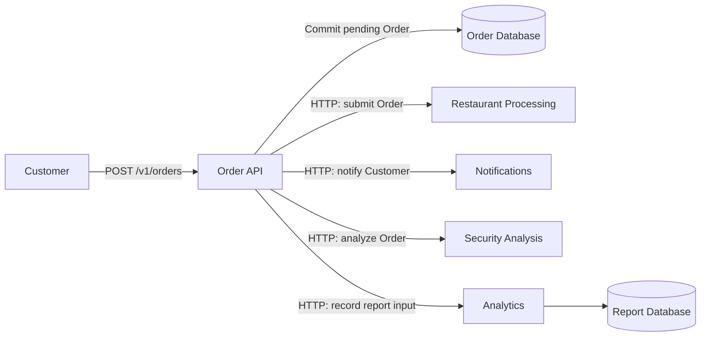
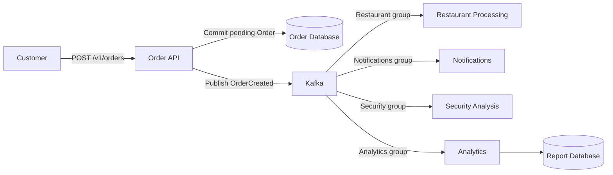
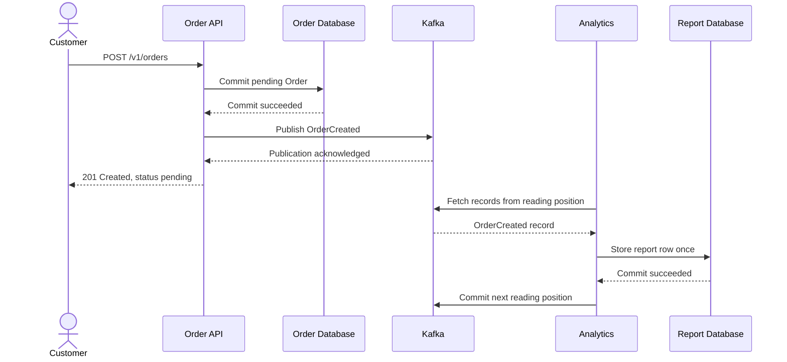
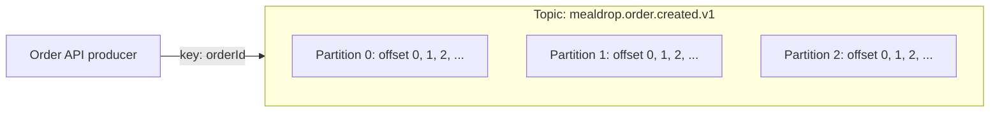
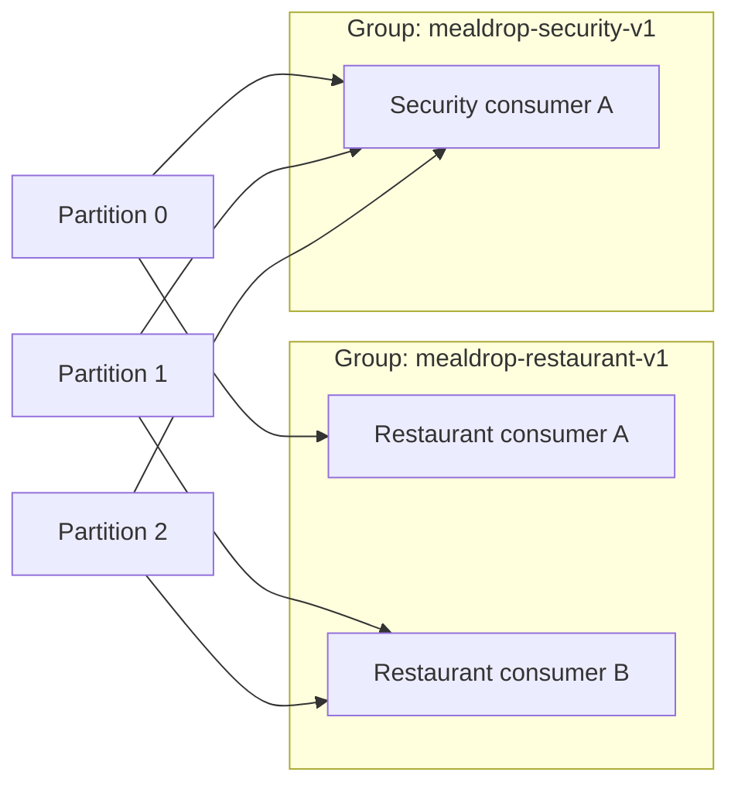
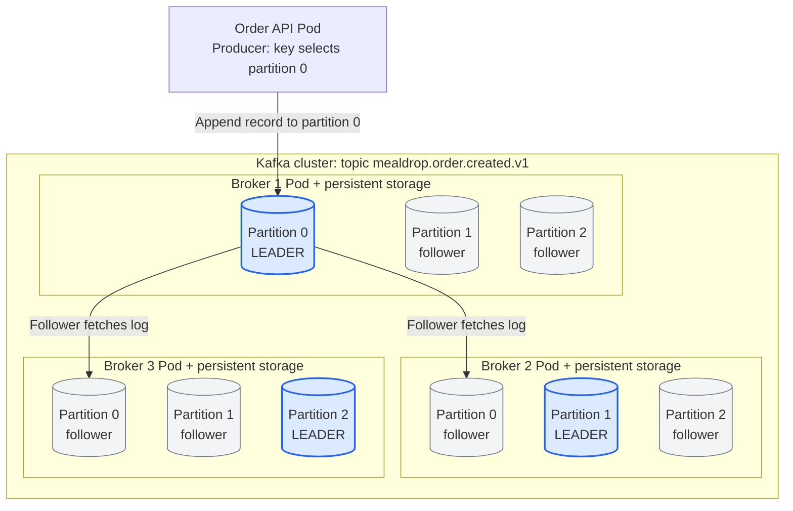
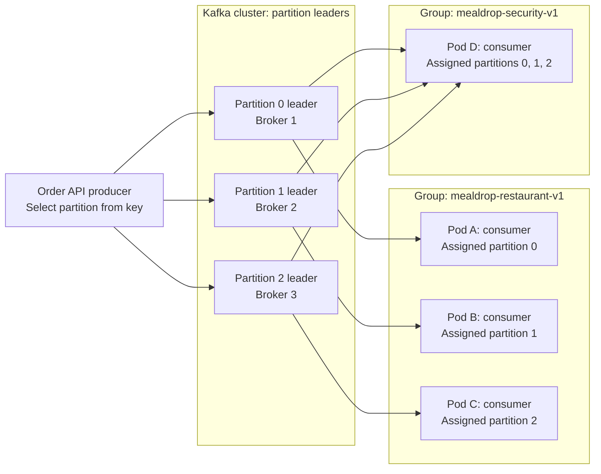

# Lecture 7: Message Brokers and Kafka

A system can receive work faster than it can process it. Several parts of the
system can also need the same data at different times. A message broker puts
messages between those parts so they can work independently.

This guide uses MealDrop Order processing. By the end, you should be able to
explain why messaging fits a system, trace a Kafka record, choose a consumer
group, reason about retries and replay, and publish and consume with TypeScript.

## 1. Build the Order pipeline with HTTP

[Lecture 6](lecture-06-api-design-and-data-modeling.md) defined MealDrop Orders
and their API. Keep the same meaning of `pending`: the Order is recorded, but
the Restaurant has not accepted it yet.

Add these responsibilities one at a time:

| Part | Responsibility |
| --- | --- |
| Order API | Validate the request, calculate agreed amounts, and record the Order |
| Restaurant Processing | Send the Order to the Restaurant and track its decision |
| Notifications | Tell the Customer about the recorded Order |
| Security Analysis | Analyze submitted Orders for suspicious patterns |
| Analytics | Build daily reports of submitted Order counts and values |

Security Analysis is background monitoring in this example. It can flag
repeated suspicious Orders for review. It does not approve payment or block
Restaurant preparation. A security decision that must block an Order needs
to complete before that Order is approved.

Start with direct HTTP calls. The Order API records the Order, then calls each
part. In this first design, it waits for those calls before responding.



These are responsibilities, not a requirement to deploy five separate
services. They can start inside one application. HTTP calls make the
dependencies visible for this example.

**Try it:** Trace one Order through the diagram. Which parts must finish before
the Customer receives a response in this design? What happens if Analytics
takes five seconds?

## 2. Find the pain points in the HTTP architecture

Keep the direct HTTP architecture from Section 1. Introduce each failure
without changing that architecture yet.

### Processing pressure: requests fail during the lunch burst

MealDrop receives 300 new Orders/s for one minute. Restaurant Processing can
handle 100 Orders/s. It accepts requests only while it has capacity and
rejects excess requests with `503 Service Unavailable`.

The Order API receives errors for work that Restaurant Processing cannot
accept. Faster Order API instances do not make that integration faster.
Immediate retries can add more requests to the overloaded service.

The pending Order is already recorded. A failed Restaurant call does not undo
that database commit. The API must track the failed handoff and decide when
and how to retry it.

**Try it:** Which part rejects requests? If the API retries every failed call
immediately, what happens to the Restaurant's load?

### Service complexity: the Order API coordinates every integration

The team adds Security Analysis to the existing Restaurant, Notifications,
and Analytics calls. The Order API now needs another endpoint, timeout,
retry rule, response contract, and error path.

For each integration, it must track whether the call succeeded, failed, or
has an unknown result. Its Order creation logic becomes mixed with downstream
coordination. Adding another responsibility makes that code more complex.

**Try it:** Analytics succeeds, Notifications fails, and Security times out.
Which calls should the API retry? What information must it retain?

### Reliability: one unavailable component affects the request

Notifications stops for ten minutes. Its HTTP calls fail. Because the Order
API waits for each downstream call, it must either return an error or return
success while recording unfinished work for later recovery.

A retry of the whole creation flow can repeat a Restaurant request that
already succeeded. If the API ignores the failed notification without
retaining enough information, some Customers never receive it.

**Check:** Does an error from Notifications mean the Order was not created?
Which successful calls could a full-flow retry repeat?

### Coupling: slow security analysis delays other work

Security Analysis calls a slow external service. Its response time increases,
and the Order API keeps requests and connections open while it waits.
Restaurant Processing can be healthy, yet Customers still wait for Security.
If the API runs out of request capacity, new Orders can fail before they reach
Restaurant Processing.

The components are coupled through the creation path: the availability and
response time of one part can affect the others. Background security work
has no independent way to resume missed analysis in this HTTP-only design
unless the application builds and stores that tracking itself.

**Try it:** Security takes 30 seconds per Order. Should background analysis
hold the Customer's response open? What happens to API capacity during lunch?

### Report repair: HTTP requests do not provide replay history

Analytics counts every received request as a new Order. A retry sends the
same Order twice, so the daily report overstates the Order count and submitted
value.

After fixing duplicate handling, the team wants to backfill the last seven
days. The past HTTP calls are no longer available as a readable input stream.
The team must obtain the original inputs from stored Orders, an archive, or
another history source, then build a separate export and reprocessing path.
An HTTP API can support that path, but the direct calls did not supply it.

This report measures submitted Orders. Submitted value is not paid revenue:
an Order can later be rejected or cancelled.

| HTTP pain point | Visible consequence |
| --- | --- |
| Requests exceed Restaurant capacity | Excess requests return errors |
| Order API coordinates all integrations | More timeout, retry, and partial-failure logic |
| Notifications is unavailable | Creation flow fails or leaves unfinished work |
| Security is slow | Customer latency and API capacity suffer |
| Report needs corrected historical input | A separate history export and backfill path is needed |

**Discuss:** Which problems require a result immediately, and which work could
finish after the pending Order is recorded?

## 3. Place Kafka in the architecture

**Apache Kafka** is an event streaming platform. It stores records in retained
logs and lets consumers read them. For this design, it supplies the message
broker between the Order API and the processing parts.

The Order API writes the database and publishes directly to Kafka. Consumers
no longer sit in the API's chain of downstream HTTP calls.



- The API waits for database commit and Kafka publication acknowledgement.
- It does not wait for the consumers to finish.
- `201 Created` means the pending Order is recorded. Kafka acknowledgement
  does not mean Restaurant acceptance or notification delivery.
- `GET /v1/orders/{orderId}` still reads current Order state from the database.
- Consumers fetch records through the Kafka protocol. The diagram arrows
  show data movement; Kafka does not make HTTP calls to those consumers.

### Revisit processing pressure: buffer the lunch burst

The same 300 Orders/s arrive, and Restaurant Processing still handles
100 Orders/s. The Order API publishes to Kafka. Assuming Kafka can accept
the full burst, excess work waits in the log instead of becoming excess HTTP
requests to Restaurant Processing. That consumer fetches work at a bounded
rate.

```text
backlog added = (300 - 100) Orders/s * 60 s = 12,000 Orders
```

After the burst, new traffic falls to 40 Orders/s:

```text
net drain rate = 100 - 40 = 60 Orders/s
drain time = 12,000 / 60 = 200 s
```

A durable queue can also buffer work for workers. Neither a queue nor Kafka
adds processing capacity. If input stays above capacity, the backlog grows.
MealDrop must define an acceptable wait and limit new work when it cannot
meet that promise. Consumers must also respect downstream capacity.

**Try it:** If traffic falls to 100 Orders/s instead of 40, will the backlog
drain? Would a four-minute Restaurant delay be acceptable for food Orders?

### Revisit service complexity: publish once, process independently

The Order API publishes `OrderCreated` instead of coordinating four
HTTP handoffs. Each consumer contains its own processing, dependency timeouts,
and recovery behavior. Adding another consumer does not add another call to
the Order creation path.

The coordination work moves to the relevant consumers; it does not disappear.
The API still validates and records the Order and handles Kafka publication.

**Check:** Which timeout rules move out of the Order API? Which write and
publication errors must it still handle?

### Revisit reliability: recover after a consumer outage

Notifications stops for ten minutes. The API continues publishing Orders
while Kafka is available. Restaurant Processing, Security, and Analytics
continue independently. Notifications resumes from its saved position and
reads missed records, provided those records are still retained.

A durable queue can retain unfinished tasks too. Recovery can repeat work,
so notification delivery and other consumer effects still need safe retry
behavior. A Kafka outage can still affect the API's publication step.

**Try it:** Notifications restarts after sending an email but before saving
its progress. Why could the same Customer receive another email?

### Revisit coupling: security keeps independent progress

Security Analysis still uses the slow external service, but the Order API
no longer waits for that analysis. The Security group keeps its own reading
position. Restaurant Processing has a separate group and keeps handling
Orders while Security falls behind.

When the external service returns, Security reads its missed Orders without
moving Restaurant Processing backward or repeating that group's work.
Consumers still depend on the message contract and share Kafka resources;
separate groups do not remove every dependency.

**Try it:** Background security findings must appear within five minutes.
Which processing delay should MealDrop measure even when Order creation
remains fast?

### Revisit report repair: replay into a corrected report

After fixing duplicate handling, Analytics reads retained Order records with
a separate consumer group and writes a fresh report. It selects the target
seven-day interval, compares the corrected results, and replaces the old
report after validation.

Restaurant Processing and Notifications keep their current positions. They
do not repeat their work just because Analytics rebuilds a report. Kafka's
retained history supplies the replay input; an ordinary work queue that
removes completed tasks would need a separate history source.

Replay can only use records Kafka received and still retains. Missing or
expired records need another source.

| Earlier HTTP problem | Change with messaging |
| --- | --- |
| Excess Restaurant requests fail | Buffer records and fetch at a bounded processing rate |
| Order API coordinates all integrations | Publish once; consumers handle their own processing |
| Notifications outage affects creation | Retain input while that consumer is unavailable |
| Slow Security delays the shared request path | Separate groups progress independently |
| Report repair needs a new historical input path | Replay retained records into a separate report |

## 4. Trace the data before learning the internals

Follow one `OrderCreated` message. Analytics is the consumer shown here;
the other consumers follow the same fetch-and-process shape.



The API encodes the message as bytes. Kafka stores those bytes. The consumer
decodes them, checks the schema, applies its result, and records its progress.
Kafka does not run the consumer's business logic.

There are two separate writes in the API: database commit and Kafka publish.
If the process stops between them, an Order can exist without a Kafka record.
Kafka cannot recover a record it never received. This direct design needs
a repair procedure that republishes missed Orders from stored data with the
same event identity. The repair implementation is outside this lecture.

**Try it:** Stop the API after database commit. Then stop Analytics after its
database commit. Which failure can leave a missing message, and which can
cause a repeated message?

## 5. Learn the Kafka model

### Producers, brokers, topics, and consumers

| Concept | Meaning | MealDrop example |
| --- | --- | --- |
| Producer | A client that publishes records | Kafka client inside Order API |
| Broker | A Kafka server that stores and serves partitions | One server in the Kafka cluster |
| Cluster | Kafka servers operating together | MealDrop's Kafka deployment |
| Topic | A named stream of records | `mealdrop.order.created.v1` |
| Record | Key, value, timestamp, and optional headers | Serialized `OrderCreated` message |
| Consumer | A client that fetches and processes records | One Security Analysis instance |

The value is bytes, not a TypeScript object. JSON is one way to encode it.
Kafka adds a record timestamp. Our JSON also contains `createdAt`, with a
meaning defined by the application.

### Partitions, keys, and offsets

A **partition** is an ordered log within a topic. A topic can contain several
partitions. New records are appended and receive **offsets**: positions within
that partition.



- A producer normally uses the key to choose a partition.
- With the same partitioning rule and partition count, the same `orderId`
  maps to the same partition.
- Each partition has its own offsets. Offset 12 in partition 0 is a different
  position from offset 12 in partition 1.
- Kafka preserves append order within a partition, not across the whole topic.
- A key groups records. It does not remove duplicates or sort records by
  `createdAt`.
- Changing the partition count can change where a key maps. Plan that change
  if related records need ordered processing.

This topic contains Order creation records. If another topic later contains
Order status changes, matching keys do not create ordering across the two
topics.

**Try it:** Two producers publish related records in the wrong business order.
Does using the same key correct the order? Why?

### Consumer groups: share work or read independently

A **consumer group** has a stable `groupId` and its own committed position
for each partition. In the ordinary consumer-group model used here, one
partition is assigned to one consumer in that group at a time.



- Restaurant consumers A and B share the Restaurant group's work.
- Security has a different group and reads all three partitions independently.
- Notifications and Analytics also need their own groups.
- If all four responsibilities use the same group, they divide records.
  Each responsibility would miss some Orders.
- With three partitions, at most three consumers in one group can actively
  process assigned partitions. More instances can remain idle.

A **rebalance** changes partition assignments when group membership changes.
If an instance stops, another can resume its partitions from committed offsets.
Keep processing in partition order when that order matters.

**Check:** Six Security instances read a three-partition topic. How many can
receive partition assignments? What changes if Notifications uses the same
`groupId` as Security?

### Connect the logical topic to the physical cluster

A topic is a logical name. Its partitions are the logs that brokers store.
Each partition has one leader replica and can have follower replicas on other
brokers. Replication factor counts all copies, including the leader.

Use this example throughout the following diagrams:

- Topic: `mealdrop.order.created.v1`.
- Partition count: 3.
- Broker count: 3.
- Replication factor: 3.
- Restaurant group: 3 consumers, one per Application Pod.
- Security group: 1 consumer in a separate Application Pod.

This creates three logical partition logs and nine stored partition replicas.
It does not create nine different streams or make consumers process each
record three times.

| Logical partition | Broker 1 | Broker 2 | Broker 3 |
| --- | --- | --- | --- |
| Partition 0 | Leader | Follower | Follower |
| Partition 1 | Follower | Leader | Follower |
| Partition 2 | Follower | Follower | Leader |

Here is the physical placement. All nine replicas belong to the same topic.
The solid arrows trace publication and replication for one record in
partition 0. For partitions 1 and 2, the table shows
the equivalent leader and follower placement.



The replication arrows show data movement. Followers fetch from the leader.
The next diagram adds consumer reads. Consumers request records from brokers;
they do not receive HTTP calls from the broker.

A **broker** is a Kafka server process, not a partition or a consumer. In this
Kubernetes example, one broker process runs in each broker Pod. Its persistent
storage keeps partition logs when the Pod restarts. One broker can lead some
partitions and follow others, including partitions from other topics.

The **consumer** is a Kafka client inside an Application Pod. It applies
business logic. Broker Pods store and serve records; Application Pods process
them. A Pod can run more than one consumer, but this example runs one.

Modern Kafka also has a **KRaft controller quorum**. Controllers maintain
cluster metadata and coordinate partition leader elections. A production
deployment can use three separate controller Pods alongside these three
broker Pods. The active controller is not the leader of every data partition.
Application records travel through brokers, not through the controller quorum.

Sources: [Apache Kafka: Replication](https://kafka.apache.org/41/design/design/#replication)
and [Apache Kafka: KRaft](https://kafka.apache.org/41/operations/kraft/).

### Connect all partitions to the producers and consumer groups

Now hide the follower copies and show the client relationships for all three
partitions. Each leader below is the same replica shown in the placement
diagram.



- One producer can publish to all three partition leaders. Many producers can
  also publish to the same partition.
- The producer selects a partition, not a consumer. Each record follows one
  of the producer arrows, not all three.
- Consumers subscribe to the topic. The group assignment determines which
  partitions each consumer reads.
- Restaurant consumers divide the work; Security independently reads every
  partition with its own progress.
- Replication factor changes stored copies. It does not add consumer-group
  members or increase that group's partition-level processing parallelism.

Sources: [KafkaJS: Producing Messages](https://kafka.js.org/docs/producing)
and [KafkaJS: Consuming Messages](https://kafka.js.org/docs/consuming).

### Trace one record and its progress

Assume the producer's partitioner maps this Order's key to partition 0:

1. The producer discovers the topic's partition leaders through Kafka metadata.
2. It sends `OrderCreated` to Broker 1, the current leader of partition 0.
3. Broker 1 appends the record at offset 42. The followers copy it with the
   same partition offset; their copies do not get independent offsets.
4. Broker 1 acknowledges according to the producer's acknowledgement settings.
5. Restaurant consumer A and the Security consumer each fetch the record.
6. Each consumer applies its own effect and commits progress independently.

After processing offset 42, a consumer commits the next offset, 43:

```text
Group: mealdrop-restaurant-v1
Topic: mealdrop.order.created.v1
Partition: 0
Committed offset: 43
```

The commit identifies the group, topic, partition, and next offset. It does
not advance other partitions or other groups. Kafka stores group commits in
the internal `__consumer_offsets` topic. A broker acting as the group's
coordinator manages those commits; it need not be the leader of partition 0.

If Security has committed offset 40, it resumes at 40 even though Restaurant
has committed 43. This is how Security can catch up independently.

Source: [KafkaJS: Manual Committing](https://kafka.js.org/docs/consuming#manual-committing)
and [Apache Kafka: Consumer Offset Tracking](https://kafka.apache.org/42/implementation/distribution/#consumer-offset-tracking).

### Keep keys, offsets, and ordering separate

The key can repeat. Several Order events can use the same `orderId`. Each
published record still receives its own partition offset. The key is separate
from the value and is not a uniqueness constraint.

A key can represent several fields, such as a stable serialization of
`[tenantId, orderId]`. Kafka's partitioner sees the whole byte sequence; Kafka
does not interpret it as a database composite key. All producers must use
consistent encoding to keep related records together.

For a future `mealdrop.order.events.v1` topic containing status changes, use
`orderId` as the key:

```text
Partition 0, key order-42:
  offset 42: OrderCreated   -> pending
  offset 43: OrderAccepted  -> active
  offset 44: OrderDelivered -> completed
```

The producer must publish these changes in business order. The assigned
consumer must apply them sequentially. Otherwise, a late `OrderAccepted`
update could overwrite `completed` with `active`.

Kafka supplies append order within this partition. Other partitions can run
in parallel, and there is no topic-wide order. Consumer code that starts work
without awaiting it can still apply the effects out of order.

Source: [KafkaJS: Message Keys](https://kafka.js.org/docs/producing#key)
and [KafkaJS: Partition-aware Concurrency](https://kafka.js.org/docs/consuming#partition-aware-concurrency).

### Choose partition count separately from Pod count

The team sets partition count when it creates the topic, through infrastructure
configuration, a command, or an admin client. Automatically created topics
can use broker defaults. Kafka does not match partition count to Application
Pod count automatically.

In this example, three partitions and three Restaurant consumers permit one
partition per consumer. With five partitions and five consumers in one group,
the equivalent assignment gives each consumer one partition. More consumers
than partitions leave some members without an assignment for that topic.

Kafka permits increasing the partition count, but not decreasing it in place.
Increasing the count leaves old records where they are and can change where
keys map for new records. Plan that change when related records must stay
ordered; moving from three to six partitions does not move existing records
into the new partitions.

Source: [Apache Kafka: Basic Operations](https://kafka.apache.org/41/operations/basic-kafka-operations/).

### Recover from a broker failure or a consumer failure

| Failure | What changes | What remains |
| --- | --- | --- |
| Broker 1 stops | An eligible follower can become partition 0's leader; clients refresh metadata | Partition 0 keeps its identity and retained log positions |
| Restaurant Pod A stops | The group can assign partition 0 to another Restaurant consumer | The group's committed progress for partition 0 |

A broker failure changes where records are served. A consumer failure changes
which application instance processes them. Those are different operations.
Records whose effects completed without an offset commit can be processed
again, so consumers still need safe duplicate handling.

**Try it:** Broker 1 and Restaurant Pod A both stop. Which operation selects
a new partition leader, and which operation assigns another consumer? Does
the Security group have to use Restaurant's committed offset?

### Retention, lag, and replay

**Retention** controls how long or how much data Kafka keeps. In this example,
use a delete-retention policy of 14 days and enough storage for that period.
Reading a record does not delete it. Size limits can remove data sooner, and
age-based deletion happens in log segments rather than at an exact second.

**Consumer lag** compares a group's progress with the available log end.
Also measure event age: the difference between current time and `createdAt`
for the work being processed. A small record count can still contain old work.

**Replay** reads retained records again. A new group can start at the earliest
available offset. An existing group's committed offsets normally control
where it resumes; a restart alone does not reset its progress.

Sources: [Apache Kafka: Introduction](https://kafka.apache.org/41/getting-started/introduction/)
and [KafkaJS: Consuming Messages](https://kafka.js.org/docs/consuming).

## 6. Make reliability explicit

### Replication and publication acknowledgements

A partition has a leader and can have replicas on other brokers. The leader
handles publication; replicas copy its log. If the leader fails, an eligible
replica can become leader.

For a production example, use replication factor 3, `min.insync.replicas=2`,
and producer `acks=all`. Publication waits for the current in-sync replicas
to acknowledge. With fewer than two in-sync replicas, writes fail rather than
accepting weaker replication. `acks=all` does not mean every configured replica
is healthy, and replication does not replace a backup.

A single local broker is enough for an integration exercise. It cannot
demonstrate survival of a broker failure through replication.

### Processing and committed offsets

A committed offset records the **next** position the group should read after
recovery. After processing offset 42, commit 43.

| Consumer sequence | Failure result |
| --- | --- |
| Commit offset, then write report | A crash can skip a report update |
| Write report, then commit offset | A crash can repeat the report update |
| Write report safely once, then commit offset | Repetition can leave the report unchanged |

Use **at-least-once processing** for this example: repeated records are
possible. An **idempotent** operation has the same result when repeated.
Store one report row per stable event ID instead of incrementing a counter
for every delivery. For a more complex change, store the processed ID and
the change in the same database transaction.

Producer idempotence can suppress duplicates from supported producer retries.
It does not make application-level republication or a consumer's external
effects happen once. Kafka transactions also do not automatically include
a PostgreSQL commit or an email provider.

**Try it:** Analytics writes the row, then loses the offset-commit response.
After restart it receives the record again. Which database constraint should
make that safe?

Source: [Apache Kafka: Message Delivery Semantics and Replication](https://kafka.apache.org/41/design/design/).

## 7. Define message formats and schema changes

Use topic `mealdrop.order.created.v1`, with `orderId` as the record key.
The value uses JSON:

```json
{
  "eventId": "order-created:c3333333-3333-4333-8333-333333333333",
  "type": "OrderCreated",
  "schemaVersion": 1,
  "createdAt": "2026-10-27T12:00:00Z",
  "orderId": "c3333333-3333-4333-8333-333333333333",
  "restaurantId": "a1111111-1111-4111-8111-111111111111",
  "total": "11.00",
  "currency": "EUR"
}
```

- `eventId` identifies this creation fact and remains stable on republication.
- `orderId` identifies the Order and is also the Kafka key.
- `createdAt` is the original Order creation time, not the time of a retry.
- `total` is a decimal string calculated by the server from the agreed prices
  and fee. This message snapshots it for consumers; it does not change the
  stored Order model from Lecture 6.
- Each consumer validates the bytes it receives. TypeScript types alone do
  not validate JSON at runtime.
- The example has report fields. Restaurant Processing may fetch Order items
  through an internal API; that adds a runtime dependency. A richer snapshot
  can carry bounded item data if consumers need to avoid that fetch.

| Format | Useful property | Cost |
| --- | --- | --- |
| JSON | Readable; simple to inspect | Larger messages; runtime schema checks needed |
| Avro | Schema-based binary encoding | Serializer and reader-schema tooling |
| Protocol Buffers | Compact encoding and generated types | Schema files, field-number rules, and tooling |

Kafka stores bytes; it does not enforce these application schemas. A Schema
Registry can store schemas and check configured compatibility rules.

### Version for old readers and old records

| Change | Decision for this JSON contract |
| --- | --- |
| Add optional `channel` | Compatible if old readers accept unknown fields and new readers handle absence |
| Require `channel` | Old retained records lack it; provide a default or migrate |
| Rename `orderId` | Breaks readers using that field |
| Change `total` from EUR units to cents | Breaks meaning even if it remains a string |
| Add a new currency | Safe only if consumers already handle that value correctly |

**Backward compatibility** means a new reader can read old records.
**Forward compatibility** means an old reader can read new records.
**Full compatibility** checks both directions. For long replay histories,
check against all retained schema versions, not only the previous version.
Exact rules differ by format.

Keep compatible additions within the `v1` contract. For a breaking change,
introduce a new contract, migrate consumers, and retain a way to read old
records. A `schemaVersion` field alone does not perform that migration.

**Try it:** Add optional `channel`, then rename `total` to `amount`. Which
change can an old consumer read? Can the new consumer still replay yesterday's
records?

Source: [Confluent: Schema Evolution and Compatibility](https://docs.confluent.io/platform/current/schema-registry/fundamentals/schema-evolution.html).

## 8. Read how companies use Kafka in production

These posts are written by the companies' engineering teams. Each describes
actual systems, inputs, and operating problems. Dates and measurements refer
to the published account, not a claim about the company's current deployment.

### Uber: ride processing, notifications, and consumer monitoring

Read [Introducing uGroup: Uber's Consumer Management Framework](https://www.uber.com/us/en/blog/introducing-ugroup-ubers-consumer-management-framework/),
October 21, 2021. Start with "Background" and "Challenges."

Uber describes Kafka usage across the ride lifecycle:

- Supply and demand data support fare calculations.
- Driver acceptance leads to mobile push notifications.
- Post-trip processing uses Kafka for payment and receipt workflows.
- Data also reaches Hive for analytics.

The post then explains an operating problem: consumer-side metrics did not
always provide a reliable view of consumer groups, especially when consumers
had connectivity problems. Uber built uGroup to improve consumer monitoring.

**Connection to MealDrop:** A recorded Order can feed several processing
responsibilities. Each responsibility needs observable progress; successful
publication does not prove that a notification or payment finished.

**Discuss:** Which Uber responsibilities resemble MealDrop's consumers? Which
consumer delay would have the most direct effect on a Customer?

### LinkedIn: background security analysis from activity events

Read [Revolutionizing Real-Time Streaming Processing: 4 Trillion Events Daily at LinkedIn](https://www.linkedin.com/blog/engineering/data-streaming-processing/revolutionizing-real-time-streaming-processing--4-trillion-event),
October 19, 2023. Focus on "Anti-Abuse & Near Real-Time AI Modeling."

LinkedIn describes Chronos, its anti-abuse platform. The pipeline analyzes
activity for problems such as fake accounts, scraping, spam, and account
takeovers:

```text
Activity events in Kafka
-> Beam Filter pipeline
-> filtered records in Kafka
-> Beam Model pipeline
-> abuse scores in applications and stores
```

The Filter pipeline selects and aggregates relevant activity. The Model
pipeline groups activity within time windows and runs AI scoring models.
Kafka carries the input and intermediate records; Beam pipelines perform the
analysis. The post also describes Kafka-fed ML features for recommendations.

**Connection to MealDrop:** Security Analysis is a separate processing path
that turns activity into findings. Kafka transports records; it does not
perform the security decision itself.

**Discuss:** Why does a security model need several activity events within a
window rather than only the latest Order?

### Shopify Inbox: cart and Order signals reach a real product

Read [Building a Real-time Buyer Signal Data Pipeline for Shopify Inbox](https://shopify.engineering/real-time-buyer-signal-data-pipeline-shopify-inbox),
December 13, 2021. Focus on "Architecture" and "High Level System Design."

Shopify wanted merchants chatting with buyers to see relevant context: cart
activity and recent Order completion. Its pipeline used Kafka, Apache Beam,
and Google Cloud Dataflow.

- Inputs included structured application events and database changes captured
  from MySQL with Debezium.
- Beam filtering and aggregation produced buyer signals.
- Output events returned to the messaging platform.
- A downstream consumer delivered the signals to Shopify Inbox.

The post explains Monorail, Shopify's event abstraction, including schema
structure and versioning. It also discusses stateful processing and timing.

**Connection to MealDrop:** An Order record can support a new product feature
through a downstream pipeline. That pipeline can consume and produce events;
Kafka is not limited to one producer followed by final consumers.

**Discuss:** Where does business processing happen, and which parts only
transport data? Why does this product need low event age?

### Shopify Server Pixels: Kafka did not remove processing pressure

Read [Leveraging Go Worker Pools to Scale Server-side Data Sharing](https://shopify.engineering/leveraging-go-worker-pools),
September 9, 2022. Focus on "The Problem" and "The Solution."

Shopify's Server Pixels service processed storefront events such as checkout
completion, searches, and product views for marketing partners. The team
reported more than one billion events per day.

Kafka was already in use, but input-topic lag grew when downstream processing
slowed. The service spawned an unbounded number of goroutines, placing more
pressure on CPU and memory as traffic increased. Its processing target was
five minutes.

The team introduced worker pools with a fixed number of workers. The post
reports per-Pod throughput increasing from 7,750 to 21,000 events/s.

**Connection to MealDrop:** Kafka can retain waiting input. The consumer still
needs bounded concurrency and enough capacity to meet its delay target. Adding
more asynchronous work inside a Pod can reduce throughput instead of improving
it. This example's worker-pool design is not a guarantee of per-key ordering.

**Discuss:** Which measurements would tell us whether to add consumer Pods,
change internal concurrency, or investigate a slow dependency?

### Compare the production cases

| Company and system | Kafka carries | Processing responsibility | Lesson for MealDrop |
| --- | --- | --- | --- |
| Uber ride workflows | Business events and interservice messages | Notifications, post-trip workflows, analytics | Observe downstream completion independently |
| LinkedIn Chronos | Activity and filtered activity | Anti-abuse pipelines | Keep security analysis separate from transport |
| Shopify Inbox | Application and database-change events | Buyer-context processing and delivery | New product features can consume existing streams |
| Shopify Server Pixels | Storefront and processed customer events | Event processing for marketing partners | Buffering still needs bounded consumer work |

For more detail:

- [Uber: Introducing uFowarder: The Consumer Proxy for Kafka Async Queuing](https://www.uber.com/us/en/blog/introducing-ufowarder/),
  February 5, 2026. Uber describes its uForwarder proxy, which reads Kafka and
  forwards work through gRPC. Read about blocked processing, delays, and
  isolation. This is Uber's additional platform, not native Kafka behavior.
- [Shopify: Capturing Every Change From Shopify's Sharded Monolith](https://shopify.engineering/capturing-every-change-shopify-sharded-monolith),
  March 12, 2021. Read how Kafka Connect and Debezium turn sharded database
  changes into streams, and how the team handles records too large for its
  normal Kafka path.

## 9. Apply practices at two levels

### Architecture level

- Keep processing off the request path when the product permits delayed results.
- Give independent responsibilities separate consumer groups.
- Size partitions and consumers from measured throughput. A hot key can still
  overload one partition.
- Choose retention and storage from the longest expected outage or backfill.
- Monitor lag, event age, publish failures, and processing failures separately.
- Plan backfills with a separate group and output. Validate before replacement.
- Bound waiting work. More buffering is not a solution to sustained overload.

### Implementation level

- Reuse producer connections instead of reconnecting for every HTTP request.
- Validate messages at runtime, including versions and field meanings.
- Keep event identity and `createdAt` stable across retries.
- Await durable consumer effects before committing the next offset.
- Use a unique ID or a database transaction to make repeats safe.
- Bound concurrency, dependency timeouts, and retry attempts. Use backoff.
- Keep ordered work sequential within each partition.
- Keep long handlers within heartbeat and session-timeout rules.
- Give malformed records an explicit policy: alert and stop, or record them
  durably for review before advancing. Do not silently discard them.
- Close consumers and producers cleanly on shutdown.

**Check:** A consumer starts 1,000 external requests without waiting. Which
problems can this create even if Kafka itself remains healthy?

## 10. Publish and consume with TypeScript

These examples use KafkaJS, Zod, and PostgreSQL. Create these files in a small
TypeScript project with ES modules and an ES2022 target:

```bash
npm install kafkajs zod pg
npm install --save-dev typescript tsx @types/node @types/pg
```

Run a local Kafka broker and PostgreSQL first. Create the topic with three
partitions, replication factor 1 for local use, and delete retention of
`1209600000` milliseconds (14 days). These snippets assume the topic exists.
Set `KAFKA_BROKERS` and `DATABASE_URL` for your local services.

### Share the connection settings and schema

Save as `shared.ts`:

```typescript
import { Kafka } from "kafkajs";
import { z } from "zod";

export const topic = "mealdrop.order.created.v1";
export const kafka = new Kafka({
  clientId: "mealdrop-example",
  brokers: (process.env.KAFKA_BROKERS ?? "localhost:9092").split(","),
  retry: { retries: 5, initialRetryTime: 300 },
});

export const orderCreatedSchema = z.object({
  eventId: z.string().min(1),
  type: z.literal("OrderCreated"),
  schemaVersion: z.literal(1),
  createdAt: z.iso.datetime(),
  orderId: z.uuid(),
  restaurantId: z.uuid(),
  total: z.string().regex(/^\d+\.\d{2}$/),
  currency: z.literal("EUR"),
}).refine(
  (event) => event.eventId === `order-created:${event.orderId}`,
  { message: "eventId must identify this Order creation" },
);

export type OrderCreated = z.infer<typeof orderCreatedSchema>;
```

This example uses Zod 4 syntax. `z.object` permits and strips unknown fields
by default, so an optional addition does not break this reader. The EUR-only
validator is an explicit example limit; adding another currency needs a
consumer change.

### Publish directly from the Order API

Save as `producer.ts`:

```typescript
import { kafka, orderCreatedSchema, topic } from "./shared.js";

export const producer = kafka.producer({
  allowAutoTopicCreation: false,
  maxInFlightRequests: 1,
});

type SavedOrder = {
  orderId: string;
  restaurantId: string;
  createdAt: string;
  total: string;
  currency: "EUR";
};

export async function publishCreatedOrder(order: SavedOrder) {
  const event = orderCreatedSchema.parse({
    ...order,
    eventId: `order-created:${order.orderId}`,
    type: "OrderCreated",
    schemaVersion: 1,
  });

  await producer.send({
    topic,
    acks: -1,
    messages: [{ key: event.orderId, value: JSON.stringify(event) }],
  });
}
```

Call `producer.connect()` once when the API starts. In the HTTP handler:

1. Validate the request and calculate amounts on the server.
2. Commit the pending Order to PostgreSQL.
3. Call `publishCreatedOrder` with the saved Order's original values.
4. Return the Order response after publication acknowledgement.

Call `producer.disconnect()` when the API shuts down. KafkaJS uses `acks: -1`
for `all`. The example keeps one request in flight to make publication order
simple. A timeout can leave publication uncertain, so retries must reuse the
same event ID. Also handle HTTP retries without creating a second Order.

If publication fails after the Order commit, do not report that the Order
never existed. Preserve the saved Order and its identity for retry and repair.
The earlier two-write failure still applies.

Source: [KafkaJS: Producing Messages](https://kafka.js.org/docs/producing).

### Consume into a report that is safe to rebuild

Create this table in the Report Database:

```sql
CREATE TABLE order_report_v2 (
  event_id text PRIMARY KEY,
  order_id uuid NOT NULL UNIQUE,
  restaurant_id uuid NOT NULL,
  created_at timestamptz NOT NULL,
  total numeric(14, 2) NOT NULL CHECK (total >= 0),
  currency text NOT NULL CHECK (currency = 'EUR')
);
```

Save as `consumer.ts`:

```typescript
import { Pool } from "pg";
import { kafka, orderCreatedSchema, topic } from "./shared.js";

const pool = new Pool({ connectionString: process.env.DATABASE_URL });
const consumer = kafka.consumer({
  groupId: "mealdrop-analytics-backfill-v2",
  allowAutoTopicCreation: false,
});

async function main() {
  await consumer.connect();
  await consumer.subscribe({ topic, fromBeginning: true });
  await consumer.run({
    autoCommit: false,
    partitionsConsumedConcurrently: 1,
    eachMessage: async ({ topic, partition, message }) => {
      if (message.value === null) throw new Error("Missing Order value");
      const event = orderCreatedSchema.parse(
        JSON.parse(message.value.toString("utf8")),
      );
      if (message.key?.toString("utf8") !== event.orderId) {
        throw new Error("Order key does not match orderId");
      }

      await pool.query(
        `INSERT INTO order_report_v2
         (event_id, order_id, restaurant_id, created_at, total, currency)
         VALUES ($1, $2, $3, $4, $5, $6)
         ON CONFLICT (event_id) DO NOTHING`,
        [event.eventId, event.orderId, event.restaurantId,
         event.createdAt, event.total, event.currency],
      );

      await consumer.commitOffsets([{
        topic,
        partition,
        offset: (BigInt(message.offset) + 1n).toString(),
      }]);
    },
  });
}

async function shutdown() {
  await consumer.disconnect();
  await pool.end();
}

process.once("SIGINT", () => {
  void shutdown().catch((error) => {
    console.error(error);
    process.exitCode = 1;
  });
});
process.once("SIGTERM", () => {
  void shutdown().catch((error) => {
    console.error(error);
    process.exitCode = 1;
  });
});
void main().catch(async (error) => {
  console.error(error);
  process.exitCode = 1;
  await shutdown();
});
```

Run with `npx tsx consumer.ts`. A completed `pool.query` commits this one SQL
statement before the offset commit. A repeated event conflicts on `event_id`
and leaves the row unchanged. Use a transaction if processing needs multiple
database changes.

The insert must complete within the consumer's processing-time budget. A
production handler needs a database timeout and heartbeats for longer work.
Invalid messages throw and prevent offset advancement; add an explicit
review policy before using this pattern for unattended operation.

`fromBeginning: true` starts a new group at the earliest retained record. If
this group already has valid committed offsets, it resumes there. To rebuild
again, use another group and an empty output table, or perform a controlled
offset reset while the group is stopped. Resetting offsets without replacing
already incorrect output does not repair the report.

Build the daily report from the corrected rows:

```sql
SELECT
  (created_at AT TIME ZONE 'UTC')::date AS report_day,
  currency,
  count(*) AS submitted_orders,
  sum(total) AS submitted_value
FROM order_report_v2
WHERE created_at >= '2026-10-21T00:00:00Z'
  AND created_at < '2026-10-28T00:00:00Z'
GROUP BY report_day, currency
ORDER BY report_day, currency;
```

Source: [KafkaJS: Consuming Messages](https://kafka.js.org/docs/consuming),
especially manual committing and `fromBeginning`.

**Try it:** Publish the same event twice. Stop the consumer after its insert
but before the offset commit, then restart it. How many report rows should
exist? Why does the report query still count one Order?

## 11. Optional integration practice

This practice is optional. Use the TypeScript examples as the starting point.

1. Start local Kafka and PostgreSQL; create the topic and report table.
2. Call the producer function from a small Order API after its database write.
3. Run Analytics and a second consumer with group `mealdrop-security-v1`.
   The Security consumer can log suspicious-order review candidates for
   this exercise.
4. Publish ten Orders and verify that both groups read them.
5. Stop Security, publish ten more Orders, and keep Analytics running.
6. Restart Security and verify that it catches up independently.
7. Repeat an event and verify that Analytics stores one row for that Order.
8. Build a fresh report table with a new group and compare its results.
9. Add optional `channel` and confirm that the original reader still works.

Keep a short record of the architecture, group IDs, observed results, and
one failure you tested. Do not claim broker fault tolerance from a single
local broker.

## References: read with a question

- [Apache Kafka: Introduction](https://kafka.apache.org/41/getting-started/introduction/).
  **Question:** Why can several groups read the same records without deleting them?
- [Apache Kafka: Design](https://kafka.apache.org/41/design/design/).
  **Question:** Which guarantees apply to publication, and which need consumer cooperation?
- [KafkaJS: Producing Messages](https://kafka.js.org/docs/producing).
  **Question:** How do the key and acknowledgement setting affect publication?
- [KafkaJS: Consuming Messages](https://kafka.js.org/docs/consuming).
  **Question:** What does a committed offset control after restart?
- [Confluent: Schema Evolution and Compatibility](https://docs.confluent.io/platform/current/schema-registry/fundamentals/schema-evolution.html).
  **Question:** Can both yesterday's records and yesterday's readers survive a change?
- [Zod: Defining Schemas](https://zod.dev/api).
  **Question:** What happens to an unknown object field, and what does parsing validate?
- [PostgreSQL: INSERT](https://www.postgresql.org/docs/current/sql-insert.html).
  **Question:** How does `ON CONFLICT` make repeated report inserts safe?
- [Martin Kleppmann: _Designing Data-Intensive Applications_](https://dataintensive.net/),
  first edition, Chapter 11, "Stream Processing."
  **Question:** How do logs, recovery, and repeated processing affect a design?
  The linked site introduces the book; the chapter is assigned reading.
