# Lecture 8: Workers, Scheduling, and Reliable Workflows

## 1. Execution concepts

### Job

A job is one unit of work with inputs and a completion condition.

- A report job reads one month's sales and writes a PDF report.
- An email job sends a password-reset message to one recipient.

### Worker

A worker is a process that executes jobs, often by taking them from a queue.

- An email worker takes pending messages from a queue and sends them.
- A report worker generates PDF files while the web server handles requests.

### Queue

A queue stores jobs waiting for execution. It buffers work when producers
submit jobs faster than workers finish them.

- An email queue holds 10,000 messages while workers send 100 messages per second.
- A print queue holds documents until a printer is available.

### Schedule

A schedule defines when work becomes due, using calendar times or intervals.

- A backup runs every day at 01:00 UTC.
- A monitoring service checks a website every 30 seconds.

### Delayed job

A delayed job becomes eligible for execution at a future time. Its actual
start time depends on worker capacity.

- A delayed job sends a reminder 24 hours after a booking is created.
- A delayed job closes an unpaid invoice seven days after it is issued.

### Workflow

A workflow coordinates steps, decisions, and waits to produce a result.

- An account-registration workflow validates an email address, creates an
  account, and sends a welcome message.
- A document-review workflow stores a draft, waits for approval, and publishes
  the approved version.

### Durable execution

Durable execution stores progress so unfinished work can resume after a
process failure. Steps whose results were not saved can run again.
A durable workflow also retains its waits and timers.

- A report process saves completed sections and resumes unfinished sections
  after a restart.
- A document-review workflow retains an approval wait across a server restart
  and continues when the approval arrives.

### Event

An event is a record that a fact occurred. Independent consumers can use the
same event for different purposes.

- A `PaymentReceived` event records that payment was received for an invoice.
- A `PasswordChanged` event triggers a security email and an audit-log entry.

### Kafka and background processing

MealDrop architecture from
[Lecture 7](lecture-07-message-brokers-and-kafka.md):

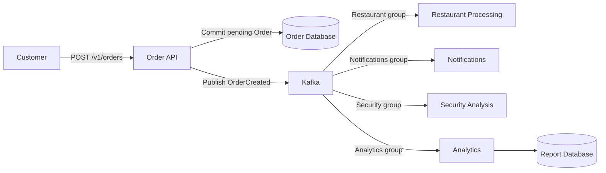

Kafka delivers `OrderCreated`; Restaurant Processing must complete the work.

## 2. Restaurant photo and video processing

### Inputs and outputs

A Restaurant uploads a dish photo or a short promotional video.

| Input | Accepted input | Required output |
| --- | --- | --- |
| Dish photo | JPEG or PNG, up to 10 MB and 40 million pixels | 400 x 300 menu-card WebP and 1200 x 900 detail WebP |
| Promotional video | Landscape video, at most 30 seconds and 100 MB | H.264 MP4 within 1280 x 720 at 30 frames/s, no audio, and a JPEG poster |

- Keep the original in Object Storage.
- Use orientation metadata before cropping a photo; remove metadata from
  outputs.
- Preserve video aspect ratio.
- Select the poster at one second, or at zero for a shorter video.
- Publish the media only after all required outputs exist.
- Show the Restaurant `processing`, `ready`, or `failed`.

### Media processing: Container View

Media Workers run alongside the Backend Server from
[Lecture 4](lecture-04-architecture-decomposition-and-data-flows.md).

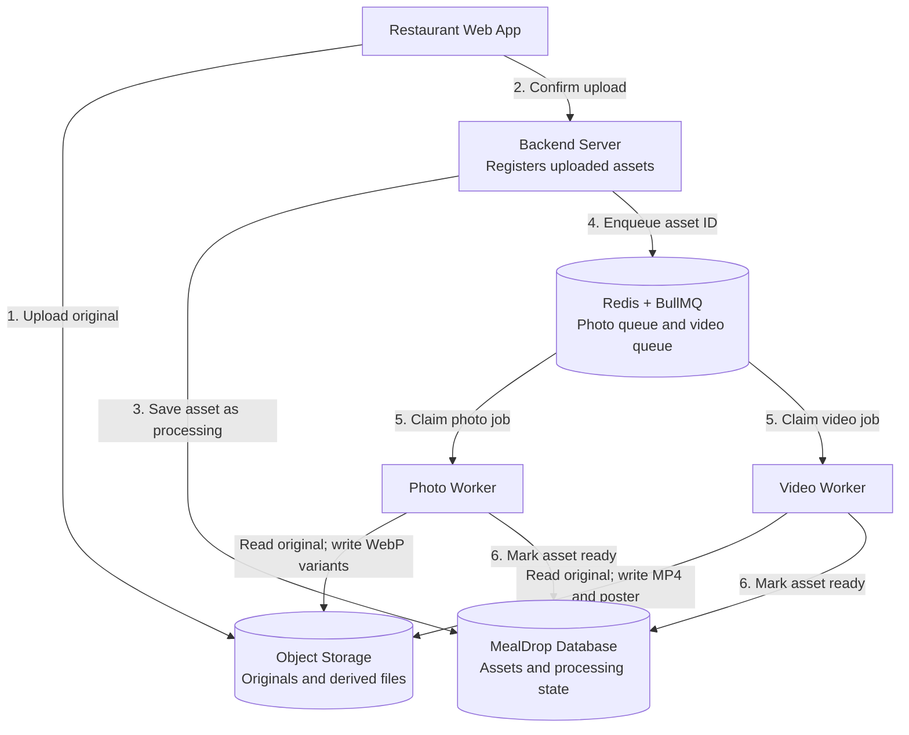

Queues hold jobs; workers read originals, create outputs, and mark assets ready.

- The Backend Server issues upload URLs and verifies ownership, size, and the
  completed object.
- After registration commits, return `202 Accepted` with `assetId`
  and a status URL.

### Photo Worker: Component View

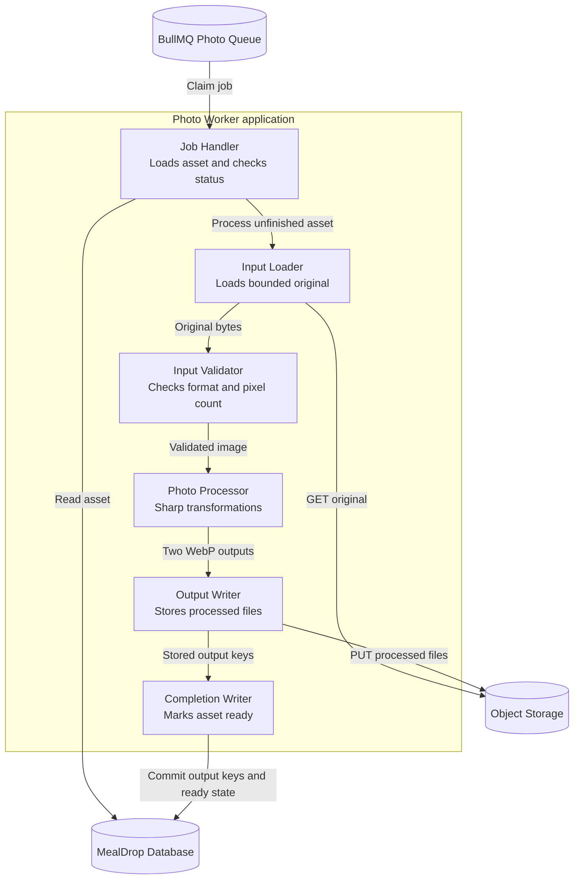

Inside one Photo Worker: load, validate, transform, store, and commit readiness.

### Photo transformation with Sharp

Install Sharp:

```bash
npm install sharp
npm install --save-dev tsx typescript @types/node
```

Save as `process-photo.ts`:

```typescript
import { mkdir } from "node:fs/promises";
import sharp from "sharp";

sharp.concurrency(1);
const input = process.argv[2];
const output = process.argv[3] ?? "derived";
if (!input) throw new Error("Use: process-photo.ts <input> [output-directory]");
await mkdir(output, { recursive: true });

for (const [name, width, height] of [
  ["card", 400, 300],
  ["detail", 1200, 900],
] as const) {
  await sharp(input, { limitInputPixels: 40_000_000 })
    .rotate()
    .resize(width, height, { fit: "cover", position: "centre" })
    .webp({ quality: 80 })
    .toFile(output + "/" + name + ".webp");
}
```

```bash
npx tsx process-photo.ts tomato-soup.jpg derived
```

Sharp removes metadata by default; this job creates the variants sequentially.
`sharp.concurrency(1)` limits threads per image; BullMQ limits active jobs.

### Video conversion with FFmpeg

Verify the FFmpeg installation:

```bash
ffmpeg -version
ffprobe -version
```

Inspect duration and streams before conversion:

```bash
ffprobe -v error -show_entries format=duration:stream=codec_type,width,height \
  -of json original.mp4
```

Reject input beyond the stated limits. Run FFmpeg as a child process with a
120-second execution timeout:

```bash
ffmpeg -nostdin -y -threads 1 -i original.mp4 \
  -filter_threads 1 \
  -vf "scale=1280:720:force_original_aspect_ratio=decrease:force_divisible_by=2,fps=30" \
  -c:v libx264 -threads 1 -crf 23 -preset fast -pix_fmt yuv420p \
  -an -movflags +faststart output.mp4

ffmpeg -nostdin -y -threads 1 -ss 1 -i original.mp4 \
  -filter_threads 1 -frames:v 1 -vf "scale=400:-2" poster.jpg
```

Use `-ss 0` for videos shorter than one second; inspect both outputs before
publication.

Pass Node.js child-process arguments as an array:

```typescript
import { execFile } from "node:child_process";
import { promisify } from "node:util";

const runFile = promisify(execFile);
await runFile("ffmpeg", [
  "-nostdin", "-y", "-threads", "1", "-i", inputPath,
  "-filter_threads", "1",
  "-vf", "scale=1280:720:force_original_aspect_ratio=decrease:force_divisible_by=2,fps=30",
  "-c:v", "libx264", "-threads", "1", "-crf", "23", "-preset", "fast",
  "-pix_fmt", "yuv420p", "-an", "-movflags", "+faststart", outputPath,
], { timeout: 120_000, maxBuffer: 1024 * 1024 });
```

Use validated job-local paths and renew the queue lease during conversion.

### Job data and retries

The job identifies the uploaded asset:

```json
{
  "assetId": "dish-photo-42"
}
```

Job ID: `media-dish-photo-42`. Output files:

```text
media/dish-photo-42/card.webp
media/dish-photo-42/detail.webp
```

- Each upload has one asset ID and one original file.
- The worker reads the original file's location from the database.
- A retry writes to the same output paths.
- The worker saves output paths and marks the asset `ready` in one transaction.
- If the asset is already `ready`, the worker completes the job without
  processing it again.

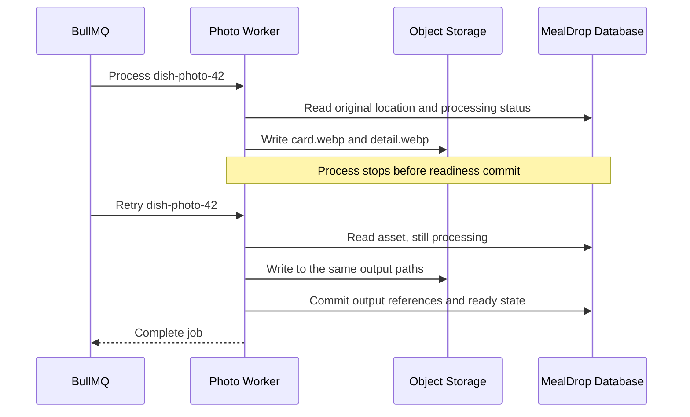

Retries write the same files; completed assets are skipped.

## 3. Concurrency and parallelism

### Concurrency

Concurrency means multiple tasks are in progress during overlapping time
periods. Tasks can alternate execution or overlap their I/O waits.

- One process starts ten file downloads and handles responses as they arrive.
- A web server handles other requests while one request waits for a database.

### Parallelism

Parallelism means tasks execute at the same time on separate execution
resources, such as CPU cores.

- Four CPU cores process four data partitions at the same time.
- Two CPU cores compress separate archives at the same time.

### Worker runner specification

The photo and video pools use separate runners with these resources:

| Resource | Runner specification |
| --- | --- |
| CPU allocation | 2 vCPU |
| CPU budget for job work | 1.5 vCPU; reserve 0.5 for runtime and overhead |
| Memory limit | 1 GiB = 1024 MiB |
| Runtime memory reserve | 128 MiB |
| Temporary disk | 1 GiB; one directory per active job |
| Photo execution | One Node.js process; Sharp with one libvips thread per image |
| Video execution | One Node.js queue process; one FFmpeg child per active job |
| Database pool | At most 2 connections per runner; transactions are short |
| Object Storage budget | 5 operations/s across both media pools |

Video worker deployment with one replica:

```yaml
apiVersion: apps/v1
kind: Deployment
metadata:
  name: mealdrop-video-worker
spec:
  replicas: 1
  selector:
    matchLabels:
      app: mealdrop-video-worker
  template:
    metadata:
      labels:
        app: mealdrop-video-worker
    spec:
      terminationGracePeriodSeconds: 150
      containers:
        - name: worker
          image: registry.example.com/mealdrop-media-worker:v1
          args: ["video"]
          env:
            - name: WORKER_CONCURRENCY
              value: "1"
          resources:
            requests:
              cpu: "2"
              memory: 1Gi
            limits:
              cpu: "2"
              memory: 1Gi
          volumeMounts:
            - name: work
              mountPath: /work
      volumes:
        - name: work
          emptyDir:
            sizeLimit: 1Gi
```

Build the worker image for this deployment; allocate node capacity for all
replicas.
CPU limits can throttle execution; CPU requests do not reserve exclusive cores.

### Job costs and traffic

Sizing assumptions for typical uploads: a 1920 x 1080 dish photo of about
2 MB, or a 15-second 1280 x 720 promotional video of about 10 MB.

| Measurement | Photo job, both variants | Video job, conversion and poster |
| --- | ---: | ---: |
| Mean wall time, including storage I/O | 1 s | 15 s |
| CPU budget per active job | 0.5 vCPU | 1 vCPU |
| Peak incremental memory per active job | 128 MiB | 512 MiB |
| Peak temporary disk per active job | 15 MiB | 150 MiB |
| Normal arrival rate | 6 jobs/min | 1 job/min |
| Burst arrival rate | 30 jobs/min for 2 min | 6 jobs/min for 3 min |

These are example values; benchmark typical and maximum accepted inputs
at the selected concurrency before deployment.

Resource ceilings:

```text
CPU ceiling = floor(job CPU budget / CPU budget per active job)
Memory ceiling = floor((memory limit - runtime reserve) / job memory)
Disk ceiling = floor(temporary disk budget / temporary bytes per job)
Affordable concurrency <= minimum of these ceilings

Photo CPU ceiling = floor(1.5 / 0.5) = 3
Photo memory ceiling = floor((1024 - 128) / 128) = 7
Photo disk ceiling = floor(1024 / 15) = 68
Photo resource ceiling = 3 jobs/runner

Video CPU ceiling = floor(1.5 / 1) = 1
Video memory ceiling = floor((1024 - 128) / 512) = 1
Video disk ceiling = floor(1024 / 150) = 6
Video resource ceiling = 1 job/runner
```

Required active jobs with a 20% capacity margin:

```text
Required active jobs = ceil(arrival rate per second * mean wall time * 1.20)

Photos = ceil((6 / 60) * 1 * 1.20) = 1
Videos = ceil((1 / 60) * 15 * 1.20) = 1
```

Pool configuration:

- **Photos:** one runner, concurrency 1, capacity 60 jobs/min.
- **Videos:** one runner, concurrency 1, capacity 4 jobs/min.

Both pools meet normal demand with the 20% capacity margin. The photo runner
fits up to 3 active jobs by CPU and memory; higher concurrency must also fit
the storage budget. Higher video throughput requires another runner.

### Video runner processes

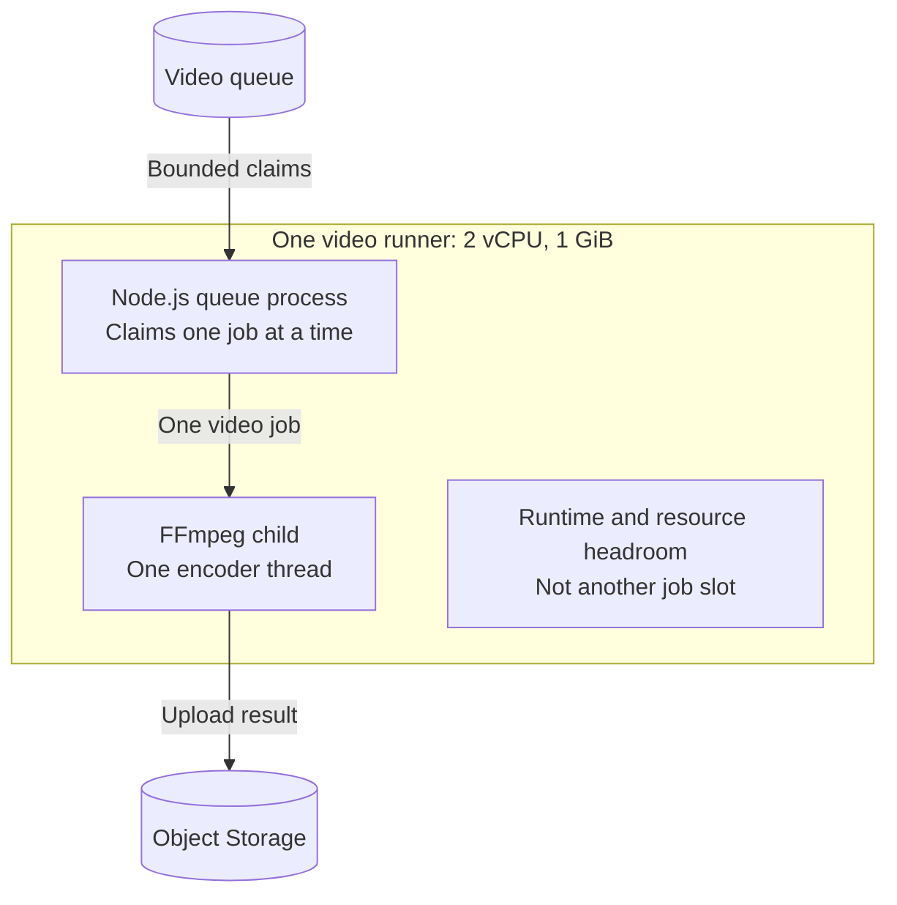

The video runner processes one job; the photo runner can execute in parallel.

### Dependency capacity and burst recovery

Each media job makes one original read and two output writes.

```text
Photo capacity = 1 job / 1 s = 1 job/s
Video capacity = 1 job / 15 s = 0.067 jobs/s
Storage traffic at full processing capacity = (1 + 1/15) * 3 = 3.2 operations/s
3.2 operations/s < allocated 5 operations/s
```

Apply a shared storage limit; also check bytes/s, connections, and request
latency.

The photo burst fits within 60 jobs/min. The video burst exceeds 4 jobs/min:

```text
Video capacity = 1 runner * 1 job / 15 s = 4 jobs/min
Backlog added = (6 - 4) jobs/min * 3 min = 6 jobs
After burst: net drain = 4 - 1 = 3 jobs/min
Drain time = 6 / 3 = 2 min
Approximate wait at burst end = 6 / 4 = 1.5 min
```

Check oldest-job age and completion percentiles; defer uploads when waiting
time exceeds the product limit.

## 4. Retries and recovery

### Retry and idempotency

A **retry** repeats an operation after a failure or an unknown result.

- A client retries a file download after the connection drops.
- A worker retries a database write after a temporary connection failure.

**Idempotency** means repeating the same operation has the same intended
effect as performing it once.

- Setting a subscription to `cancelled` twice leaves it cancelled.
- Retrying a payment with the same idempotency key returns the existing
  payment instead of charging the Customer again.

### Failure classification

| Outcome | Meaning | Response |
| --- | --- | --- |
| Object Storage timeout | Temporary failure; write result can be unknown | Retry with the same object identity and verify existing output |
| Provider rate limit | Too many requests | Respect retry time and the shared request limit |
| Invalid image or excessive duration | Input violates product rules | Fail permanently; tell the Restaurant |
| Database unavailable | Completion cannot be confirmed | Retry; keep outputs and processing identity |
| Worker stopped | Work may be partly complete | Recover the job and re-read stored progress |
| Attempts exhausted | Automatic recovery has stopped | Retain failure and require a reviewed retry |

### Timeouts and deadlines

An **attempt timeout** limits the duration of one execution or request.

- An HTTP client stops waiting for a response after five seconds.
- A report worker stops a calculation that exceeds ten minutes.

A **business deadline** is the latest acceptable completion time. Retries
do not extend it.

- A verification link must reach the recipient before its ten-minute expiry.
- A shipment-label workflow must finish before the warehouse's 17:00 cutoff.

### Backoff and jitter

**Backoff** is a delay between retry attempts. Exponential backoff increases
the delay after each failure, up to a limit.

**Jitter** adds randomness to the delay so failed jobs do not all retry at once.

- A client waits one, two, and four seconds between failed connection attempts.
- Workers choose different retry delays between two and four seconds after
  a shared service outage.

```text
Base retry delay = min(30 s, 1 s * 2^(attempt - 1))
Actual delay = base delay * random value in [0.5, 1.0]
Maximum automatic attempts = 5, including the first attempt
```

Enqueue after the processing request commits:

```typescript
await photoQueue.add("process-photo", {
  assetId,
}, {
  jobId: "media-" + assetId,
  attempts: 5,
  backoff: { type: "exponential", delay: 1000, jitter: 0.5 },
  removeOnComplete: { age: 3600, count: 1000 },
});
```

`photoQueue` is a shared BullMQ `Queue` instance.

### At-least-once execution

At-least-once execution means a job runs one or more times. It does not
guarantee that every attempt succeeds; repeated attempts need safe effects.

- A worker stores a generated report but stops before acknowledging the job;
  another worker receives the same job and reuses the report.
- A worker retries a payment after losing the response; the payment service
  returns the existing payment using the same idempotency key.

### Missing-job repair

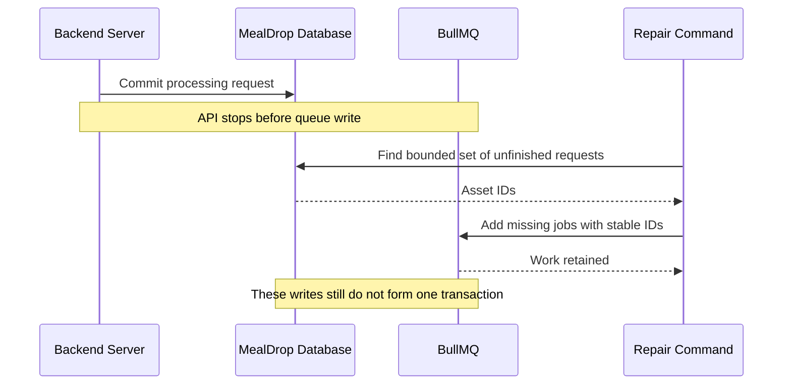

Repair recreates missing jobs from saved requests using the same identities.

During shutdown, the worker stops claiming jobs and allows active jobs to finish.

Monitoring metrics:

- Oldest waiting work and end-to-end completion time.
- Failed or stalled jobs.
- Dependency errors and request-limit responses.
- Stored processing requests without an executable job.
- Successful business completion, separately from successful enqueue.

## 5. Rush-hour cashback with cron

### Scheduled processing

**Scheduled processing** starts work at predefined times or intervals.
Media jobs start after an upload. Cashback distribution starts at 02:00 UTC
each day and processes a batch of completed Orders.

### Cron and cron jobs

**Cron** is a background program on Unix and Linux that starts commands at
specified times.

A **cron job** is a command paired with a schedule. The command can process
a batch directly or add jobs to a queue for workers.

A **crontab** lists cron jobs. Each entry in a user's crontab has five schedule
fields followed by the command to run:

```text
minute hour day-of-month month day-of-week command
```

| Field | Allowed values |
| --- | --- |
| Minute | 0-59 |
| Hour | 0-23 |
| Day of the month | 1-31 |
| Month | 1-12 |
| Day of the week | 0-6; 0 is Sunday |

`*` means every allowed value in that field. Cron uses its configured time
zone; these examples use UTC:

```cron
0 1 * * * /app/backup-database
0 3 * * 0 /app/delete-expired-files
```

- The first job starts a database backup every day at 01:00 UTC.
- The second job deletes expired files every Sunday at 03:00 UTC.

`crontab -e` opens the current user's crontab for editing.
`crontab -l` lists that user's configured jobs.

Cron starts the command; the command handles progress, retries, and completion.

### Cashback rules

Credit the Customer's rewards balance using the Restaurant's local submission
time:

| Local submission time | Promised cashback |
| --- | ---: |
| 12:00 <= time < 14:00 | 5% |
| 18:00 <= time < 20:00 | 5% |
| Other times | 2% |

Restaurant time zone: `Europe/Chisinau`.

- Save the cashback rate with the Order when it is submitted.
- Eligible amount is paid food after discounts, excluding delivery fees and
  tips.
- Credit paid, completed Orders.

```text
Eligible amount = EUR 40.00 = 4000 cents
Rush-hour credit = 4000 * 500 / 10000 = 200 cents = EUR 2.00
Other-time credit = 4000 * 200 / 10000 = 80 cents = EUR 0.80
```

Round half up with integer cent arithmetic:

```typescript
function cashbackCents(foodCents: bigint, rateBps: bigint): bigint {
  return (foodCents * rateBps + 5000n) / 10000n;
}
```

### Daily schedule: 02:00 UTC

Configure the cron daemon to use UTC:

```cron
0 2 * * * /app/distribute-cashback
```

`0 2 * * *` selects minute 0, hour 2, every day. Cron starts
`/app/distribute-cashback` at 02:00 UTC.

The command processes Orders completed during the previous UTC day.

An Order submitted at 13:50 but completed tomorrow keeps its 5% rate and joins
tomorrow's UTC completion interval.

### Scheduled cashback processing

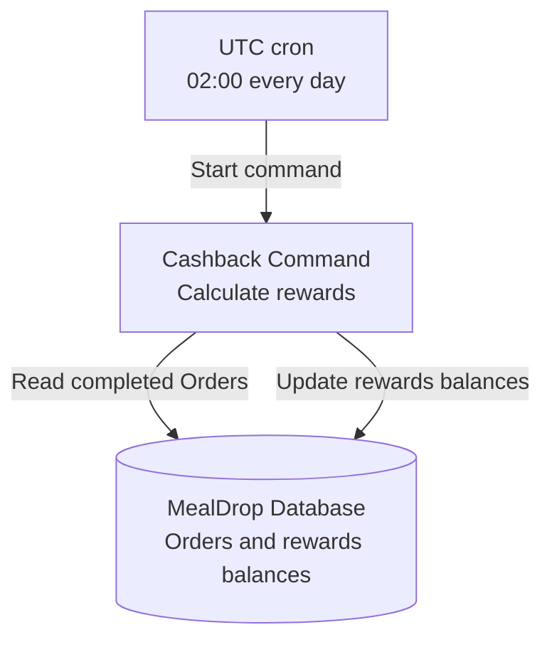

Cron supplies the time trigger; the command calculates and credits cashback.

## 6. Restaurant processing with a durable workflow

### Acceptance rules

The Order contains two tomato soups.

| Resource or decision | Starting condition |
| --- | --- |
| Kitchen slot | At most 8 Orders in one ten-minute preparation slot; 7 already reserved |
| Tomatoes | 700 g available; this Order needs 500 g |
| Bread | 4 portions available; this Order needs 2 |
| Manager decision | Approve or reject within 120 seconds of reservation |
| Reminder | Send after 60 seconds if no decision is recorded |

- Keep `pending`: the Restaurant has not accepted the Order.
- Approval changes `pending` to `active`.
- Rejection sets `rejected`; a missed deadline sets `expired`.
- Capacity and ingredients are held while waiting for the decision.
- Rejection or expiry releases the holds. Approval transfers them to
  preparation.

### Restaurant Processing: Container View

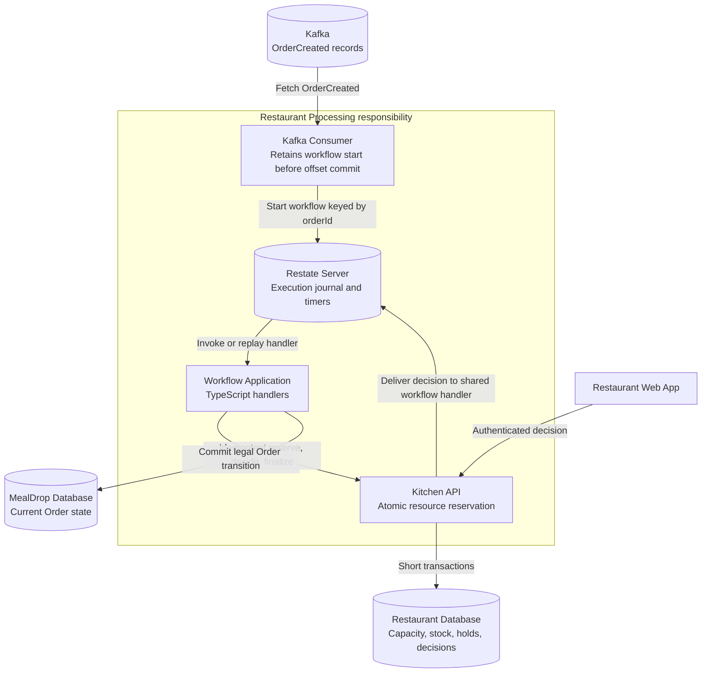

Restate records workflow progress; Kitchen API reserves shared resources.

### Workflow Application: Component View

```mermaid
flowchart TB
    subgraph app["Workflow Application"]
        checks["Availability Checks<br/>Read capacity and ingredients"]
        reserve["Reservation Step<br/>Recheck and reserve together"]
        request["Approval Request Step<br/>Fixed reservation deadline"]
        wait["Decision Wait<br/>Durable event or deadline"]
        finalize["Finalization Step<br/>Accept, reject, or expire"]
        notify["Result Step<br/>Update Order and request notification"]
        checks -->|"Advisory results"| reserve
        reserve -->|"Saved hold and deadline"| request
        request -->|"Manager review requested"| wait
        wait -->|"Candidate decision"| finalize
        finalize -->|"Stored final result"| notify
    end
```

Checks are advisory; the reservation transaction rechecks and allocates
resources.

Two capacity and ingredient reads can overlap:

```typescript
const [capacity, ingredients] = await restate.RestatePromise.all([
  ctx.run("capacity-check", () => kitchen.getCapacity(orderId)),
  ctx.run("ingredient-check", () => kitchen.getIngredients(orderId)),
]);
```

Restate records both results for replay.

### Kitchen API contract

| Operation | Database rule |
| --- | --- |
| `reserve(orderId)` | Lock the preparation slot and required inventory rows in a stable order; reserve all resources or none |
| Repeated reservation | Return the existing hold and its original deadline |
| `recordDecision(orderId, decision)` | Lock the hold; store the first valid manager decision before the deadline |
| `finalize(orderId)` | Under the same hold lock, accept a valid decision or expire a hold whose deadline has passed |
| Repeated finalization | Return the stored final outcome without decrementing or releasing resources again |
| Release | Restore held stock and capacity exactly once through the hold's status transition |

- Reject insufficient capacity or ingredients; retry database timeouts.
- Store `order_id`, `restaurant_id`, slot, quantities, `deadline_at`, and hold
  status.
- Make `order_id` unique to prevent repeated reservations.
- Close transactions before HTTP calls or manager waits.

### Competing reservations and compensation

**Compensation** is a new operation that reverses a previous business effect
when the workflow cannot continue.

- A booking workflow releases a reserved room after payment is declined.
- A purchase workflow refunds a payment after the supplier cancels delivery.

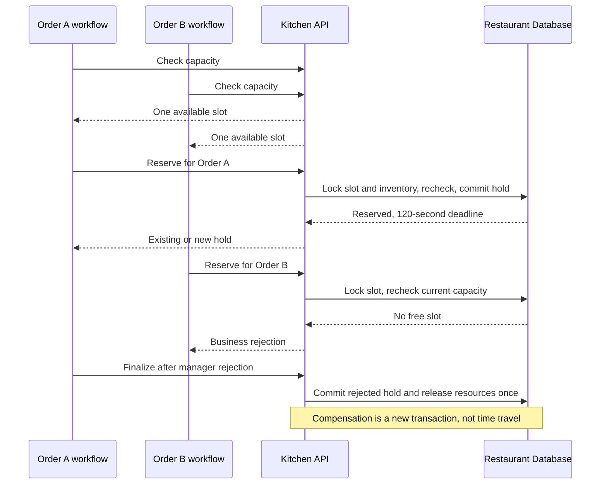

The reservation lock allocates the last slot; rejection releases it in a new
transaction.

### Restate implementation

Install the TypeScript SDK:

```bash
npm install @restatedev/restate-sdk
```

This fragment uses `kitchen`, `orders`, and `notifications` clients with the
contracts above, request timeouts, and operation keys based on `orderId`.

```typescript
import * as restate from "@restatedev/restate-sdk";

type Decision = "approve" | "reject";
type Outcome = "active" | "rejected" | "expired";

export const restaurantWorkflow = restate.workflow({
  name: "RestaurantOrder",
  handlers: {
    run: async (ctx: restate.WorkflowContext) => {
      const orderId = ctx.key;
      await restate.RestatePromise.all([
        ctx.run("capacity-check", () => kitchen.getCapacity(orderId)),
        ctx.run("ingredient-check", () => kitchen.getIngredients(orderId)),
      ]);
      const hold = await ctx.run("reserve", () => kitchen.reserve(orderId));
      if (!hold.reserved) {
        await ctx.run("reject-order", () => orders.finish(orderId, "rejected"));
        return "rejected";
      }

      await ctx.run("request-review", () => notifications.requestReview(orderId));
      const decision = ctx.promise<Decision>("manager-decision").get();
      const reminderDelay = Math.max(0, hold.deadlineAt - 60_000 - await ctx.date.now());
      const first = await restate.RestatePromise.race([
        decision,
        ctx.sleep(reminderDelay).map(() => "reminder" as const),
      ]);
      if (first === "reminder") {
        await ctx.run("reminder", () => notifications.remindIfUndecided(orderId));
        const remaining = Math.max(0, hold.deadlineAt - await ctx.date.now());
        await restate.RestatePromise.race([
          decision,
          ctx.sleep(remaining).map(() => "deadline" as const),
        ]);
      }

      const outcome: Outcome = await ctx.run("finalize", () => kitchen.finalize(orderId));
      await ctx.run("update-order", () => orders.finish(orderId, outcome));
      await ctx.run("notify-result", () => notifications.sendResult(orderId, outcome));
      return outcome;
    },
    decision: async (ctx: restate.WorkflowSharedContext, input: Decision) => {
      const saved = await ctx.run("record-decision", () => kitchen.recordDecision(ctx.key, input));
      if (saved.accepted) await ctx.promise<Decision>("manager-decision").resolve(saved.decision);
      return saved;
    },
  },
});
```

- `ctx.run` records successful step results.
- `orderId` identifies the workflow; its promise receives the manager decision.
- Durable timers survive restarts and use the original reservation deadline.
- `finalize` uses the saved decision and deadline to settle the outcome.
- Kitchen API authenticates the Restaurant, checks ownership,
  and validates decisions before forwarding.
- Accept approvals saved before the deadline, even if their notification arrives
  late.
- Reject late decisions and conflicting callbacks; return saved identical
  decisions.
- Retry transient failures with bounded request timeouts.
- Retain failed finalization and release operations for retry or repair.
- A Kitchen repair command finds expired open holds if the workflow is
  unavailable.

### Replay and external effects

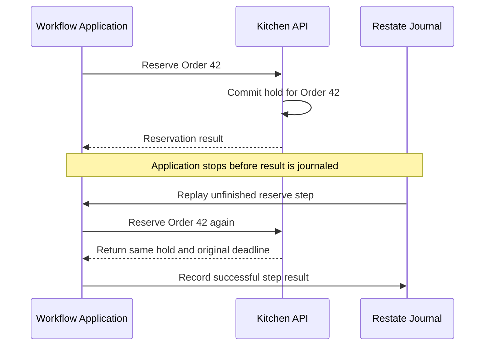

The Kitchen's unique reservation key protects a write repeated before journal
confirmation.

Keep database duplicate checks beyond Restate's retention period.
See [durable steps](https://docs.restate.dev/develop/ts/durable-steps),
[external events](https://docs.restate.dev/develop/ts/external-events), and
[durable timers](https://docs.restate.dev/develop/ts/durable-timers).

### Temporal alternative

| Underlying concept | Restate example | Temporal alternative |
| --- | --- | --- |
| Stable execution identity | Workflow key | Workflow ID |
| Recorded external step | `ctx.run` | Activity |
| External decision | Workflow promise or signal | Signal or Update |
| Persistent wait | Durable timer | Workflow timer |
| Recovery | Replay using recorded operations | Replay using event history |
| External duplicate protection | Kitchen reservation key and transaction | Same Kitchen reservation key and transaction |

A database state machine and queue jobs can implement the same rules, with
application code for progress, timers, and recovery.

## 7. Kafka handoffs and completion events

### Workflow start and result publication

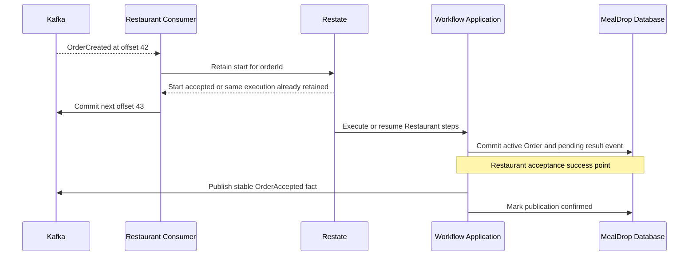

Commit the offset after workflow start is retained; publish after Order commit.

- Verify stored workflow identity when a repeated start reports an existing
  execution.
- Commit the Order transition and pending result event in one transaction.
- Retry pending publications with stable event IDs.
- Consumers deduplicate result events because lost acknowledgements can cause
  republication.
- Use the same pattern for `MediaReady` and `CashbackCredited`.

## 8. Concepts in MealDrop

| Concept | MealDrop |
| --- | --- |
| Stable identity | Asset ID and Order ID |
| Retained progress | Media status, workflow steps and holds |
| Scheduling | Nightly cashback and manager deadline |
| Concurrency | Bounded Sharp and FFmpeg work |
| Duplicate handling | Ready asset check and unique reservation |
| Recovery | Missing-job repair and compensation |
| Observable result | Ready asset, credited balance, accepted Order |

BullMQ provides job delivery; Restate and Temporal provide durable execution.
The application defines work identities, business rules, and safe effects.

## References

- [BullMQ workers and concurrency](https://docs.bullmq.io/guide/workers/concurrency)
- [BullMQ Job Schedulers](https://docs.bullmq.io/guide/job-schedulers)
- [BullMQ rate limiting](https://docs.bullmq.io/guide/rate-limiting)
- [BullMQ stalled jobs](https://docs.bullmq.io/guide/jobs/stalled)
- [Sharp metadata](https://sharp.pixelplumbing.com/api-output/)
- [FFmpeg documentation](https://ffmpeg.org/ffmpeg.html)
- [POSIX crontab](https://pubs.opengroup.org/onlinepubs/9699919799/utilities/crontab.html)
- [Restate services](https://docs.restate.dev/develop/ts/services)
- [Restate concurrency](https://docs.restate.dev/develop/ts/concurrent-tasks)
- [Restate sagas](https://docs.restate.dev/guides/sagas)
- [Temporal TypeScript guide](https://docs.temporal.io/develop/typescript)
