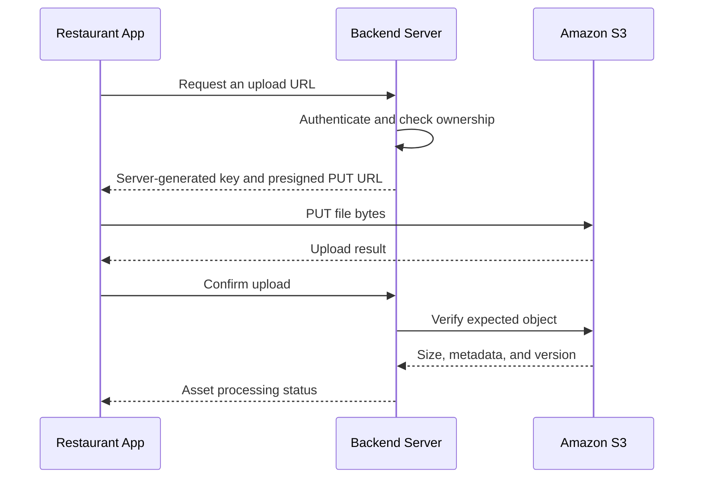
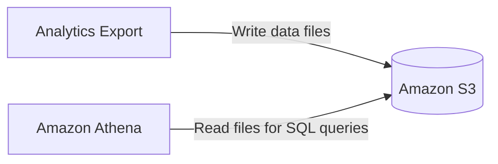
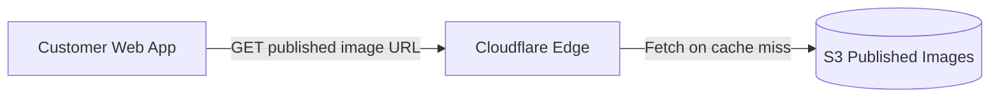
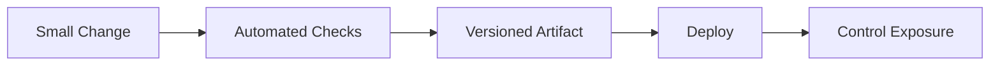

# Lecția 9: Stocare de obiecte, livrarea conținutului, observabilitate și lansări sigure

## Obiective de învățare

- Explică când să stochezi fișiere într-un serviciu de stocare de obiecte.
- Descrie cum un server edge al unui CDN reduce latența și încărcarea sursei.
- Folosește loguri structurate, metrici și trace-uri pentru a înțelege comportamentul sistemului.
- Explică modul în care livrarea continuă permite lansări mai mici și mai sigure.

MealDrop acceptă deja fotografii și videoclipuri de la Restaurante. Workerii
creează rezultatele necesare și marchează un Asset ca `ready`.

## 1. Stocare de obiecte: Amazon S3

### Obiecte, bucket-uri și chei

**Stocarea de obiecte** păstrează datele ca obiecte accesate printr-un API.
Amazon Simple Storage Service, sau **Amazon S3**, este exemplul folosit aici.

| Termen | Semnificație | Exemplu |
| --- | --- | --- |
| Bucket | O colecție de obiecte | `mealdrop-media` |
| Cheie | Numele unui obiect dintr-un bucket | `assets/8b19/v1/menu-card.webp` |
| Corp | Octeții stocați | Conținutul unei imagini WebP |
| Metadate | Informații despre obiect | `Content-Type: image/webp` |
| ID de versiune | Identitatea unei versiuni stocate când este activată păstrarea versiunilor | O valoare atribuită de S3 |

```text
s3://mealdrop-media/assets/8b19/v1/menu-card.webp
     bucket         object key
```

Într-un bucket de uz general, `/` face parte din cheie. Prefixele ajută la
organizarea obiectelor; ele nu creează directoare într-un sistem de fișiere.

- `PUT` stochează un obiect.
- `GET` citește octeții acestuia.
- `HEAD` citește metadatele fără corp.
- `DELETE` șterge un obiect sau creează un marcaj de ștergere, în funcție de păstrarea versiunilor.
- Listarea după prefix găsește cheile obiectelor asociate.

S3 Versioning poate păstra versiunile anterioare după o suprascriere sau ștergere.
Versiunile păstrate consumă și ele spațiu de stocare.

### Alege S3 în funcție de modul de acces

| Date | Utilizare potrivită pentru S3 |
| --- | --- |
| Imagini și videoclipuri | Stochează originalele și variantele procesate |
| Fișiere mari | Stochează fișiere pentru descărcare, înregistrări, seturi de date și exporturi generate |
| Copii de siguranță | Păstrează fișiere de backup ale bazei de date și alte copii pentru recuperare |
| Arhive | Păstrează fișiere mai vechi cu o politică definită de acces și retenție |
| Date pentru analiză | Stochează exporturi de evenimente și seturi de date istorice pentru motoare de interogare |

Pentru MealDrop:

- S3 stochează octeții fotografiilor și videoclipurilor.
- Baza de date a aplicației stochează proprietarul, starea procesării și cheile fiecărui Asset.
- Baza de date răspunde la întrebarea "Ce fotografie pregătită aparține acestui Restaurant?"
- S3 returnează octeții pentru cheia și versiunea selectate.

O bază de date poate stoca valori binare, dar fișierele mari sporesc volumul de
stocare, backup și transfer. Discul local al unui Worker este util pentru
fișierele temporare de procesare. O altă instanță Worker nu are automat acele
fișiere. S3 permite instanțelor să acceseze fișiere independent de discurile locale.

### Încărcări directe cu URL-uri presemnate

Un **URL presemnat** acordă permisiunea pentru o anumită operație S3 asupra unui
anumit obiect, pentru un timp limitat. Backend-ul îl semnează folosind propriile
permisiuni de stocare.

Restaurantul trimite octeții fișierului direct către S3:



Astfel, transferul fișierului este eliminat din calea cererii către Backend.
Backend-ul controlează în continuare cine poate încărca și când devine utilizabil fișierul.

- Păstrează credențialele AWS pe server.
- Generează cheia obiectului pe server și păstrează originalele private.
- Verifică obiectul așteptat, dimensiunea și proprietarul după încărcare.
- Configurează Workerul să inspecteze octeții fișierului și să aplice limitele de procesare.
- Marchează Asset ca `ready` după ce există toate rezultatele necesare.

URL-ul este o permisiune temporară: oricine îl deține îl poate folosi. URL-urile
presemnate S3 pot fi refolosite înainte de expirare. O încărcare la aceeași cheie
poate înlocui octeții curenți. Înregistrează versiunea verificată și configurează
Workerul să citească acea versiune sau copiază datele de intrare la o cheie
controlată de server înainte de procesare.

Fluxul existent cu coadă și Worker începe după verificarea încărcării. Un fișier
stocat nu înseamnă, de unul singur, că procesarea sau publicarea a reușit.

### Fișiere mari și încărcări multipart

O încărcare mare poate eșua aproape de final. Retrimiterea întregului fișier
consumă timp și lățime de bandă.

**Încărcarea multipart** împarte un obiect în părți:

1. Începe o încărcare și păstrează ID-ul acesteia.
2. Încarcă părțile independent, cu paralelism limitat.
3. Reîncearcă părțile care au eșuat.
4. Finalizează încărcarea pentru ca S3 să asambleze obiectul.

Rezultatul este un singur obiect. Aplicația poate relua lucrul neterminat cât
timp păstrează ID-ul încărcării și informațiile despre părțile finalizate.
Anulează încărcările abandonate, astfel încât părțile neterminate să nu continue
să consume spațiu de stocare.

### Copii de siguranță, retenție și cost

Un fișier de backup și un export pentru analiză au scopuri diferite:

| Artefact | Scop principal | Validare |
| --- | --- | --- |
| Copie de siguranță a bazei de date | Restabilește starea bazei de date | Restaureaz-o și verifică înregistrările necesare |
| Export pentru analiză | Răspunde la întrebări despre trecut | Verifică schema, caracterul complet al datelor și rezultatele interogărilor |

O copie de siguranță poate folosi un format specific bazei de date pe care
Athena nu îl poate interoga direct. Un export zilnic pentru analiză poate omite
informații necesare pentru recuperare.

- Folosește metoda de backup acceptată de baza de date pentru a obține o copie consistentă.
- Definește reguli de retenție și acces pentru copiile de recuperare.
- Testează restaurarea; simpla încărcare a unui fișier de backup nu dovedește că recuperarea funcționează.
- Folosește reguli S3 Lifecycle pentru a muta obiectele între clase de stocare sau a le șterge la expirare, conform politicii.
- Selectează clasele de stocare în funcție de frecvența accesului și întârzierea acceptabilă la recuperare.
- Estimează stocarea, cererile, transferul, versiunile păstrate și părțile neterminate.

### Interoghează datele pentru analiză stocate în S3

Un **data lake** stochează seturi de date ca fișiere pe care instrumentele de
procesare și interogare le pot citi. S3 poate păstra aceste fișiere. Nu execută
singur SQL.

**Amazon Athena** este un serviciu de interogare care poate executa SQL peste
datele din S3. Metadatele tabelelor descriu schema, formatul și locațiile
fișierelor. Athena poate folosi AWS Glue Data Catalog pentru aceste metadate.

**ClickHouse** poate, de asemenea, să interogheze direct fișiere S3 cu funcția de
tabel `s3()`. Consultă
[exemplele de interogări S3](https://clickhouse.com/docs/reference/functions/table-functions/s3).



De exemplu, exportă Comenzile finalizate într-un set separat de date pentru analiză:

```text
s3://mealdrop-analytics/orders/order_date=2026-11-12/part-0001.parquet
```

Presupune că tabelul înregistrat `analytics.orders` are partiția de tip șir de
caractere `order_date` și câmpurile `restaurant_id` și `total_cents`:

```sql
SELECT restaurant_id, SUM(total_cents) AS sales_cents
FROM analytics.orders
WHERE order_date = '2026-11-12'
GROUP BY restaurant_id;
```

- **Parquet** este un format de fișier orientat pe coloane. O interogare poate
  citi coloanele selectate în loc de fiecare câmp din fiecare rând.
- **Partiționarea** grupează datele după un câmp, cum ar fi data. Un filtru
  potrivit poate permite motorului să ignore partițiile care nu sunt relevante.
- Înregistrează sau descoperă partițiile în metadatele tabelului; numele unui
  director nu configurează singur tabelul.
- Pentru interogările SQL Athena tarifate după octeții scanați, citirea unui
  volum mai mic de date reduce costul interogării.

Analiza istorică rulează pe setul de date exportat. Baza de date a aplicației
continuă să gestioneze operațiile curente cu Comenzi.

**Discută:** Un export nocturn de Comenzi poate fi citit în Athena. Ce dovezi
mai sunt necesare înainte de a-l numi copie de siguranță a bazei de date?

### Referințe despre S3 și analiza datelor

- [Prezentare generală S3](https://docs.aws.amazon.com/AmazonS3/latest/userguide/Welcome.html)
  explică funcțiile și cazurile de utilizare.
- [Obiecte](https://docs.aws.amazon.com/AmazonS3/latest/userguide/UsingObjects.html)
  și [păstrarea versiunilor](https://docs.aws.amazon.com/AmazonS3/latest/userguide/Versioning.html)
  explică identitatea obiectelor și versiunile păstrate.
- [URL-uri presemnate](https://docs.aws.amazon.com/AmazonS3/latest/userguide/using-presigned-url.html)
  explică permisiunile temporare de încărcare și descărcare.
- [Încărcări multipart](https://docs.aws.amazon.com/AmazonS3/latest/userguide/mpuoverview.html)
  explică încărcarea părților, finalizarea și recuperarea.
- [S3 Lifecycle](https://docs.aws.amazon.com/AmazonS3/latest/userguide/object-lifecycle-mgmt.html)
  explică mutarea între clase de stocare și expirarea.
- [Athena](https://docs.aws.amazon.com/athena/latest/ug/what-is.html),
  [partiționarea](https://docs.aws.amazon.com/athena/latest/ug/partitions.html)
  și
  [formatele orientate pe coloane](https://docs.aws.amazon.com/athena/latest/ug/columnar-storage.html)
  explică interogările pe seturi de date S3 și reducerea volumului de date scanate.

## 2. CDN: Cloudflare

### De ce sunt importante serverele edge

O **rețea de livrare a conținutului (CDN)** are servere în multe locații.
O **sursă (origin)** păstrează conținutul original. Un **server edge** primește
cererile celor care accesează conținutul și poate servi răspunsuri din cache.

Dacă un Client este departe de sursă, cererile și răspunsurile parcurg un traseu
lung prin rețea. Codul mai rapid la sursă nu poate elimina acest timp de
transfer prin rețea. Un server edge apropiat poate returna conținutul din cache
pe un traseu mai scurt.

[Performanța Cloudflare CDN](https://www.cloudflare.com/learning/cdn/performance/).

Măsura importantă este timpul dus-întors prin rețea. Cloudflare folosește rutare
anycast pentru a ajunge la un server edge; rutarea selectează un traseu de rețea,
care nu ajunge întotdeauna la locația cea mai apropiată geografic.

### Un cache miss și un cache hit

La un **cache miss**, serverul edge trebuie să obțină conținutul de la sursă.
La un **cache hit**, serverul edge poate returna un răspuns utilizabil din cache.

- Un hit evită o cerere către sursă și transferul asociat.
- Un miss depinde în continuare de sursă.
- Servere edge diferite pot avea obiecte diferite în cache.
- Un cache poate elimina un obiect înainte de sfârșitul perioadei de prospețime.

### Calea imaginilor publicate în MealDrop

Aici este necesară doar calea de citire pentru o imagine pregătită și publică:



Răspunsul cu meniul furnizează URL-ul curent al imaginii. Octeții imaginii se pot
încărca apoi fără un apel către Backend. Originalele rămân în afara acestei căi publice.

Accesul la sursa S3 trebuie configurat pentru ca Cloudflare să poată prelua
obiectele publicate. O sursă S3 privată și un URL CDN public sunt alegeri de acces
separate. Descărcările private necesită și autorizarea celui care accesează
conținutul, inclusiv la cache hit-uri.

### Chei de cache și prospețime

O **cheie de cache** stabilește ce cereri pot refolosi același răspuns din cache.
Dacă dimensiunea imaginii schimbă răspunsul, dimensiunea trebuie să influențeze
cheia. Includerea variantelor în cale face diferența explicită:

```text
/assets/8b19/v1/menu-card.webp
/assets/8b19/v1/detail.webp
```

O **durată de viață (TTL)** definește o perioadă de prospețime. Două politici de cache sunt:

```http
Cache-Control: public, max-age=300
```

```http
Cache-Control: public, max-age=31536000, immutable
```

| Politică | Beneficiu | Consecință |
| --- | --- | --- |
| Prospețime de cinci minute | Refolosire normală mai scurtă înainte de validare sau o nouă preluare | Mai multe cereri ajung la sursă |
| Prospețime îndelungată cu URL-uri imuabile | Mai multă refolosire a unui fișier neschimbat | Copiile existente din browser pot rămâne utilizabile mult timp |

- Cu URL-uri imuabile, octeții modificați necesită o cheie și un URL noi.
- `immutable` nu împiedică o suprascriere în S3; aplicația impune această regulă.
- Răspunsul cu meniul are nevoie de propria politică de prospețime pentru a furniza noile URL-uri ale imaginilor.
- `no-cache` permite stocarea, dar cere validare înainte de refolosire.
- `no-store` indică cache-urilor să nu stocheze răspunsul.
- `private` împiedică stocarea în cache-uri partajate; nu autentifică persoana care accesează conținutul.

Prospețimea în browser și cea de pe serverul edge pot fi diferite. Verifică
împreună antetele răspunsului și Cloudflare Cache Rules.

### Eliminare, defecțiuni și cost

| Situație | Comportament așteptat |
| --- | --- |
| Backend indisponibil | URL-urile cunoscute ale imaginilor se pot încărca în continuare dacă livrarea CDN funcționează |
| S3 indisponibil | Hit-urile utilizabile pot reuși; cererile care necesită S3 pot eșua |
| Obiect șters din S3 | Un răspuns existent din cache poate fi servit în continuare |
| Cache Cloudflare golit | Cache-urile browserelor și copiile descărcate pot rămâne |

### Documentație Cloudflare pentru lectură și utilizare

- [Ce este un CDN?](https://www.cloudflare.com/learning/cdn/what-is-a-cdn/)
  explică mecanismul și beneficiile.
- [Performanța CDN](https://www.cloudflare.com/learning/cdn/performance/)
  conține ilustrațiile despre distanță și cache menționate mai sus.
- [Arhitectură de referință CDN](https://developers.cloudflare.com/reference-architecture/architectures/cdn/)
  prezintă surse, servere edge și rutare anycast. Figurile 1 și 2 compară livrarea
  fără și cu un CDN.
- [Primii pași cu Cache](https://developers.cloudflare.com/cache/get-started/)
  explică ce stochează Cloudflare în cache și condițiile care influențează stocarea.
- [Cache Rules](https://developers.cloudflare.com/cache/how-to/cache-rules/),
  [cheile de cache](https://developers.cloudflare.com/cache/how-to/cache-keys/) și
  [Origin Cache Control](https://developers.cloudflare.com/cache/concepts/cache-control/)
  descriu controlul comportamentului cache-ului.
- [Golirea cache-ului](https://developers.cloudflare.com/cache/how-to/purge-cache/)
  explică eliminarea din cache-urile Cloudflare.

## 3. Observabilitate: loguri, metrici și trace-uri

**Observabilitatea** este capacitatea de a înțelege comportamentul intern al unui
sistem din datele pe care le produce. Instrumentarea înregistrează aceste date.

Logurile, metricile și trace-urile sunt trei piloni folosiți frecvent:

| Pilon | Întrebare principală | Exemplu MealDrop |
| --- | --- | --- |
| Loguri | Ce s-a întâmplat în această operație? | Un Asset nu a trecut validarea |
| Metrici | Cât de des, cât de mult sau cât de lent? | Procentul încărcărilor care devin pregătite în timpul țintă |
| Trace-uri | Unde a consumat timp operația? | Un Worker a așteptat o citire din S3 |

Colectarea tuturor celor trei este utilă când ajută la răspunsul la întrebări
despre comportamentul real. Un dashboard singur nu explică fiecare defecțiune.

### Loguri structurate

Un log înregistrează un eveniment la un moment dat. **Logurile structurate**
folosesc câmpuri denumite, cu tipuri consistente. JSON este un format uzual.

```json
{
  "timestamp": "2026-11-12T10:15:30Z",
  "level": "error",
  "service": "media-worker",
  "env": "production",
  "version": "media-42",
  "event": "asset_processing_failed",
  "asset_id": "8b19",
  "job_id": "photo-8b19",
  "trace_id": "4bf92f3577b34da6a3ce929d0e0e4736",
  "span_id": "00f067aa0ba902b7",
  "duration_ms": 2030,
  "error_code": "S3_READ_TIMEOUT"
}
```

Aceste câmpuri permit filtre precise: serviciu, versiune, eveniment și cod de
eroare. ID-urile pentru Asset și job leagă încercările pentru același lucru.
ID-urile de trace și span leagă logul de calea de execuție înregistrată.

- Folosește un nume stabil pentru eveniment și câmpuri explicite pentru valorile care se schimbă.
- Folosește nivelurile în mod consistent: informație, avertisment și eroare necesită reguli de echipă.
- Înregistrează rezultate utile și contextul defecțiunilor.
- Exclude credențialele, URL-urile presemnate complete și conținutul fișierelor private.
- Definește retenția și accesul, deoarece logurile pot conține identificatori sensibili.

### Metrici

O metrică este o măsurătoare numerică urmărită în timp, adesea cu dimensiuni
precum serviciul, mediul și versiunea.

| Tip de metrică | Ce înregistrează | Exemplu |
| --- | --- | --- |
| Counter | Evenimente acumulate | Numărul încercărilor de procesare finalizate sau eșuate |
| Gauge | O valoare curentă | Numărul curent de Asset-uri în așteptare |
| Histogramă | O distribuție de observații | Durata procesării sau latența cererilor HTTP |

Din contoare, calculează o rată sau o proporție. Din observațiile de latență,
verifică percentile precum p95. O medie poate ascunde cererile lente.

Separă încercările de rezultate. Un Asset poate avea mai multe încercări eșuate
și totuși să devină pregătit. Numărarea joburilor, de una singură, nu măsoară
rezultatul pentru Utilizator.

De exemplu, definește:

```text
Dintre încărcările valide al căror termen de 60 de secunde s-a încheiat în ultima
oră, ce procent a devenit pregătit înainte de acel termen?
```

Termenul-limită este la 60 de secunde după finalizarea încărcării. Această măsură
necesită atât momentul finalizării, cât și momentul în care fișierul a devenit
pregătit și trebuie să includă încărcările valide care nu au devenit niciodată
pregătite. Urmărește și vechimea celui mai vechi Asset în așteptare, astfel încât
lucrul neterminat să rămână vizibil.

- Măsoară traficul, erorile, latența și utilizarea resurselor.
- Pentru conținutul media, adaugă timpul până la pregătire, vechimea lucrului în așteptare și numărul de Asset-uri eșuate.
- Pentru livrarea CDN, adaugă proporția de hit-uri, erorile sursei și octeții transferați.
- Folosește etichete cu un set limitat de valori, precum rezultat, serviciu și versiune.
- Păstrează ID-urile pentru fiecare Asset în loguri și trace-uri. O serie metrică
  pentru fiecare Asset creează multe combinații unice, adică **o cardinalitate
  ridicată**, și crește costul.

### Trace-uri și span-uri

Un **trace** înregistrează calea unei operații. Un **span** înregistrează o parte
cronometrată a acelei operații. Relațiile părinte-copil arată ce activitate a
apelat o alta.

Pentru încercarea eșuată din logul de mai sus, un trace ilustrativ ar putea fi:

```text
Trace: process Asset 8b19                    2030 ms
  Read Asset record                           10 ms
  S3 GET original: timeout                  2000 ms
  Record failed attempt                       20 ms
```

### Leagă pilonii în timpul unei investigații

Presupune că timpul până la pregătirea conținutului media crește după un deployment:

1. **Metrici:** identifică momentul în care a început schimbarea și versiunea afectată.
2. **Trace-uri:** verifică operațiile lente pentru a localiza timpul consumat.
3. **Loguri:** verifică erorile, încercările și rezultatele corespunzătoare.
4. **Din nou metrici:** verifică dacă recuperarea a îmbunătățit rezultatul pentru Utilizator.

### Grafana și Datadog

| Instrument | Rol | View tipic |
| --- | --- | --- |
| Grafana | Interoghează, vizualizează, explorează și alertează pe baza surselor de telemetrie conectate | Un dashboard legat de loguri și trace-uri |
| Datadog | O platformă găzduită pentru metrici, loguri, tracing, dashboarduri și alerte | Un view de serviciu care corelează semnalele după serviciu și versiune |

Grafana folosește frecvent Prometheus sau Mimir pentru metrici, Loki pentru
loguri și Tempo pentru trace-uri. Grafana Cloud oferă servicii gestionate.
Grafana în sine nu înlocuiește aceste backend-uri de stocare și interogare.

**OpenTelemetry** oferă instrumentare și export de telemetrie care pot funcționa
cu backend-uri diferite. Numele consistente ale serviciilor și câmpurile de
corelare fac utilă navigarea între semnale atât în Grafana, cât și în Datadog.

O alertă care permite o acțiune concretă are o condiție clară, un responsabil și
un pas următor. De exemplu, alertează la eșecul susținut de a produce conținut
media pregătit, cu un link către serviciul afectat și o procedură de recuperare.

### Referințe despre observabilitate

- [Introducere în observabilitate cu OpenTelemetry](https://opentelemetry.io/docs/concepts/observability-primer/) leagă instrumentarea de comportamentul sistemului.
- [Logurile](https://opentelemetry.io/docs/concepts/signals/logs/),
  [metricile](https://opentelemetry.io/docs/concepts/signals/metrics/) și
  [trace-urile](https://opentelemetry.io/docs/concepts/signals/traces/)
  explică cele trei semnale.
- [Bazele Grafana](https://grafana.com/docs/grafana/latest/fundamentals/)
  explică Grafana și backend-urile de telemetrie asociate.
- [Corelarea logurilor și trace-urilor în Datadog](https://docs.datadoghq.com/tracing/other_telemetry/connect_logs_and_traces/)
  arată cum câmpurile comune leagă dovezile operaționale.
- [Observability Engineering](https://www.oreilly.com/library/view/observability-engineering-2nd/9781098179915/)
  de Charity Majors, Liz Fong-Jones și George Miranda este recomandată pentru
  studiu aprofundat. Explică modul de a pune întrebări utile despre sistemele
  în funcțiune și de a îmbunătăți practicile de observabilitate.

## 4. CI/CD și lansări sigure

### Ce oferă CI/CD unei echipe

| Practică | Semnificație | Beneficiu principal |
| --- | --- | --- |
| Integrare continuă (CI) | Integrează schimbările frecvent și verifică-le prin compilări și verificări automate | Identifică devreme problemele de integrare |
| Livrare continuă | Păstrează software-ul verificat pregătit pentru deployment în producție la cerere | Face livrarea repetabilă și reduce efortul de lansare |
| Deployment continuu | Face automat deployment pentru schimbările care trec verificările de livrare | Scurtează calea de la o schimbare verificată la producție |

Instrumentele CI/CD automatizează părți ale acestui proces. Valoarea vine din
feedback rapid, schimbări repetabile și o cale de recuperare cunoscută.



Schimbările mici sunt mai ușor de verificat, observat și inversat decât multe
schimbări fără legătură lansate împreună. Promovează același artefact verificat
între medii, astfel încât producția să primească versiunea care a fost verificată.

### Deployment-ul și lansarea sunt decizii separate

- **Deployment:** instalează o versiune software într-un mediu.
- **Lansare:** expune un comportament nou Utilizatorilor.

Un **feature flag** selectează comportamentul fără un alt deployment al codului.
Pentru MealDrop, o cale nouă de procesare media poate fi instalată în timp ce
rămâne selectată calea existentă. Echipa o poate activa apoi pentru un grup limitat.

| Capacitate | Ce oferă echipei | Limită importantă |
| --- | --- | --- |
| Flag dezactivat după deployment | Timp pentru a verifica versiunea nouă înainte de expunerea largă | Defecțiunile la pornire sau în codul comun instalat pot afecta în continuare Utilizatorii |
| Activare pentru Utilizatori selectați | Feedback de la un grup controlat | Grupul poate să nu reprezinte toate volumele de lucru |
| Dezactivarea comportamentului nou | Recuperare rapidă pentru operațiile viitoare | Efectele deja produse există în continuare |

### Activare treptată și lansări canary

O **lansare canary** expune o versiune sau un comportament nou unui grup limitat
înainte de utilizarea mai largă. Expunerea poate fi controlată prin rutare sau
printr-un feature flag.

Un exemplu de activare treptată este:

```text
Internal Users -> 1% -> 10% -> 50% -> 100%
```

### Rollback și compatibilitate

Un **rollback** revine la o versiune sau un comportament care funcționa anterior.
Poate restabili serviciul mai repede decât așteptarea unei reparații complete.

| Acțiune de recuperare | Utilă când | Ce rămâne de rezolvat |
| --- | --- | --- |
| Dezactivează feature flag-ul | Comportamentul nou provoacă problema | Rezultatele existente, lucrul din coadă și schimbările stocate |
| Restaurează artefactul anterior | Versiunea instalată în sine este defectă | Compatibilitatea datelor și joburilor cu versiunea veche |
| Lansează o corecție | Revenirea este nesigură sau incompatibilă | Timpul necesar pentru a verifica și livra corecția |

Pregătește compatibilitatea înainte de lansare:

- Menține funcționale componentele vechi care citesc datele în timp ce introduci câmpuri sau formate noi.
- Păstrează rezultatele media anterioare și calea de procesare pe durata perioadei
  de recuperare.
- Ia în calcul joburile create de ambele versiuni.
- Elimină câmpurile, fișierele și căile vechi după încheierea perioadei de compatibilitate.

Schimbarea codului nu inversează o plată finalizată, nu restabilește un obiect
șters și nu retrage o imagine deja descărcată. Recuperarea poate necesita și
repararea datelor sau o operație de afaceri compensatorie.

Înregistrează versiunea și starea flag-ului în telemetrie. Astfel, o problemă
vizibilă este legată de comportamentul pe care l-a primit efectiv un Utilizator
sau un job.

### Referințe despre CI/CD

- [Integrare continuă](https://martinfowler.com/articles/continuousIntegration.html)
  explică integrarea frecventă și feedbackul rapid.
- [Livrare continuă](https://martinfowler.com/bliki/ContinuousDelivery.html)
  explică software-ul pregătit pentru deployment și diferența față de deployment-ul continuu.
- [Feature Toggles](https://martinfowler.com/articles/feature-toggles.html)
  explică expunerea controlată, lansările canary și costul flag-urilor păstrate.
