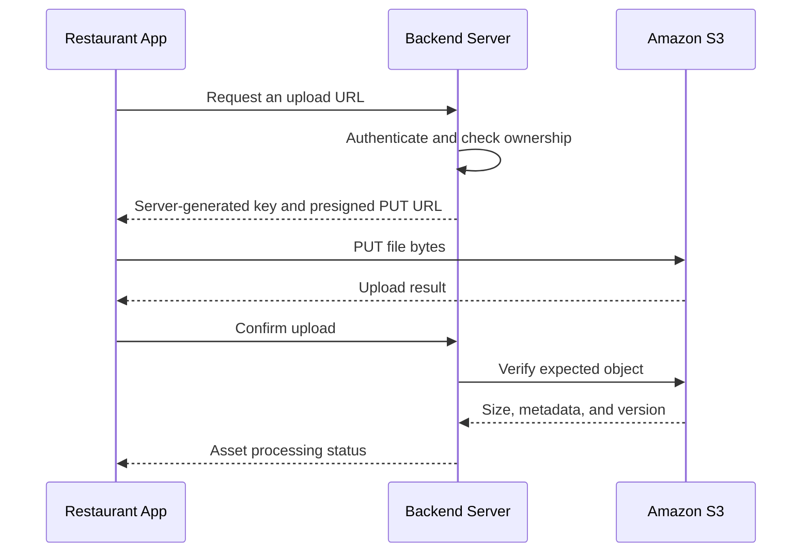
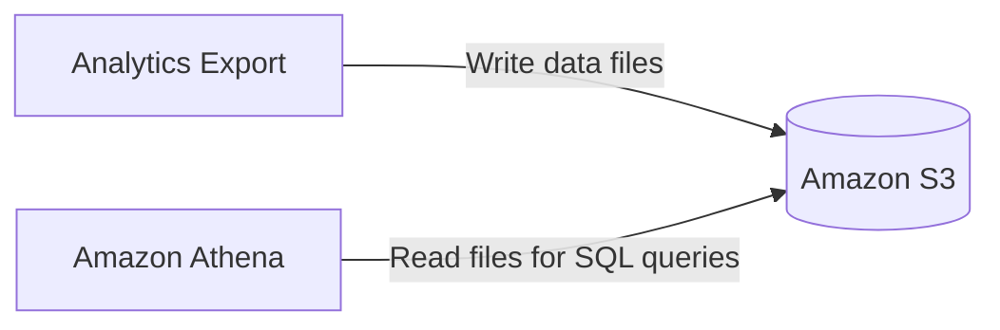
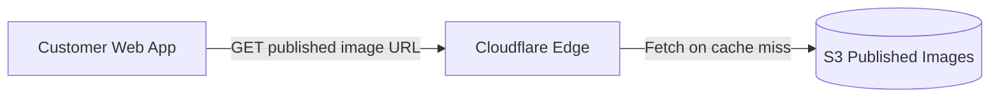
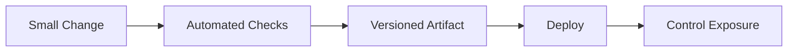

# Lecture 9: Object Storage, Content Delivery, Observability, and Safe Releases

## Learning goals

- Explain when to store files in an Object Storage
- Describe how a CDN edge reduces latency and origin load.
- Use structured logs, metrics, and traces to understand system behavior.
- Explain how continuous delivery supports smaller and safer releases.

MealDrop already accepts Restaurant photos and videos. Workers create the
required outputs and mark an Asset `ready`.

## 1. Object Storage: Amazon S3

### Objects, buckets, and keys

**Object Storage** stores data as objects accessed through an API.
Amazon Simple Storage Service, or **Amazon S3**, is the example used here.

| Term | Meaning | Example |
| --- | --- | --- |
| Bucket | A collection of objects | `mealdrop-media` |
| Key | The name of an object inside a bucket | `assets/8b19/v1/menu-card.webp` |
| Body | The stored bytes | WebP image content |
| Metadata | Information about the object | `Content-Type: image/webp` |
| Version ID | Identity of one stored version when versioning is enabled | A value assigned by S3 |

```text
s3://mealdrop-media/assets/8b19/v1/menu-card.webp
     bucket         object key
```

In a general purpose bucket, `/` is part of the key. Prefixes help organize
objects; they do not create filesystem directories.

- `PUT` stores an object.
- `GET` reads its bytes.
- `HEAD` reads its metadata without the body.
- `DELETE` removes an object or creates a delete marker, depending on versioning.
- Listing by prefix finds related object keys.

S3 Versioning can retain earlier versions after an overwrite or deletion.
Retained versions also consume storage.

### Choose S3 from the access pattern

| Data | Suitable use of S3 |
| --- | --- |
| Images and video | Store originals and processed variants |
| Large files | Store downloads, recordings, datasets, and generated exports |
| Backups | Retain database backup files and other recovery copies |
| Archives | Retain older files with a defined access and retention policy |
| Analytics data | Store event exports and historical datasets for query engines |

For MealDrop:

- S3 stores photo and video bytes.
- The application database stores Asset ownership, processing status, and keys.
- The database answers "Which ready photo belongs to this Restaurant?"
- S3 returns the bytes for the selected key and version.

A database can store binary values, but large files increase its storage,
backup, and transfer work. A Worker's local disk is useful for temporary
processing files. Another Worker instance does not automatically have those
files. S3 lets instances access files independently of their local disks.

### Direct uploads with presigned URLs

A **presigned URL** grants a specific S3 operation on a specific object for a
limited time. The Backend signs it using its own storage permissions.

The Restaurant sends the file bytes directly to S3:



This removes file transfer from the Backend request path. The Backend still
controls who can upload and when the file becomes usable.

- Keep AWS credentials on the server.
- Generate the object key on the server and keep originals private.
- Check the expected object, size, and ownership after upload.
- Have the Worker inspect the file bytes and enforce processing limits.
- Mark the Asset `ready` after all required outputs exist.

The URL is a temporary permission: anyone who has it can use it. S3 presigned
URLs can be reused before expiry. An upload to the same key can replace its
current bytes. Record the verified version and have the Worker read that
version, or copy the input to a server-controlled key before processing.

The existing queue and Worker flow starts after upload verification. A stored
file alone does not mean that processing or publication succeeded.

### Large files and multipart uploads

A large upload can fail near completion. Sending the entire file again wastes
time and bandwidth.

**Multipart upload** splits one object into parts:

1. Start an upload and retain its upload ID.
2. Upload parts independently, with bounded parallelism.
3. Retry failed parts.
4. Complete the upload so S3 assembles the object.

The result is one object. The application can resume unfinished work while
it retains the upload ID and completed-part information. Abort abandoned
uploads so unfinished parts do not continue to consume storage.

### Backups, retention, and cost

A backup file and an analytics export serve different purposes:

| Artifact | Main purpose | Validation |
| --- | --- | --- |
| Database backup | Restore database state | Restore it and verify the required records |
| Analytics export | Answer historical questions | Check schema, completeness, and query results |

A database backup can use a database-specific format that Athena cannot query
directly. A daily analytics export can omit information needed for recovery.

- Use the database's supported backup method to obtain a consistent backup.
- Define retention and access rules for recovery copies.
- Test restoration; an uploaded backup file alone does not prove recovery.
- Use S3 Lifecycle rules to transition or expire objects by policy.
- Select storage classes from access frequency and acceptable retrieval delay.
- Estimate storage, requests, transfer, retained versions, and unfinished parts.

### Query analytics data stored in S3

A **data lake** stores datasets as files that processing and query tools can
read. S3 can hold those files. It does not execute SQL itself.

**Amazon Athena** is a query service that can run SQL over data in S3.
Table metadata describes the schema, format, and file locations. Athena can
use the AWS Glue Data Catalog for this metadata.

**ClickHouse** can also query S3 files directly with its `s3()` table function.
See its
[S3 query examples](https://clickhouse.com/docs/reference/functions/table-functions/s3).



For example, export completed Orders into a separate analytics dataset:

```text
s3://mealdrop-analytics/orders/order_date=2026-11-12/part-0001.parquet
```

Assume the registered `analytics.orders` table has the string partition
`order_date` and the fields `restaurant_id` and `total_cents`:

```sql
SELECT restaurant_id, SUM(total_cents) AS sales_cents
FROM analytics.orders
WHERE order_date = '2026-11-12'
GROUP BY restaurant_id;
```

- **Parquet** is a columnar file format. A query can read selected columns
  instead of every field in every row.
- **Partitioning** groups data by a field such as date. A matching filter can
  let the engine skip unrelated partitions.
- Register or discover partitions in the table metadata; a folder name alone
  does not configure the table.
- For Athena SQL queries priced by scanned bytes, reading less data reduces
  query cost.

Historical analysis runs on the exported dataset. The application database
continues to handle current Order operations.

**Discuss:** A nightly Order export is readable in Athena. What evidence is
still needed before calling it a database backup?

### S3 and analytics references

- [S3 overview](https://docs.aws.amazon.com/AmazonS3/latest/userguide/Welcome.html)
  explains features and use cases.
- [Objects](https://docs.aws.amazon.com/AmazonS3/latest/userguide/UsingObjects.html)
  and [versioning](https://docs.aws.amazon.com/AmazonS3/latest/userguide/Versioning.html)
  explain object identity and retained versions.
- [Presigned URLs](https://docs.aws.amazon.com/AmazonS3/latest/userguide/using-presigned-url.html)
  explain temporary upload and download permissions.
- [Multipart uploads](https://docs.aws.amazon.com/AmazonS3/latest/userguide/mpuoverview.html)
  explain part upload, completion, and recovery.
- [S3 Lifecycle](https://docs.aws.amazon.com/AmazonS3/latest/userguide/object-lifecycle-mgmt.html)
  explains storage transitions and expiration.
- [Athena](https://docs.aws.amazon.com/athena/latest/ug/what-is.html),
  [partitioning](https://docs.aws.amazon.com/athena/latest/ug/partitions.html),
  and
  [columnar formats](https://docs.aws.amazon.com/athena/latest/ug/columnar-storage.html)
  explain queries over S3 datasets and how to reduce scanned data.

## 2. CDN: Cloudflare

### Why edge servers matter

A **Content Delivery Network (CDN)** has servers in many locations.
An **origin** holds the source content. An **edge** receives viewer requests
and can serve cached responses.

If a Customer is far from the origin, requests and responses travel a long
network path. Faster origin code cannot remove that network travel time.
A nearby edge can return cached content over a shorter path.

[Cloudflare CDN performance](https://www.cloudflare.com/learning/cdn/performance/).

The important measure is the network round-trip time. Cloudflare uses anycast
routing to reach an edge; routing selects a network path, which does not
always reach the geographically closest location.

### A cache miss and a cache hit

On a **cache miss**, the edge must obtain content from the origin
On a **cache hit**, a usable cached response can be returned by the edge

- A hit avoids an origin request and its associated transfer.
- A miss still depends on the origin.
- Different edges can have different cached objects.
- A cache can evict an object before its freshness lifetime ends.

### MealDrop's published image path

Only the read path for a ready, public image is needed here:



The menu response supplies the current image URL. Image bytes can then load
without a Backend call. Originals remain outside this public path.

S3 origin access must be configured for Cloudflare to retrieve the published
objects. A private S3 origin and a public CDN URL are separate access choices.
Private downloads also need viewer authorization, including on cache hits.

### Cache keys and freshness

A **cache key** determines which requests can reuse the same cached response.
If image size changes the response, the size must affect the key. Putting
variants in the path makes the distinction explicit:

```text
/assets/8b19/v1/menu-card.webp
/assets/8b19/v1/detail.webp
```

A **time to live (TTL)** defines a freshness period. Two cache policies are:

```http
Cache-Control: public, max-age=300
```

```http
Cache-Control: public, max-age=31536000, immutable
```

| Policy | Benefit | Consequence |
| --- | --- | --- |
| Five-minute freshness | Shorter normal reuse before validation or refetch | More requests reach the origin |
| Long freshness with immutable URLs | More reuse of an unchanged file | Existing browser copies can remain usable for a long time |

- With immutable URLs, changed bytes need a new key and URL.
- `immutable` does not prevent an S3 overwrite; the application enforces that.
- The menu response needs its own freshness policy to expose new image URLs.
- `no-cache` permits storage but requires validation before reuse.
- `no-store` instructs caches not to store the response.
- `private` prevents shared caching; it does not authenticate the viewer.

Browser freshness and edge freshness can differ. Check the response headers
and Cloudflare Cache Rules together.

### Removal, failures, and cost

| Situation | Expected behavior |
| --- | --- |
| Backend unavailable | Known image URLs can still load if CDN delivery works |
| S3 unavailable | Usable hits can succeed; requests needing S3 can fail |
| Object deleted from S3 | An existing cached response can still be served |
| Cloudflare cache purged | Browser caches and downloaded copies can remain |


### Cloudflare reading and usage documentation

- [What is a CDN?](https://www.cloudflare.com/learning/cdn/what-is-a-cdn/)
  explains the mechanism and benefits.
- [CDN performance](https://www.cloudflare.com/learning/cdn/performance/)
  contains the distance and cache illustrations above.
- [CDN reference architecture](https://developers.cloudflare.com/reference-architecture/architectures/cdn/)
  shows origins, edges, and anycast routing. Figures 1 and 2 compare delivery
  without and with a CDN.
- [Get started with Cache](https://developers.cloudflare.com/cache/get-started/)
  explains what Cloudflare caches and the conditions that affect it.
- [Cache Rules](https://developers.cloudflare.com/cache/how-to/cache-rules/),
  [cache keys](https://developers.cloudflare.com/cache/how-to/cache-keys/), and
  [Origin Cache Control](https://developers.cloudflare.com/cache/concepts/cache-control/)
  describe how to control cache behavior.
- [Purge cache](https://developers.cloudflare.com/cache/how-to/purge-cache/)
  explains removal from Cloudflare caches.

## 3. Observability: logs, metrics, and traces

**Observability** is the ability to understand a system's internal behavior
from the data it produces. Instrumentation records that data.

Logs, metrics, and traces are three common pillars:

| Pillar | Main question | MealDrop example |
| --- | --- | --- |
| Logs | What happened in this operation? | One Asset failed validation |
| Metrics | How often, how much, or how slow? | Percentage of uploads that become ready within a target time |
| Traces | Where did the operation spend time? | A Worker waited on an S3 read |

Collecting all three is useful when they help answer questions about actual
behavior. A dashboard alone does not explain every failure.

### Structured logs

A log records an event at a point in time. **Structured logs** use named fields
with consistent types. JSON is a common format.

```json
{
  "timestamp": "2026-11-12T10:15:30Z",
  "level": "error",
  "service": "media-worker",
  "env": "production",
  "version": "media-42",
  "event": "asset_processing_failed",
  "asset_id": "8b19",
  "job_id": "photo-8b19",
  "trace_id": "4bf92f3577b34da6a3ce929d0e0e4736",
  "span_id": "00f067aa0ba902b7",
  "duration_ms": 2030,
  "error_code": "S3_READ_TIMEOUT"
}
```

These fields support precise filters: service, version, event, and error code.
The Asset and job IDs connect attempts for the same work. Trace and span IDs
connect the log to the recorded execution path.

- Use a stable event name and explicit fields for changing values.
- Use levels consistently: information, warning, and error need team rules.
- Record useful outcomes and failure context.
- Exclude credentials, full presigned URLs, and private file contents.
- Define retention and access because logs can contain sensitive identifiers.

### Metrics

A metric is a numeric measurement tracked over time, often with dimensions
such as service, environment, and version.

| Metric type | What it records | Example |
| --- | --- | --- |
| Counter | Accumulated events | Number of completed or failed processing attempts |
| Gauge | A current value | Current pending Asset count |
| Histogram | A distribution of observations | Processing duration or HTTP request latency |

From counters, calculate a rate or a proportion. From latency observations,
inspect percentiles such as p95. An average can hide slow requests.

Separate attempts from outcomes. One Asset can have several failed attempts
and still become ready. Counting jobs alone does not measure the User result.

For example, define:

```text
Of valid uploads whose 60-second deadline fell in the last hour, what
percentage became ready before that deadline?
```

The deadline is 60 seconds after upload completion. This measure needs both
completion and ready times and must include valid uploads that never became
ready. Also track oldest pending Asset age so unfinished work remains visible.

- Measure traffic, errors, latency, and resource use.
- For media, add time to ready, pending work age, and failed Asset count.
- For CDN delivery, add hit ratio, origin errors, and bytes transferred.
- Use bounded labels such as result, service, and version.
- Keep per-Asset IDs in logs and traces. One metric series per Asset creates
  many unique combinations, or **high cardinality**, and increases cost.

### Traces and spans

A **trace** records the path of an operation. A **span** records one timed part
of that operation. Parent-child relationships show which work called which.

For the failed attempt in the log above, an illustrative trace could be:

```text
Trace: process Asset 8b19                    2030 ms
  Read Asset record                           10 ms
  S3 GET original: timeout                  2000 ms
  Record failed attempt                       20 ms
```

### Connect the pillars during an investigation

Suppose media-ready time increases after a deployment:

1. **Metrics:** find when the change started and which version is affected.
2. **Traces:** inspect slow operations to locate the time spent.
3. **Logs:** inspect the corresponding errors, attempts, and outcomes.
4. **Metrics again:** check whether recovery improved the User result.


### Grafana and Datadog

| Tool | Role | Typical view |
| --- | --- | --- |
| Grafana | Query, visualize, explore, and alert on connected telemetry sources | A dashboard linked to logs and traces |
| Datadog | A hosted platform for metrics, logs, tracing, dashboards, and alerts | A service view that correlates signals by service and version |

Grafana commonly uses Prometheus or Mimir for metrics, Loki for logs, and Tempo
for traces. Grafana Cloud offers managed services. Grafana itself does not
replace those storage and query backends.

**OpenTelemetry** provides instrumentation and telemetry export that can work
with different backends. Consistent service names and correlation fields make
navigation between signals useful in both Grafana and Datadog.

An actionable alert has a concrete condition, an owner, and a next step. For
example, alert on sustained failure to produce ready media, with a link to
the affected service and a recovery procedure.

### Observability references

- [OpenTelemetry observability primer](https://opentelemetry.io/docs/concepts/observability-primer/) connects instrumentation with system behavior.
- [Logs](https://opentelemetry.io/docs/concepts/signals/logs/),
  [metrics](https://opentelemetry.io/docs/concepts/signals/metrics/), and
  [traces](https://opentelemetry.io/docs/concepts/signals/traces/)
  explain the three signals.
- [Grafana fundamentals](https://grafana.com/docs/grafana/latest/fundamentals/)
  explains Grafana and the related telemetry backends.
- [Datadog log and trace correlation](https://docs.datadoghq.com/tracing/other_telemetry/connect_logs_and_traces/)
  shows how shared fields connect operational evidence.
- [Observability Engineering](https://www.oreilly.com/library/view/observability-engineering-2nd/9781098179915/)
  by Charity Majors, Liz Fong-Jones, and George Miranda is recommended deeper
  reading. It explains how to ask useful questions about running systems and
  improve observability practices.

## 4. CI/CD and safe releases

### What CI/CD gives a team

| Practice | Meaning | Main benefit |
| --- | --- | --- |
| Continuous Integration (CI) | Integrate changes frequently and verify them with automated builds and checks | Find integration problems early |
| Continuous Delivery | Keep verified software ready for production deployment on demand | Make delivery repeatable and reduce release effort |
| Continuous Deployment | Automatically deploy changes that pass the delivery checks | Shorten the path from a verified change to production |

CI/CD tools automate parts of this process. The value comes from fast feedback,
repeatable changes, and a known recovery path.



Small changes are easier to review, observe, and reverse than many unrelated
changes released together. Promote the same verified artifact between
environments so production receives the version that was checked.

### Deployment and release are separate decisions

- **Deployment:** install a software version in an environment.
- **Release:** expose new behavior to Users.

A **feature flag** selects behavior without requiring another code deployment.
For MealDrop, a new media-processing path can be deployed while the existing
path remains selected. The team can then enable it for a limited group.

| Capability | What it gives the team | Important limit |
| --- | --- | --- |
| Flag off after deployment | Time to check the new version before broad exposure | Deployed startup or shared-code failures can still affect Users |
| Enable for selected Users | Feedback from a controlled group | The group may not represent all workloads |
| Disable new behavior | Fast recovery for future operations | Effects already produced still exist |


### Gradual rollout and canary releases

A **canary release** exposes a new version or behavior to a limited group
before wider use. Exposure can be controlled by routing or a feature flag.

An illustrative rollout is:

```text
Internal Users -> 1% -> 10% -> 50% -> 100%
```


### Rollback and compatibility

**Rollback** returns to a previously working version or behavior.
It can restore service faster than waiting for a complete repair.

| Recovery action | Useful when | What it leaves to resolve |
| --- | --- | --- |
| Disable the feature flag | The new behavior causes the problem | Existing output, queued work, and stored changes |
| Restore the previous artifact | The deployed version itself is faulty | Data and job compatibility with the old version |
| Release a forward fix | Reversal is unsafe or incompatible | Time to verify and deliver the correction |

Prepare compatibility before release:

- Keep old readers working while new fields or formats are introduced.
- Retain the previous media outputs and processing path during the recovery
  period.
- Account for jobs created by both versions.
- Remove old fields, files, and paths after the compatibility period ends.

Changing code does not reverse a completed payment, restore a deleted object,
or recall an image already downloaded. Recovery can also require data repair
or a compensating business operation.

Record version and flag state with telemetry. This connects a visible problem
to the behavior a User or job actually received.


### CI/CD references

- [Continuous Integration](https://martinfowler.com/articles/continuousIntegration.html)
  explains frequent integration and fast feedback.
- [Continuous Delivery](https://martinfowler.com/bliki/ContinuousDelivery.html)
  explains deployable software and the difference from continuous deployment.
- [Feature Toggles](https://martinfowler.com/articles/feature-toggles.html)
  explains controlled exposure, canary releases, and the cost of retained flags.

