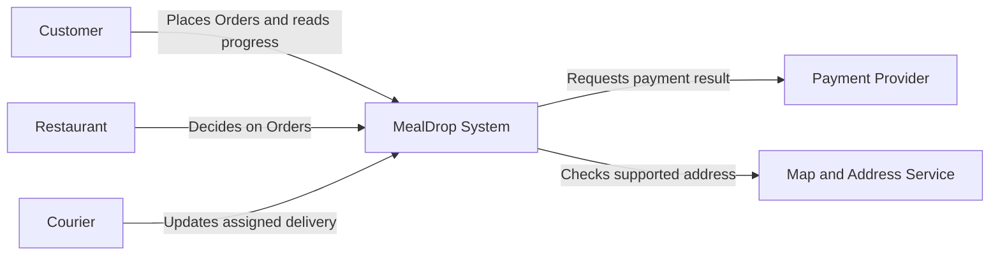
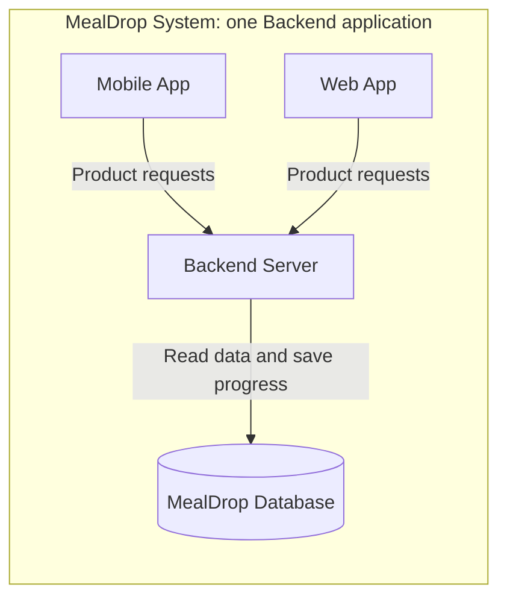
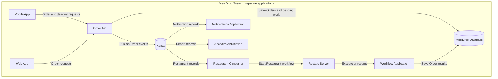
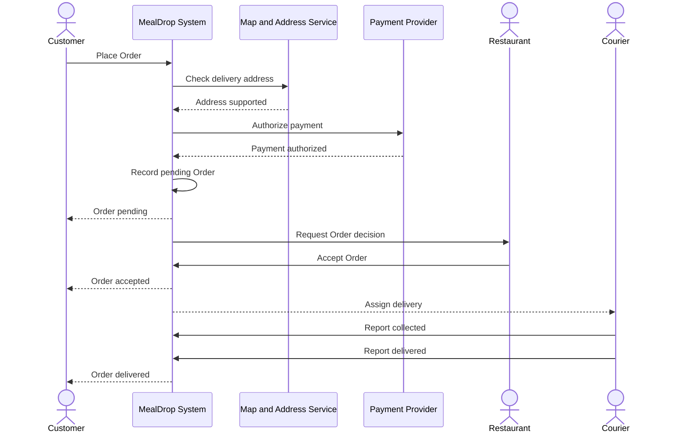
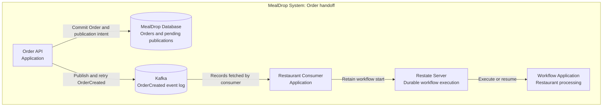
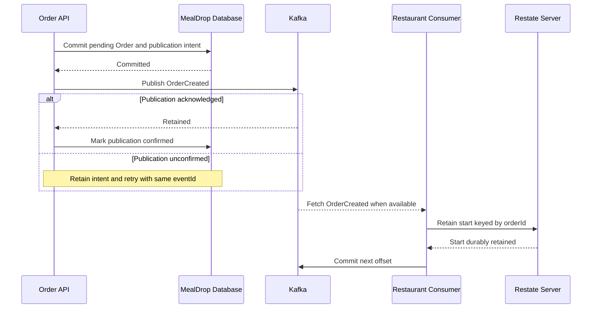
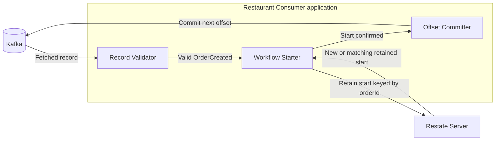
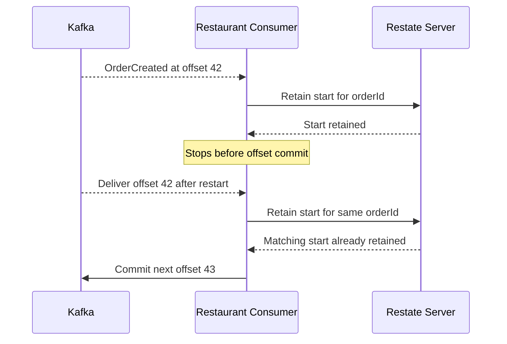

# Lecția 10: Documente de proiectare tehnică, RFC-uri și ADR-uri

## Obiective de învățare

- Organizează o proiectare de la problema produsului până la planul de implementare.
- Compară cel puțin două soluții viabile.
- Explică rolurile unui document tehnic, ale unui RFC și ale unui ADR.
- Prezintă riscurile și întrebările deschise, cu acțiuni următoare clare.
- Alege nivelul de detaliu al documentului în funcție de domeniul de aplicare și de cititor.

## 1. Document tehnic, RFC și ADR

| Termen | Scop | Domeniu de aplicare obișnuit |
| --- | --- | --- |
| Document de proiectare tehnică | Explică problema, proiectarea propusă și pregătirea implementării | Sistem, funcționalitate sau modificare |
| RFC: Request for Comments | Prezintă o propunere pentru feedback înainte de o decizie | O modificare care necesită discuții |
| ADR: Architecture Decision Record | Înregistrează o decizie importantă și motivul acesteia | O alegere cu consecințe importante |

Un RFC poate conține documentul de proiectare tehnică. Un ADR poate fi o secțiune
scurtă sau o înregistrare accesibilă printr-un link. Denumirile și formatele diferă între echipe.

Un proces simplu de verificare este:

```text
Draft proposal -> Comments -> Revised proposal -> Design decision
```

Un ADR conține:

- **Context:** cerințele și constrângerile care stau la baza alegerii.
- **Decizie:** soluția aleasă și starea acesteia.
- **Alternative:** alte soluții viabile analizate.
- **Consecințe:** beneficii, costuri și riscuri rămase.

Folosește un ADR pentru alegeri precum adăugarea Kafka sau mutarea lucrului la Workers.
Detaliile locale obișnuite pot rămâne în documentul de proiectare.

Surse: [Documentele de proiectare Google](https://abseil.io/resources/swe-book/html/ch10.html),
[Formatul ADR al lui Nygard](https://www.cognitect.com/blog/2011/11/15/documenting-architecture-decisions).

### ADR-uri reale

- [GOV.UK Search API: Ce documente se indexează](https://docs.publishing.service.gov.uk/repos/search-api-v2/adr/004-which-documents-to-index.html): context, opțiuni analizate și o decizie scurtă.
- [GOV.UK Whitehall: Tipuri de conținut definite prin configurare](https://docs.publishing.service.gov.uk/repos/whitehall/adr/0006-config-driven-content-types.html): o modificare mai amplă, cu beneficii, riscuri și pași de migrare.
- [Backstage: Formatul implicit al fișierului pentru catalogul software](https://github.com/backstage/backstage/blob/master/docs/architecture-decisions/adr002-default-catalog-file-format.md): un contract de date detaliat, cu exemple.

## 2. Structura unui document de proiectare tehnică

Folosește aceste secțiuni. Combină secțiunile scurte când modificarea este mică.

### 2.1. Definirea problemei

Scrie un paragraf scurt care explică problema și rezultatul necesar.
Evidențiază obiectivul sau o limită importantă.

Clienții trebuie să știe dacă un Restaurant le poate pregăti Comanda.
**MealDrop trebuie să afișeze un rezultat clar al Comenzii**, cu 120 de secunde
pentru decizia Restaurantului după rezervare. Domeniul de aplicare inițial include
Restaurantele participante dintr-un singur oraș și exclude Comenzile programate.

Folosește definirea produsului din
[Domeniul de aplicare al produsului și limitele sistemului](lecture-02-product-scope-and-system-boundaries.md).

### 2.2. Cerințe funcționale

Grupează punctele scurte după nivelul cerinței. Fiecare punct descrie un
comportament observabil. Folosește grupurile necesare pentru propunere.

În exemplele de cerințe, termenii cu majuscule `MUST`, `MUST NOT` și `SHOULD`
au sensurile definite în
[RFC 2119](https://www.rfc-editor.org/rfc/rfc2119.html) și
[RFC 8174](https://www.rfc-editor.org/rfc/rfc8174.html).

#### MUST

Comportament obligatoriu:

- Înregistrează o Comandă nouă ca `pending` înainte de începerea procesării pentru Restaurant.
- Păstrează posibilitatea de a recupera procesarea neterminată a Comenzilor după defectarea unui proces.
- Acceptă o decizie doar de la Restaurantul căruia îi aparține Comanda.

#### SHOULD

Comportament recomandat. O excepție necesită un motiv și consecințe cunoscute.

- Trimite un memento după 60 de secunde dacă decizia este încă în așteptare.

Indisponibilitatea serviciului de memento poate justifica omiterea mementoului.
Termenul pentru decizie se aplică în continuare. Înregistrează această excepție
și efectul ei asupra răspunsului Restaurantului.

#### NICE TO HAVE

Comportament opțional. Acest titlu este o etichetă locală de prioritate.

- Afișează timpul rămas până la termenul pentru decizia Restaurantului.

#### MUST NOT

Comportament interzis:

- Rezervarea sau eliberarea resurselor de două ori când o operație se repetă.

Un obiectiv exclus definește ce rămâne în afara domeniului de aplicare al
produsului. O cerință `MUST NOT` interzice un comportament în domeniul de aplicare ales.

### 2.3. Cerințe de calitate și volum de lucru

Scrie fiecare țintă ca măsură, valoare țintă și condiție de funcționare.

Aceste ținte sunt exemple de ipoteze pentru propunere:

| ID | Țintă | Condiție |
| --- | --- | --- |
| QR-1 | Pentru 95% dintre Comenzi, procesarea pentru Restaurant începe în cel mult 5 secunde de la commit-ul Comenzii. | 20 Orders/s pentru Comenzi noi; dependențele funcționează corect |
| QR-2 | Lucrul păstrat se reia în cel mult 30 de secunde de la repornirea unui consumer. | Dependențele funcționează corect; același volum de lucru |

Aici, procesarea începe când cererea de pornire a workflow-ului este păstrată durabil.
Aprobarea Restaurantului poate avea loc mai târziu, în termenul rezervării.

Leagă calculele și țintele de operațiile alese. Folosește
[Cerințe de calitate și capacitate](lecture-03-quality-requirements-workload-and-capacity.md)
pentru metoda de măsurare.

### 2.4. Arhitectură și contracte

Alege view-urile în funcție de întrebările la care cititorul are nevoie de răspuns.

| View sau contract | Conținut |
| --- | --- |
| System View / C4 System Context | Actori, limita sistemului, sisteme externe |
| Container View | Aplicații, spații de stocare și responsabilitățile lor |
| View al componentelor | Responsabilitățile din interiorul unui container ales |
| Date și stare | Înregistrări importante, relații, tranziții permise și invariante |
| Contracte API și de evenimente | Date de intrare, rezultate, identitate, reguli de acces și erori |

Folosește doar nivelul de detaliu necesar pentru decizie. Păstrează schemele API
complete în fișierele lor de contract. O diagramă de secvență completează aceste view-uri structurale.

Refolosește metodele din
[Descompunerea arhitecturii](lecture-04-architecture-decomposition-and-data-flows.md)
și [Modelarea datelor și API-uri](lecture-06-api-design-and-data-modeling.md).

### 2.5. Fluxuri principale și defecțiuni

Arată secvența principală, punctul ei de succes și o cale importantă de tratare a unei defecțiuni.

Pentru acceptarea de către Restaurant în MealDrop:

1. Înregistrează Comanda în așteptare și păstrează cererea ei de procesare.
2. Pornește procesarea pentru Restaurant și rezervă resursele disponibile.
3. Așteaptă decizia Restaurantului sau termenul limită.
4. Acceptă o decizie validă salvată sau expiră o rezervare fără răspuns.
5. Salvează rezultatul final; eliberează rezervările nefolosite o singură dată.

Punctul de succes al acceptării este commit-ul tranziției Comenzii la `active`.
Crearea în starea pending și pornirea workflow-ului au puncte de succes separate.

Arată cum afectează acest flux timeout-urile, mesajele duplicate și defectarea proceselor.
Regulile detaliate de rezervare sunt în
[Workers și workflow-uri fiabile](lecture-08-workers-and-reliable-workflows.md).

### 2.6. Soluții și decizie

Fiecare proiectare trebuie să prezinte cel puțin două soluții viabile pentru
aceeași problemă a produsului, cu limite clare.

Pentru fiecare soluție, precizează:

- cum produce rezultatul necesar;
- cum îndeplinește țintele de calitate;
- beneficiile, costurile și riscurile sale.

Compară ambele soluții la același nivel de detaliu. Alege una și prezintă
motivul decisiv. Include o consecință negativă a soluției alese.

### 2.7. Riscuri și întrebări deschise

Precizează ce poate merge prost și ce răspunsuri sunt încă necesare. Atribuie
fiecărui punct un responsabil și o acțiune următoare. Secțiunea 4 prezintă un format compact.

Această structură adaptează aspectele tratate în [arc42](https://arc42.org/overview/).
Alege secțiunile și nivelul de detaliu pentru propunere.

## 3. Compară două soluții

MealDrop trebuie să transmită Comenzile înregistrate către Restaurant Processing,
Notifications și Analytics. Fiecare are nevoie de progres și recuperare independente.

| Soluție | Abordare | Beneficiu | Cost sau risc | Îndeplinirea cerințelor |
| --- | --- | --- | --- | --- |
| A. Interogarea periodică a bazei de date | Fiecare consumer interoghează înregistrările durabile de lucru în fiecare secundă și salvează starea de finalizare. | Folosește baza de date existentă. | Interogări repetate; logică separată de progres și replay pentru fiecare consumer. | Poate păstra Comenzile și lucrul neterminat; verifică QR-1 și QR-2 sub sarcină. |
| B. Evenimente Kafka | Publică `OrderCreated`; fiecare consumer group își păstrează propria poziție. | Consum și replay independente. | Operarea brokerului, recuperarea publicării și tratarea duplicatelor. | Poate îndeplini aceleași cerințe și ținte; verifică sub sarcină. |

Interogarea periodică necesită lucru păstrat pentru fiecare consumer. O Comandă
poate ieși din `pending` înainte ca un consumer lent să o citească.

### ADR: transmiterea OrderCreated prin Kafka

| Câmp | Înregistrare |
| --- | --- |
| Stare | Propus |
| Context | Trei consumere au nevoie de progres și replay independente. |
| Decizie | Alege B: transmiterea evenimentelor prin Kafka. |
| Alternativă | A: interogarea periodică a bazei de date, cu lucru păstrat pentru fiecare consumer. |
| Consecințe | Recuperare independentă; operarea brokerului și tratarea duplicatelor. |

Păstrează publicarea în așteptare în aceeași tranzacție cu Comanda. Reîncearcă
publicarea cu același ID de eveniment. Fă commit pentru progresul consumerului
după ce lucrul necesar este păstrat.

Aceste mecanisme provin din
[Brokeri de mesaje și Kafka](lecture-07-message-brokers-and-kafka.md).
Comparația urmează accentul pus pe alternative în
[Design Docs at Google](https://www.industrialempathy.com/posts/design-docs-at-google/).

## 4. Riscuri și întrebări deschise

| Tip | Sens | Exemplu MealDrop |
| --- | --- | --- |
| Ipoteză | O afirmație folosită de proiectare, care necesită dovezi. | Traficul de vârf este de 20 Orders/s pentru Comenzi noi. |
| Risc | Un eveniment posibil cu un rezultat nefavorabil. | Lucrul acumulat la consumer întârzie procesarea pentru Restaurant. |
| Întrebare deschisă | Un răspuns sau o decizie încă necesară. | Pentru cât timp de indisponibilitate trebuie să fie posibilă recuperarea unui consumer? |

Enumeră mai întâi cele mai importante riscuri. Leagă-le de o cerință sau de o alegere.

| Risc | Efect | Răspuns | Responsabil |
| --- | --- | --- | --- |
| API-ul se oprește după commit-ul Comenzii, înainte de publicare. | O Comandă poate rămâne neprocesată dacă se pierde transferul ei spre procesare. | Păstrează publicarea în aceeași tranzacție; reîncearc-o. | Inginerul Order API |
| Lucrul acumulat depășește capacitatea de procesare. | QR-1 nu este îndeplinită. | Verifică comportamentul la creșteri bruște de trafic și capacitatea de recuperare înainte de lansare. | Inginerul Restaurant Processing |

| Întrebare deschisă | Acțiune următoare | Responsabil | Când este necesar răspunsul |
| --- | --- | --- | --- |
| Este corectă încărcarea de vârf presupusă? | Confirmă cererea și testează ambele opțiuni. | Responsabilul de produs și inginerul backend | Înainte de acceptarea proiectării |
| Cât timp trebuie să rămână disponibile evenimentele? | Stabiliți nevoile de recuperare; setați retenția și estimați costul. | Inginerii Analytics și de platformă | Înainte de configurarea topicului |

Separă întrebările care blochează decizia de proiectare de detaliile care pot fi
stabilite în timpul implementării. Un răspuns la risc poate reduce riscul;
înregistrează expunerea rămasă.

Surse: [Riscuri în arc42](https://docs.arc42.org/section-11/),
[Întrebări nerezolvate în RFC-urile Rust](https://github.com/rust-lang/rfcs/blob/main/0000-template.md#unresolved-questions).

## 5. Alege dimensiunea documentului și nivelul de abstractizare

Dimensiunea documentului se referă aici la domeniul de aplicare al lucrării.
Lungimea textului depinde de dovezile necesare. O modificare restrânsă poate necesita detalii precise.

| Document | Cititor principal | Detalii |
| --- | --- | --- |
| Propunere pentru întregul sistem | Responsabilul de produs și echipa de inginerie | Problemă, domeniu de aplicare, cerințe, System View, Container View de ansamblu, secvență principală și riscuri |
| RFC pentru o funcționalitate | Inginerii funcționalității | Interacțiuni între containere, contracte, secvențe, plan de implementare |
| Notă pentru o modificare restrânsă | Inginerul care implementează | Componente alese, reguli de stare, alternative locale, verificări |

Deschide câte o limită pe rând. Nu include componentele interne în System View
și Container View. Adaptează participanții din secvențe la domeniul de aplicare al documentului.

[Recomandările C4](https://c4model.com/diagrams) susțin alegerea nivelului de detaliu al diagramelor.
[Cursul SEI](https://www.sei.cmu.edu/training/documenting-software-architectures/)
folosește nevoile cititorului pentru a alege view-uri utile ale arhitecturii.

## 6. Trei documente MealDrop

Acestea sunt proiectări propuse. Exemplele trec de la MealDrop în ansamblu la
o funcționalitate, apoi la o alegere de implementare din acea funcționalitate.

### 6.1. Propunere pentru întregul sistem: livrare MealDrop

#### Definirea problemei

Clienții au nevoie de livrare de la Restaurantele participante dintr-un singur oraș.
Restaurantele decid asupra Comenzilor; Curierii alocați actualizează progresul livrării.
Comenzile programate și gestionarea flotei sunt excluse.

#### Cerințe funcționale

##### MUST

- Păstrează Comenzile trimise și afișează rezultatul lor curent.
- Acceptă o decizie doar de la Restaurantul căruia îi aparține Comanda.
- Permite Curierilor alocați să raporteze preluarea și livrarea.

#### Țintă de calitate

- Țintă: pentru 95% dintre Comenzi, procesarea pentru Restaurant începe în cel mult
  5 secunde, la 20 Orders/s pentru Comenzi noi, cu dependențe care funcționează corect.

Volumul de lucru este o ipoteză care trebuie confirmată înainte de acceptarea proiectării.

#### System View: C4 System Context



#### Opțiuni de arhitectură

##### A. O singură aplicație Backend

O singură aplicație gestionează cererile produsului, procesarea pentru Restaurant,
notificările și raportarea. Salvează progresul în baza de date și reia lucrul
neterminat după o repornire.



- Beneficiu: mai puține aplicații de deployat și operat.
- Cost: cererile produsului și lucrul în fundal împart capacitatea procesului și lansările.

##### B. Aplicații separate pentru API și procesare

Order API gestionează cererile pentru Comenzi și actualizările stării livrării.
Aplicații separate procesează deciziile Restaurantelor, notificările și raportarea.



Ambele diagrame Container View arată aplicațiile pentru cereri și procesarea în fundal.
Verificările de plată și adresă folosesc furnizorii externi din System View.

- Beneficiu: aplicațiile de procesare se pot scala și reporni separat de API.
- Cost: mai multe deployări, tratarea mesajelor și căi de recuperare.

Alege A pentru simplitate și viteza iterațiilor.

#### Flux principal

Această secvență arată parcursul normal al Clientului la limita sistemului.



Un rezultat lipsă pentru plată sau adresă rămâne în așteptare sau indisponibil.
Respingerea de către Restaurant sau expirarea rezervării închide Comanda înainte de alocarea Curierului.

#### Pregătirea implementării, riscuri și întrebări

- Implementează înregistrarea Comenzilor, transferul spre procesare, apoi actualizarea rezultatelor finale.
- Verifică plasarea, respingerea, livrarea și procesarea întreruptă înainte de lansare.
- Risc: un rezultat lipsă pentru plată blochează acceptarea. Inginerul backend
  definește comportamentul la timeout și recuperare.
- Întrebare: este corectă cererea presupusă? Responsabilul de produs o confirmă
  înainte de acceptarea proiectării.

### 6.2. RFC pentru o funcționalitate: transferul unei Comenzi noi spre procesare

#### Definirea problemei

O Comandă pentru care s-a făcut commit necesită procesare recuperabilă pentru Restaurant.
Acest RFC acoperă acel transfer. Se aplică regulile existente de rezervare, decizie și expirare.

#### Cerințe funcționale

##### MUST

- Înregistrează `pending` înainte de începerea procesării.
- Recuperează transferurile neterminate după defectarea unui proces.

##### MUST NOT

- Rezervarea resurselor de două ori când un eveniment se repetă.

#### Ținte de calitate

La 20 Orders/s pentru Comenzi noi, cu baza de date, Kafka și dependențele workflow-ului funcționale:

- Pentru 95% dintre Comenzi, cererea de pornire a workflow-ului pentru Restaurant
  este păstrată în cel mult 5 secunde de la commit-ul Comenzii.
- După repornirea unui consumer, lucrul păstrat se reia în cel mult 30 de secunde.

Volumul de lucru este o ipoteză a proiectării care trebuie confirmată înainte de acceptarea acesteia.

#### Container View și contracte



- `POST /v1/orders` înregistrează Comanda în așteptare.
- `GET /v1/orders/{orderId}` citește starea curentă.
- `OrderCreated` păstrează valori stabile pentru `eventId` și `orderId`.
- Tranzacția Comenzii păstrează și publicarea ei în așteptare.
- Confirmarea publicării lasă aprobarea Restaurantului în așteptare.

#### Secvența principală și eșecul publicării



O publicare neconfirmată poate exista deja în Kafka. Reîncercarea ei poate repeta
evenimentul. Tratarea de către consumer trebuie să rămână sigură.

#### Soluții și decizie

| Soluție | Beneficiu | Cost |
| --- | --- | --- |
| A. Interoghează lucrul păstrat în fiecare secundă | Baza de date existentă furnizează lucrul și recuperarea. | Consumerele independente necesită logică separată de progres și replay. |
| B. Kafka cu intenția de publicare păstrată | Consumer groups oferă progres și replay independente. | Operarea brokerului, repararea publicării și duplicate. |

Alege B pentru cele trei consumere independente. Păstrează A ca opțiune viabilă
pentru un sistem cu nevoi mai mici de procesare.

#### Pregătirea implementării, riscuri și întrebări

1. Adaugă înregistrarea publicării și scanarea pentru recuperare.
2. Adaugă reîncercările publicării și Restaurant Consumer.
3. Oprește API-ul după commit; verifică transferul ulterior spre procesare.
   Repetă un eveniment și verifică o singură pornire logică a workflow-ului.
4. Măsoară întârzierea transferului și cea mai veche publicare în așteptare în timpul lansării limitate.

- Recuperare: pune pe pauză citirile consumerului; păstrează Comenzile și lucrul de publicare pentru reluare.
- Risc: reîncercarea publicării poate repeta o pornire. Inginerul Restaurant Processing
  implementează pornirea care tratează sigur duplicatele.
- Întrebare: durata necesară de retenție. Inginerii de platformă și Analytics o
  stabilesc înainte de configurarea topicului.

### 6.3. Notă pentru o modificare restrânsă: pornirea workflow-ului în siguranță la duplicate

#### Definirea problemei

Restaurant Consumer citește `OrderCreated` și pornește workflow-ul pentru Restaurant.
Kafka păstrează poziția consumerului printr-un offset pentru care s-a făcut commit.
Pornirea unui workflow și commit-ul unui offset sunt operații separate.

De exemplu:

1. Consumerul citește evenimentul pentru Comanda 742 la offset 42.
2. Procesarea păstrează cererea de pornire a workflow-ului pentru acea Comandă.
3. Consumerul se oprește înainte de commit-ul următorului offset, 43.
4. După repornire, Kafka livrează din nou offset 42.

O reîncercare cu o identitate nouă de workflow ar putea porni din nou fluxul de
afaceri. Două workflow-uri ar putea încerca apoi aceeași rezervare de resurse sau
trimite cereri repetate către Restaurant. Evenimentul repetat trebuie să refolosească același workflow logic.

#### Cerințe funcționale

##### MUST

- Recuperează transferurile neterminate după defectarea unui proces.

##### MUST NOT

- Pornirea unui al doilea workflow logic pentru un eveniment repetat.
- Repetarea unei rezervări sau eliberări de resurse.

După repornirea unui consumer, reia lucrul păstrat în cel mult 30 de secunde,
la 20 Orders/s pentru Comenzi noi, cu dependențe care funcționează corect.

#### View al componentelor: aplicația Restaurant Consumer



#### Soluții locale

##### A. Salvează pornirile în așteptare într-o bază de date

1. Salvează cererea de pornire validată cu un ID unic de Comandă.
2. Fă commit pentru offset-ul Kafka după commit-ul tranzacției din baza de date.
3. Un dispatcher pornește workflow-ul folosind același ID de Comandă drept cheie.
4. După confirmare, marchează cererea ca pornită. Reîncearcă o pornire neconfirmată
   cu aceeași cheie.

Baza de date păstrează lucrul cât timp Restate este indisponibil. Înregistrarea
unică protejează preluarea; cheia workflow-ului protejează apelurile repetate de pornire.
Această opțiune adaugă un tabel, un dispatcher și logica lor de recuperare.

##### B. Folosește Restate și păstrează direct cererea de pornire a workflow-ului

1. Cere Restate să păstreze o pornire cu cheia `orderId`.
2. Confirmă o pornire nouă sau verifică identitatea unei porniri existente.
3. Fă commit pentru următorul offset Kafka după acea confirmare.
4. La timeout, lasă offset-ul fără commit și reîncearcă cu aceeași cheie.

Kafka păstrează transferurile neterminate cât timp Restate este indisponibil.
Această opțiune folosește pornirea durabilă a motorului de workflow ales și evită
un spațiu separat de stocare pentru pornirile în așteptare. Progresul consumerului
depinde de disponibilitatea Restate.

Alege B deoarece Restate păstrează deja cererile de pornire ale workflow-urilor.
Păstrează `orderId` stabil la fiecare reîncercare. Ambele opțiuni necesită în
continuare operații de rezervare și eliberare în Kitchen API care tratează sigur duplicatele.

#### Secvența defecțiunii



#### Pregătirea implementării și verificări

- Validează `eventId`, `orderId` și cheia Kafka.
- Lasă offset-ul fără commit după un timeout la pornire; reîncearcă aceeași identitate.
- Fă commit în ordinea partiției, fără a trece peste înregistrări neterminate.
- Verifică situațiile cu repornire și răspuns pierdut; confirmă o singură pornire logică a workflow-ului.
- Păstrează verificările de duplicate din Kitchen API pentru efectele externe repetate.

#### Risc și întrebare deschisă

- Risc: identitatea workflow-ului expiră înainte de replay-ul unui eveniment vechi.
  Inginerul consumerului definește o limită pentru replay și păstrează verificări
  durabile de duplicate pentru operațiile de afaceri.
- Întrebare: cât timp rămâne disponibilă protecția pornirii cu aceeași cheie?
  Inginerul de platformă confirmă retenția configurată înainte de implementare.

## Explorare suplimentară

- [arc42](https://arc42.org/overview/): compară o structură completă de documentare a arhitecturii.
- [Software Engineering at Google, capitolul 10](https://abseil.io/resources/swe-book/html/ch10.html): scopul documentului și publicul său.
- [Design Docs at Google](https://www.industrialempathy.com/posts/design-docs-at-google/): compromisuri și detalii specifice proiectului.
- [Șablonul RFC Rust](https://github.com/rust-lang/rfcs/blob/main/0000-template.md): motivație, dezavantaje, alternative și întrebări.
- [Articolul lui Nygard despre ADR](https://www.cognitect.com/blog/2011/11/15/documenting-architecture-decisions): o decizie și consecințele ei.
- [Documenting Software Architectures: Views and Beyond](https://www.sei.cmu.edu/library/documenting-software-architectures-views-and-beyond-second-edition/): carte despre alegerea și documentarea view-urilor arhitecturii.
- [Cursul SEI de documentare](https://www.sei.cmu.edu/training/documenting-software-architectures/): programa publică a cursului bazat pe carte.
- [Diagrame C4](https://c4model.com/diagrams): domeniul de aplicare al view-urilor și nivelul de detaliu al diagramelor.
