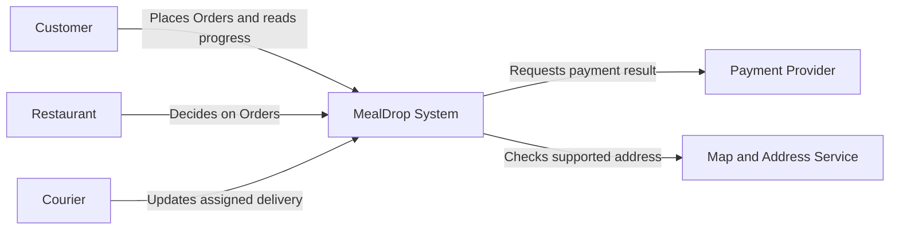
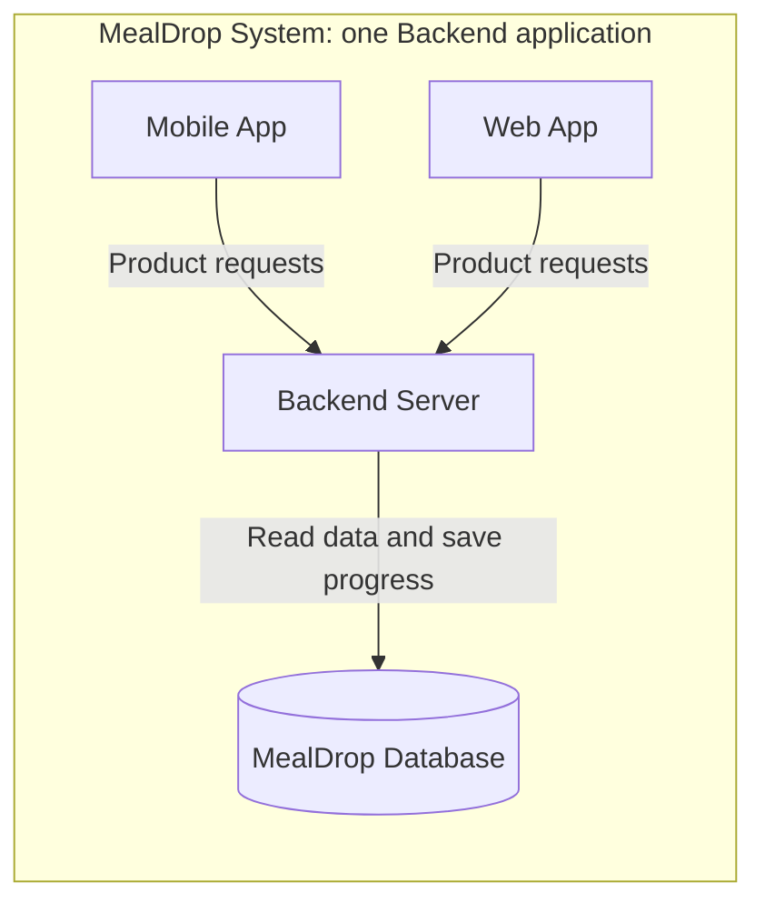
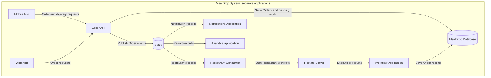
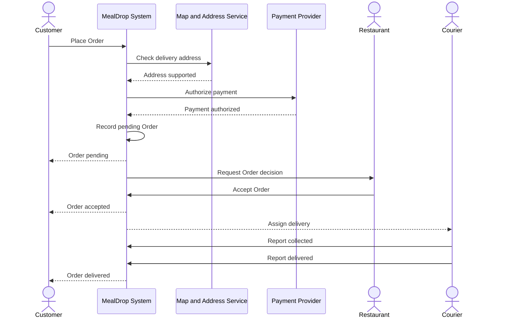
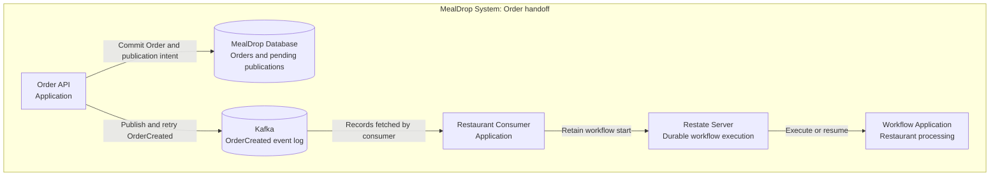
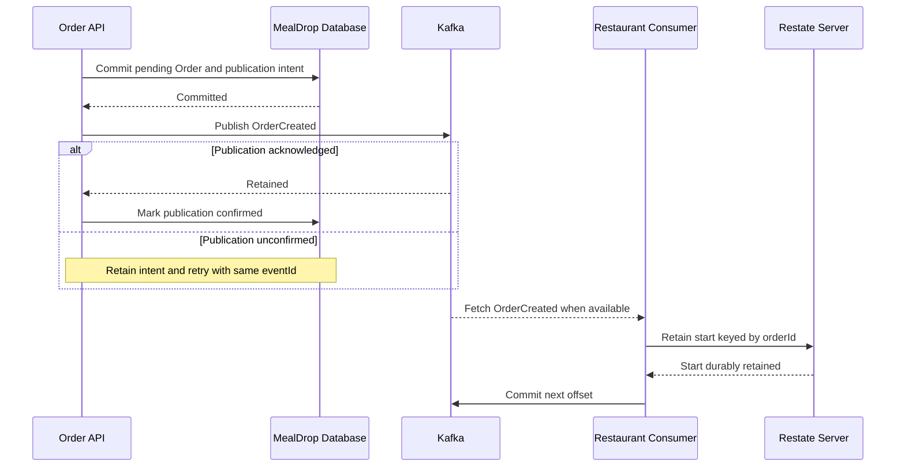
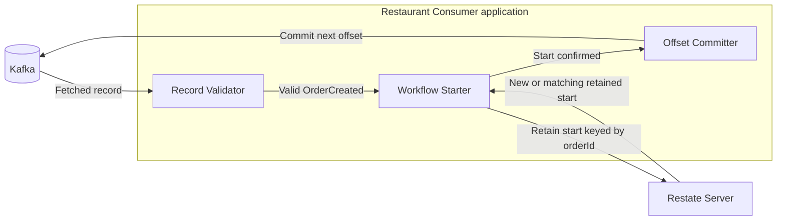
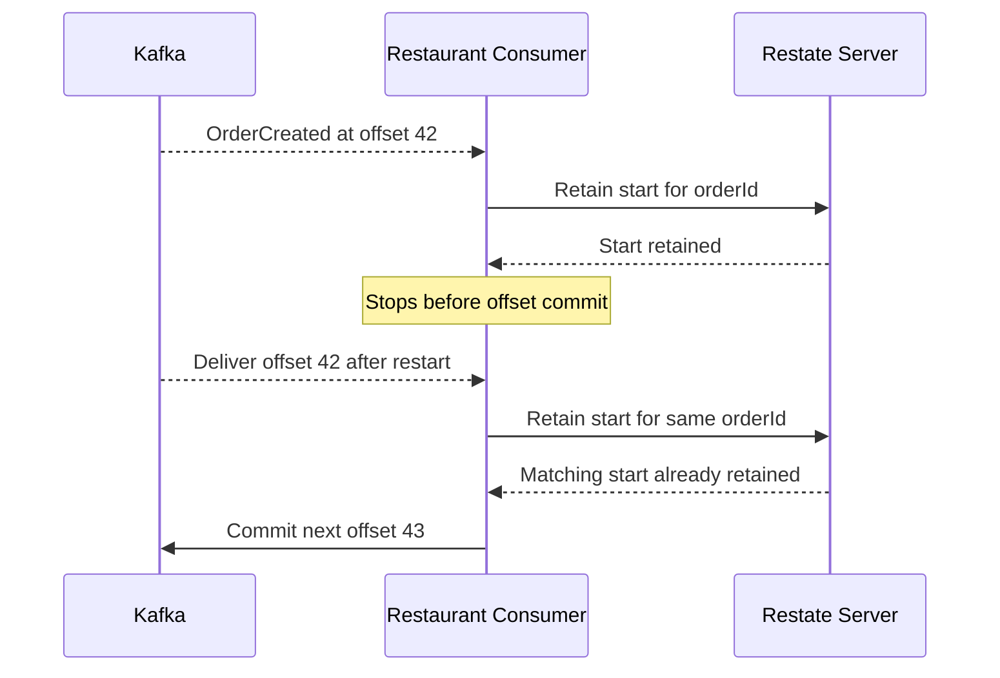

# Lecture 10: Engineering Design Documents, RFCs, and ADRs

## Learning goals

- Organize a design from product problem to implementation plan.
- Compare at least two viable solutions.
- Explain the roles of an engineering document, RFC, and ADR.
- State risks and open questions with clear next actions.
- Select document detail for its scope and reader.

## 1. Engineering document, RFC, and ADR

| Term | Purpose | Typical scope |
| --- | --- | --- |
| Engineering design document | Explain the problem, proposed design, and implementation preparation | System, feature, or change |
| RFC: Request for Comments | Present a proposal for feedback before a decision | A change that needs discussion |
| ADR: Architecture Decision Record | Record one significant decision and its reason | One choice with important consequences |

An RFC can contain the engineering design document. An ADR can be a short
section or a linked record. Team names and formats vary.

A simple review path is:

```text
Draft proposal -> Comments -> Revised proposal -> Design decision
```

An ADR contains:

- **Context:** requirements and constraints behind the choice.
- **Decision:** the selected solution and its status.
- **Alternatives:** other viable solutions considered.
- **Consequences:** benefits, costs, and remaining risks.

Use an ADR for choices such as adding Kafka or moving work to Workers.
Routine local details can remain in the design document.

Sources: [Google design documents](https://abseil.io/resources/swe-book/html/ch10.html),
[Nygard's ADR format](https://www.cognitect.com/blog/2011/11/15/documenting-architecture-decisions).

### Real ADRs

- [GOV.UK Search API: Which documents to index](https://docs.publishing.service.gov.uk/repos/search-api-v2/adr/004-which-documents-to-index.html): context, considered options, and a short decision.
- [GOV.UK Whitehall: Config driven content types](https://docs.publishing.service.gov.uk/repos/whitehall/adr/0006-config-driven-content-types.html): a broader change with benefits, risks, and migration steps.
- [Backstage: Default Software Catalog File Format](https://github.com/backstage/backstage/blob/master/docs/architecture-decisions/adr002-default-catalog-file-format.md): a detailed data contract with examples.

## 2. Structure of an engineering design document

Use these sections. Merge short sections when the change is small.

### 2.1. Problem statement

Write a short paragraph that explains the problem and the result needed.
Highlight the goal or an important limit.

Customers need to know whether a Restaurant can prepare their Order.
**MealDrop must show a clear Order result**, with 120 seconds for a Restaurant
decision after reservation. The initial scope covers participating Restaurants
in one city and excludes scheduled Orders.

Use the product framing from
[Product Scope and System Boundaries](lecture-02-product-scope-and-system-boundaries.md).

### 2.2. Functional requirements

Group short bullets by requirement level. Each bullet describes observable
behavior. Use the groups needed for the proposal.

In the example requirements, uppercase `MUST`, `MUST NOT`, and `SHOULD` use
the meanings defined in
[RFC 2119](https://www.rfc-editor.org/rfc/rfc2119.html) and
[RFC 8174](https://www.rfc-editor.org/rfc/rfc8174.html).

#### MUST

Required behavior:

- Record a new Order as `pending` before Restaurant processing starts.
- Keep unfinished Order processing recoverable after a process failure.
- Accept a decision only from the owning Restaurant.

#### SHOULD

Recommended behavior. An exception needs a reason and known consequences.

- Send a reminder after 60 seconds if the decision is still pending.

A reminder outage can justify skipping the reminder. The decision deadline
still applies. Record this exception and its effect on Restaurant response.

#### NICE TO HAVE

Optional behavior. This heading is a local priority label.

- Show the time left before the Restaurant decision deadline.

#### MUST NOT

Prohibited behavior:

- Reserve or release resources twice when an operation is repeated.

A non-goal defines excluded product scope. A `MUST NOT` requirement prohibits
behavior within the selected scope.

### 2.3. Quality requirements and workload

Write each target as a measure, target value, and operating condition.

These targets are example assumptions for the proposal:

| ID | Target | Condition |
| --- | --- | --- |
| QR-1 | 95% of Orders start Restaurant processing within 5 seconds of Order commit. | 20 new Orders/s; dependencies healthy |
| QR-2 | Retained work resumes within 30 seconds of a consumer restart. | Dependencies healthy; same workload |

Here, processing starts when its workflow start is durably retained.
Restaurant approval can occur later, within the reservation deadline.

Keep calculations and targets tied to the selected operations. Use
[Quality Requirements and Capacity](lecture-03-quality-requirements-workload-and-capacity.md)
for the measurement method.

### 2.4. Architecture and contracts

Choose views from the questions the reader needs answered.

| View or contract | Content |
| --- | --- |
| System View / C4 System Context | Actors, system boundary, external systems |
| Container View | Applications, stores, and their responsibilities |
| Component view | Responsibilities inside one selected container |
| Data and state | Important records, relationships, legal transitions, and invariants |
| API and event contracts | Inputs, results, identity, access rules, and errors |

Use only the detail needed for the decision. Keep full API schemas in their
contract files. A sequence diagram complements these structure views.

Reuse the methods from
[Architecture Decomposition](lecture-04-architecture-decomposition-and-data-flows.md)
and [Data Modeling and APIs](lecture-06-api-design-and-data-modeling.md).

### 2.5. Main flows and failures

Show the main sequence, its success point, and one important failure path.

For MealDrop Restaurant acceptance:

1. Record the pending Order and retain its processing request.
2. Start Restaurant processing and reserve available resources.
3. Wait for the Restaurant decision or deadline.
4. Accept a valid saved decision, or expire an unanswered reservation.
5. Save the final result; release unused reservations once.

The acceptance success point is the committed Order transition to `active`.
Pending creation and workflow start have separate success points.

Show how timeouts, duplicate messages, and process failures affect this flow.
The detailed reservation rules are in
[Workers and Reliable Workflows](lecture-08-workers-and-reliable-workflows.md).

### 2.6. Solutions and decision

Every design must present at least two viable solutions to the same
bounded product problem.

For each solution, state:

- how it produces the required result;
- how it meets the quality targets;
- its benefits, costs, and risks.

Compare both at the same level of detail. Select one and give the deciding
reason. Include a negative consequence of the selected solution.

### 2.7. Risks and open questions

State what can go wrong and which answers are still needed. Give each item an
owner and a next action. Section 4 shows a compact format.

This structure adapts the concerns in [arc42](https://arc42.org/overview/).
Select sections and depth for the proposal.

## 3. Compare two solutions

MealDrop must deliver recorded Orders to Restaurant Processing, Notifications,
and Analytics. Each needs independent progress and recovery.

| Solution | Approach | Benefit | Cost or risk | Requirement fit |
| --- | --- | --- | --- | --- |
| A. Database polling | Each consumer polls durable work records every second and saves completion state. | Uses the existing database. | Repeated queries; separate progress and replay logic for each consumer. | Can retain Orders and unfinished work; verify QR-1 and QR-2 under load. |
| B. Kafka events | Publish `OrderCreated`; each consumer group retains its own position. | Independent consumption and replay. | Broker operation, publication recovery, and duplicate handling. | Can meet the same requirements and targets; verify under load. |

Polling needs retained work for each consumer. An Order can leave `pending`
before a slow consumer reads it.

### ADR: deliver OrderCreated through Kafka

| Field | Record |
| --- | --- |
| Status | Proposed |
| Context | Three consumers need independent progress and replay. |
| Decision | Select B: Kafka event delivery. |
| Alternative | A: database polling with retained work per consumer. |
| Consequences | Independent recovery; broker operation and duplicate handling. |

Retain pending publication with the Order transaction. Retry publication with
the same event ID. Commit consumer progress after the required work is retained.

These mechanisms come from
[Message Brokers and Kafka](lecture-07-message-brokers-and-kafka.md).
The comparison follows the emphasis on alternatives in
[Design Docs at Google](https://www.industrialempathy.com/posts/design-docs-at-google/).

## 4. Risks and open questions

| Type | Meaning | MealDrop example |
| --- | --- | --- |
| Assumption | A claim used by the design that needs evidence. | Peak traffic is 20 new Orders/s. |
| Risk | A possible event with an adverse result. | Consumer backlog delays Restaurant processing. |
| Open question | An answer or decision still needed. | How long must an unavailable consumer be able to recover? |

List the most important risks first. Link them to a requirement or choice.

| Risk | Effect | Response | Owner |
| --- | --- | --- | --- |
| API stops after Order commit, before publication. | An Order can remain unprocessed if its handoff is lost. | Retain publication in the same transaction; retry it. | Order API engineer |
| Backlog exceeds processing capacity. | QR-1 fails. | Check burst behavior and recovery capacity before release. | Restaurant Processing engineer |

| Open question | Next action | Owner | Answer needed |
| --- | --- | --- | --- |
| Is the assumed peak load correct? | Confirm demand and test both options. | Product owner and backend engineer | Before accepting the design |
| How long must events remain available? | Agree recovery needs; set retention and estimate cost. | Analytics and platform engineers | Before topic setup |

Separate questions that block the design decision from details that can be
settled during implementation. A risk response can reduce risk; record any
remaining exposure.

Sources: [arc42 risks](https://docs.arc42.org/section-11/),
[Rust RFC unresolved questions](https://github.com/rust-lang/rfcs/blob/main/0000-template.md#unresolved-questions).

## 5. Select the document size and abstraction

Document size here refers to the scope of the work. Text length depends on
the evidence needed. A narrow change can need precise detail.

| Document | Main reader | Detail |
| --- | --- | --- |
| Whole-system proposal | Product owner and engineering team | Problem, scope, requirements, System View, overview Container View, main sequence, and risks |
| Feature RFC | Feature engineers | Container interactions, contracts, sequences, implementation plan |
| Focused change note | Implementing engineer | Selected components, state rules, local alternatives, checks |

Open one boundary at a time. Keep internal components out of the System View
and Container View. Match sequence participants to the document's scope.

The [C4 guidance](https://c4model.com/diagrams) supports selective diagram depth.
The [SEI course](https://www.sei.cmu.edu/training/documenting-software-architectures/)
uses reader needs to select useful architecture views.

## 6. Three MealDrop documents

These are proposed designs. The examples move from MealDrop as a whole to
one feature, then to one implementation choice within that feature.

### 6.1. Whole-system proposal: MealDrop delivery

#### Problem statement

Customers need delivery from participating Restaurants in one city.
Restaurants decide on Orders; assigned Couriers update delivery progress.
Scheduled Orders and fleet management are excluded.

#### Functional requirements

##### MUST

- Retain submitted Orders and show their current result.
- Accept a decision only from the owning Restaurant.
- Let assigned Couriers report collection and delivery.

#### Quality target

- Target: 95% of Orders start Restaurant processing within 5 seconds at
  20 new Orders/s, with healthy dependencies.

The workload is an assumption to confirm before design acceptance.

#### System View: C4 System Context



#### Architecture options

##### A. One Backend application

One application handles product requests, Restaurant processing, notifications,
and reporting. It saves progress in the Database and resumes unfinished work
after a restart.



- Benefit: fewer applications to deploy and operate.
- Cost: product requests and background work share process capacity and releases.

##### B. Separate API and processing applications

The Order API handles Order requests and delivery-status updates. Separate
applications process Restaurant decisions, notifications, and reporting.



Both Container Views show the request and background-processing applications.
Payment and address checks use the external providers in the System View.

- Benefit: processing applications can scale and restart separately from the API.
- Cost: more deployments, message handling, and recovery paths.

Select A for simplicity and iteration speed.

#### Main flow

This sequence shows the normal Customer journey at the system boundary.



A missing payment or address result stays pending or unavailable. Restaurant
rejection or reservation expiry closes the Order before Courier assignment.

#### Implementation preparation, risks, and questions

- Implement Order recording, processing handoff, then final-result updates.
- Check placement, rejection, delivery, and interrupted processing before release.
- Risk: a missing payment result blocks acceptance. Backend engineer defines
  timeout and recovery behavior.
- Question: is the assumed demand correct? Product owner confirms it before
  design acceptance.

### 6.2. Feature RFC: new Order handoff

#### Problem statement

A committed Order needs recoverable Restaurant processing. This RFC covers
that handoff. The existing reservation, decision, and expiry rules apply.

#### Functional requirements

##### MUST

- Record `pending` before processing starts.
- Recover unfinished handoffs after process failure.

##### MUST NOT

- Reserve resources twice when an event is repeated.

#### Quality targets

At 20 new Orders/s, with healthy database, Kafka, and workflow dependencies:

- 95% of Orders have a retained Restaurant workflow start within 5 seconds
  of Order commit.
- After a consumer restart, retained work resumes within 30 seconds.

The workload is a design assumption to confirm before design acceptance.

#### Container View and contracts



- `POST /v1/orders` records the pending Order.
- `GET /v1/orders/{orderId}` reads current state.
- `OrderCreated` retains stable `eventId` and `orderId` values.
- The Order transaction also retains its pending publication.
- Publication acknowledgement leaves Restaurant approval pending.

#### Main sequence and publication failure



An unconfirmed publication can already exist in Kafka. Its retry can repeat
the event. Consumer handling must remain safe.

#### Solutions and decision

| Solution | Benefit | Cost |
| --- | --- | --- |
| A. Poll retained work every second | Existing database supplies work and recovery. | Independent consumers need separate progress and replay logic. |
| B. Kafka with retained publication intent | Consumer groups supply independent progress and replay. | Broker operation, publication repair, and duplicates. |

Select B for the three independent consumers. Retain A as a viable option
for a system with fewer processing needs.

#### Implementation preparation, risks, and questions

1. Add the publication record and recovery scan.
2. Add publication retries and the Restaurant Consumer.
3. Stop the API after commit; verify eventual handoff. Repeat an event and
   verify one logical workflow start.
4. Measure handoff delay and oldest pending publication during limited release.

- Recovery: pause consumer reads; retain Orders and publication work for resume.
- Risk: publication retry can repeat a start. Restaurant Processing engineer
  implements the duplicate-safe start.
- Question: required retention duration. Platform and Analytics engineers agree
  it before topic setup.

### 6.3. Focused change note: duplicate-safe workflow start

#### Problem statement

The Restaurant Consumer reads `OrderCreated` and starts the
Restaurant workflow. Kafka retains the consumer's position through a committed
offset. A workflow start and an offset commit are separate operations.

For example:

1. The consumer reads the event for Order 742 at offset 42.
2. Processing retains the workflow start for that Order.
3. The consumer stops before committing the next offset, 43.
4. After restart, Kafka delivers offset 42 again.

A retry with a new workflow identity could start the business flow again.
Two workflows could then attempt the same resource reservation or send repeated
Restaurant requests. The repeated event must reuse the same logical workflow.

#### Functional requirements

##### MUST

- Recover unfinished handoffs after a process failure.

##### MUST NOT

- Start a second logical workflow for a repeated event.
- Repeat a resource reservation or release.

After a consumer restart, resume retained work within 30 seconds at
20 new Orders/s, with healthy dependencies.

#### Component view: Restaurant Consumer application



#### Local solutions

##### A. Save pending starts in a database

1. Save the validated start request with a unique Order ID.
2. Commit the Kafka offset after the database transaction commits.
3. A dispatcher starts the workflow with that same Order ID as its key.
4. After confirmation, mark the request as started. Retry an unconfirmed start
   with the same key.

The database retains work while Restate is unavailable. The unique record
protects intake; the workflow key protects repeated start calls.
This option adds a table, a dispatcher, and their recovery logic.

##### B. Use Restate and retain the workflow start directly

1. Ask Restate to retain a start keyed by `orderId`.
2. Confirm a new start or verify the identity of an existing start.
3. Commit the next Kafka offset after that confirmation.
4. On timeout, leave the offset uncommitted and retry with the same key.

Kafka retains unfinished handoffs while Restate is unavailable. This option
uses the selected workflow engine's durable start and avoids a separate
pending-start store. Consumer progress depends on Restate being available.

Select B because Restate already retains workflow starts. Keep `orderId` stable
on every retry. Both options still need duplicate-safe reservation and release
operations in the Kitchen API.

#### Failure sequence



#### Implementation preparation and checks

- Validate `eventId`, `orderId`, and the Kafka key.
- Leave the offset uncommitted after a start timeout; retry the same identity.
- Commit in partition order without passing unfinished records.
- Check restart and lost-response cases; verify one logical workflow start.
- Keep the Kitchen API's duplicate checks for repeated external effects.

#### Risk and open question

- Risk: workflow identity expires before an old event is replayed. The consumer
  engineer defines a replay limit and keeps durable business duplicate checks.
- Question: how long does keyed-start protection remain available? The platform
  engineer confirms the configured retention before implementation.

## Further exploration

- [arc42](https://arc42.org/overview/): compare a complete architecture-document structure.
- [Software Engineering at Google, Chapter 10](https://abseil.io/resources/swe-book/html/ch10.html): document purpose and audience.
- [Design Docs at Google](https://www.industrialempathy.com/posts/design-docs-at-google/): tradeoffs and project-specific detail.
- [Rust RFC template](https://github.com/rust-lang/rfcs/blob/main/0000-template.md): motivation, drawbacks, alternatives, and questions.
- [Nygard's ADR article](https://www.cognitect.com/blog/2011/11/15/documenting-architecture-decisions): one decision and its consequences.
- [Documenting Software Architectures: Views and Beyond](https://www.sei.cmu.edu/library/documenting-software-architectures-views-and-beyond-second-edition/): book on selecting and documenting architecture views.
- [SEI documentation course](https://www.sei.cmu.edu/training/documenting-software-architectures/): public course outline based on the book.
- [C4 diagrams](https://c4model.com/diagrams): view scope and diagram depth.
